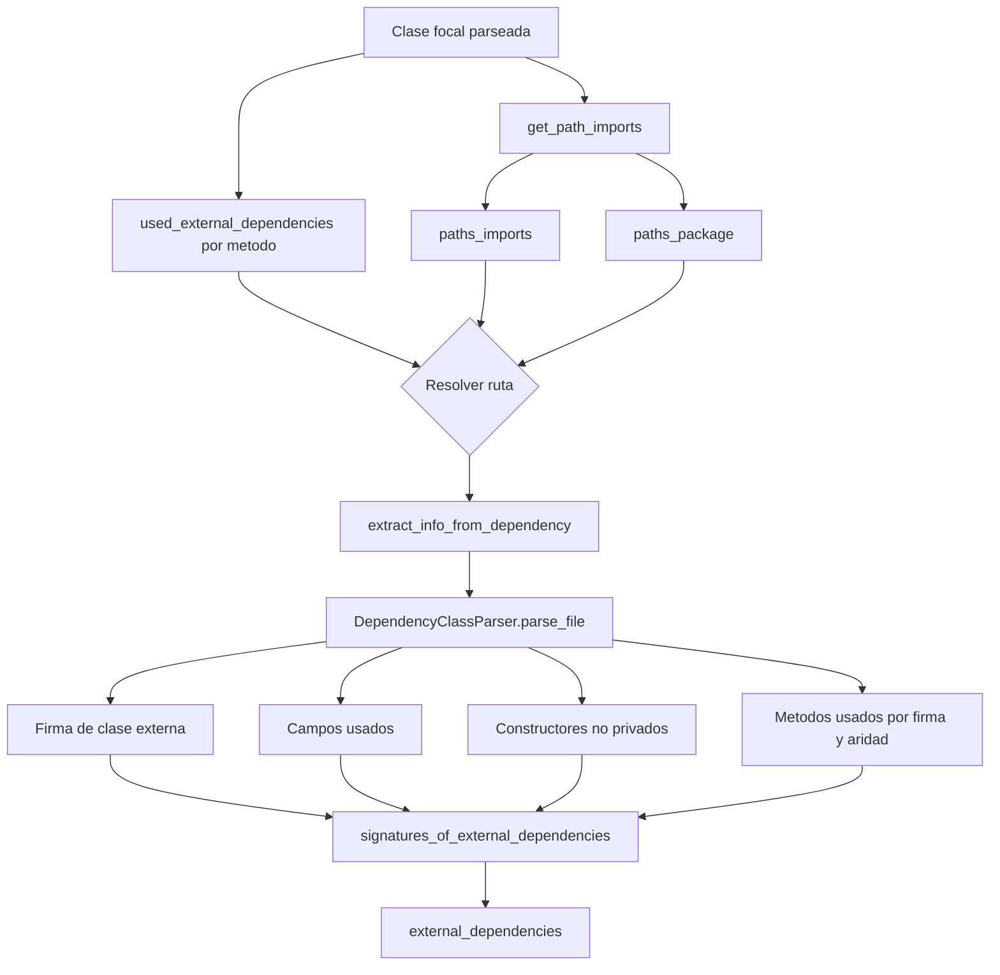

# 01 — Capa de minería AST y emparejamiento Test ↔ Método Focal

Sección de referencia sobre la primera etapa del pipeline de DynaMTests: la descarga de repositorios, el análisis del AST con `tree-sitter-java`, el emparejamiento de clases/métodos de prueba con clases/métodos focales, y la construcción de las dos representaciones de entrada del corpus.

Archivos cubiertos: [`find_map_tests_cases_from_repo.py`](find_map_tests_cases_from_repo.py), [`ClassParser.py`](ClassParser.py), [`dependency_parser_utils.py`](dependency_parser_utils.py), [`DependencyClassParser.py`](DependencyClassParser.py), [`ParserUtils.py`](ParserUtils.py).

Aclaración terminológica obligatoria: las etiquetas `FM_FC_DCTX` y `FM_FC_MS_FF` **no existen como literales** en el código (la búsqueda de las cadenas devuelve cero coincidencias). En la implementación corresponden a las claves y variables `src_fm_fc_dctx` y `src_fm_fc_ms_ff`, emitidas por [`build_format_corpus()`](build_corpus.py:416). El mapeo entre etiqueta conceptual e identificador real se documenta en la sección 6.

---

## 1) Script find_map_tests_cases_from_repo.py

Script que descarga los repositorios (clonado superficial con `GitPython`) y extrae toda la metadata del AST, emparejando casos de prueba con métodos focales y exportando un JSON por cada caso mapeado.

### 1.1 Configuración de módulo y dependencias

1.1.1 Se importan las dependencias del sistema (`argparse`, `subprocess`, `glob`, `shutil`, `multiprocessing.Pool`, `tqdm`, `GitPython`, `command_runner`) en [`find_map_tests_cases_from_repo.py:1-25`](find_map_tests_cases_from_repo.py:1).

1.1.2 Se importan las tres piezas del analizador: [`ClassParser`](find_map_tests_cases_from_repo.py:18), [`DependencyClassParser`](find_map_tests_cases_from_repo.py:19) y [`DependencyParserUtils`](find_map_tests_cases_from_repo.py:21).

1.1.3 Se resuelve la ruta absoluta del script y su directorio en [`PATH_SCRIPT`](find_map_tests_cases_from_repo.py:27) y [`DIR_SCRIPT`](find_map_tests_cases_from_repo.py:28); este último se usa para restaurar el directorio de trabajo al final del análisis.

1.1.4 Se leen credenciales de GitHub desde variables de entorno en [`GITHUB_USER`](find_map_tests_cases_from_repo.py:32) y [`GITHUB_TOKEN`](find_map_tests_cases_from_repo.py:33). Riesgo: el acceso es por índice directo de `os.environ`, de modo que la ausencia de cualquiera de las dos variables aborta la importación del módulo con `KeyError` antes de cualquier validación de argumentos.

### 1.2 Ejecución del método `parse_args()`

1.2.1 Se construye un `ArgumentParser` y se definen seis parámetros en [`parse_args()`](find_map_tests_cases_from_repo.py:798).

1.2.2 `--repos_file` (sin valor por defecto) define la ruta del JSON con la lista de repositorios a procesar en lote ([`find_map_tests_cases_from_repo.py:803-809`](find_map_tests_cases_from_repo.py:803)).

1.2.3 `--repo_url` define la URL de un único repositorio, con valor por defecto `https://github.com/google/gson` ([`find_map_tests_cases_from_repo.py:810-817`](find_map_tests_cases_from_repo.py:810)).

1.2.4 `--repo_id` define el identificador textual del repositorio, por defecto `32538871` ([`find_map_tests_cases_from_repo.py:818-825`](find_map_tests_cases_from_repo.py:818)).

1.2.5 `--tmp`, `--output` y `--output_empty` definen las carpetas de clonado temporal, de salida del dataset y de clasificación de fallos ([`find_map_tests_cases_from_repo.py:826-846`](find_map_tests_cases_from_repo.py:826)).

1.2.6 Se retorna `vars(parser.parse_args())` como diccionario ([`find_map_tests_cases_from_repo.py:848`](find_map_tests_cases_from_repo.py:848)).

### 1.3 Ejecución del método `main()`

1.3.1 Se desempaqueta el diccionario de argumentos en variables locales ([`main()`](find_map_tests_cases_from_repo.py:850), líneas [852-857](find_map_tests_cases_from_repo.py:852)).

1.3.2 Si `repos_file` no es `None`, se carga el JSON con `json.load` y se invoca [`analyze_repositories()`](find_map_tests_cases_from_repo.py:745) en modo lote ([`find_map_tests_cases_from_repo.py:859-863`](find_map_tests_cases_from_repo.py:859)).

1.3.3 Si `repos_file` es `None`, se construye un diccionario con `repo_id` y `url` y se invoca directamente [`analyze_project()`](find_map_tests_cases_from_repo.py:99) para un único repositorio ([`find_map_tests_cases_from_repo.py:864-869`](find_map_tests_cases_from_repo.py:864)).

1.3.4 El bloque de arranque verifica privilegios con `is_admin()`; la elevación mediante `elevate(main)` permanece comentada ([`find_map_tests_cases_from_repo.py:872-875`](find_map_tests_cases_from_repo.py:872)).

### 1.4 Ejecución del método `analyze_repositories()`

1.4.1 Se registra el instante inicial para el cálculo del tiempo total ([`find_map_tests_cases_from_repo.py:749`](find_map_tests_cases_from_repo.py:749)).

1.4.2 Se determina el número de procesos como `os.cpu_count()`, sin división ni acotamiento ([`find_map_tests_cases_from_repo.py:753`](find_map_tests_cases_from_repo.py:753)).

1.4.3 En el modo reintento descrito en la referencia, se descomenta `folders = get_repos_not_exists()` y `random.shuffle(folders)`, y se filtra cada repositorio con `if str(repo['repo_id']) in folders:` antes de agregarlo a `repos` ([`find_map_tests_cases_from_repo.py:760-766`](find_map_tests_cases_from_repo.py:760)).

1.4.4 [`get_repos_not_exists()`](find_map_tests_cases_from_repo.py:733) lee el archivo `/root/repos_not_exists.txt`, elimina saltos de línea y retorna la lista de identificadores ([`find_map_tests_cases_from_repo.py:736-742`](find_map_tests_cases_from_repo.py:736)). Nota: la ruta está fijada a un `HOME` de Linux.

1.4.5 Se crea un `Pool(num_cpus)`, se arma la lista de tuplas `(repo, tmp, output, output_empty)` y se consume con `pool.imap_unordered(analyze_project_wrapper, args_list)`, actualizando la barra `tqdm` por cada repositorio finalizado ([`find_map_tests_cases_from_repo.py:781-787`](find_map_tests_cases_from_repo.py:781)).

1.4.6 Se calcula y se imprime el tiempo transcurrido en segundos y en formato `días, HH:MM:SS` ([`find_map_tests_cases_from_repo.py:790-795`](find_map_tests_cases_from_repo.py:790)).

### 1.5 Ejecución del método `analyze_project_wrapper()`

1.5.1 Se invoca `analyze_project(*args)` y se retorna `1`, valor consumido por la barra de progreso del pool ([`find_map_tests_cases_from_repo.py:728-730`](find_map_tests_cases_from_repo.py:728)).

### 1.6 Ejecución del método `analyze_project()`

1.6.1 Se extraen `url` y `repo_id` del diccionario del repositorio ([`analyze_project()`](find_map_tests_cases_from_repo.py:99), líneas [104-105](find_map_tests_cases_from_repo.py:104)).

1.6.2 Se realiza una copia profunda del diccionario con `copy.deepcopy` y se elimina la clave `num_instances` si existe ([`find_map_tests_cases_from_repo.py:107-111`](find_map_tests_cases_from_repo.py:107)).

1.6.3 Se crean la carpeta temporal, el directorio destino del repositorio y las rutas `repo_path` y `dataset_out` ([`find_map_tests_cases_from_repo.py:114-118`](find_map_tests_cases_from_repo.py:114)).

1.6.4 Se inyectan usuario y token en la URL sustituyendo `https://` por `https://{GITHUB_USER}:{GITHUB_TOKEN}@` ([`find_map_tests_cases_from_repo.py:120-121`](find_map_tests_cases_from_repo.py:120)).

1.6.5 Se clona el repositorio invocando [`clone_repo()`](find_map_tests_cases_from_repo.py:82) dentro de un `try`; ante excepción se marca `error_cloning = True` ([`find_map_tests_cases_from_repo.py:126-130`](find_map_tests_cases_from_repo.py:126)).

1.6.6 En caso de error de clonado se fuerza el borrado de la carpeta con `shutil.rmtree(..., ignore_errors=True)`, se espera 3 segundos y, si el directorio persiste vacío, se intenta `os.rmdir` ([`find_map_tests_cases_from_repo.py:134-142`](find_map_tests_cases_from_repo.py:134)).

1.6.7 Se fija `language = 'java'` y se invoca [`find_map_test_cases()`](find_map_tests_cases_from_repo.py:192) con `repo_path`, el lenguaje, `dataset_out`, el diccionario del repositorio y la bandera `error_cloning` ([`find_map_tests_cases_from_repo.py:146-148`](find_map_tests_cases_from_repo.py:146)).

1.6.8 Se desempaqueta la tupla de siete elementos retornada en `tot_tclass, tot_tc, tot_tclass_fclass, tot_mtc, repo_exists, repo_has_test_files, error_finding_java_files` ([`find_map_tests_cases_from_repo.py:149`](find_map_tests_cases_from_repo.py:149)). Tras el desempaquetado, `tot_mtc` pasa a ser el entero de casos mapeados.

1.6.9 Clasificación de fallos: si `tot_mtc == 0` se listan los archivos del directorio de salida y se copian al subdirectorio correspondiente mediante [`copy_error_files()`](find_map_tests_cases_from_repo.py:92), con el siguiente orden de precedencia ([`find_map_tests_cases_from_repo.py:152-164`](find_map_tests_cases_from_repo.py:152)).
   - `1_repo_not_exists/` cuando `not repo_exists` ([`find_map_tests_cases_from_repo.py:155-156`](find_map_tests_cases_from_repo.py:155)).
   - `2_does_not_have_tests/` cuando `not repo_has_test_files` ([`find_map_tests_cases_from_repo.py:157-158`](find_map_tests_cases_from_repo.py:157)).
   - `3_error_finding_files/` cuando `error_finding_java_files` ([`find_map_tests_cases_from_repo.py:159-160`](find_map_tests_cases_from_repo.py:159)).
   - `4_not_matching_tests/` en el caso restante, es decir, repositorio con tests pero sin emparejamientos ([`find_map_tests_cases_from_repo.py:161-162`](find_map_tests_cases_from_repo.py:161)).
   - Finalmente se elimina el directorio de salida del repositorio con `shutil.rmtree(dataset_out, ignore_errors=True)` ([`find_map_tests_cases_from_repo.py:164`](find_map_tests_cases_from_repo.py:164)).

1.6.10 Se restaura el directorio del script con `os.chdir(DIR_SCRIPT)` ([`find_map_tests_cases_from_repo.py:167`](find_map_tests_cases_from_repo.py:167)).

1.6.11 Limpieza del clon: se intenta `git.rmtree(repo_path)` y, ante excepción, se recurre a `shutil.rmtree(..., ignore_errors=True)` imprimiendo el error ([`find_map_tests_cases_from_repo.py:169-177`](find_map_tests_cases_from_repo.py:169)).

1.6.12 Se imprimen las estadísticas del repositorio: clases de prueba, clases de prueba mapeadas, casos de prueba y casos mapeados, o el mensaje de error de clonado ([`find_map_tests_cases_from_repo.py:181-189`](find_map_tests_cases_from_repo.py:181)).

### 1.7 Reintentos, progreso y clonado

1.7.1 El decorador [`retry()`](find_map_tests_cases_from_repo.py:36) envuelve la función en un bucle `while True`, incrementa `tries` por cada excepción, duerme `wait` segundos mientras `tries <= retries` y, agotados los intentos, re-lanza la última excepción si `reraise` es verdadero ([`find_map_tests_cases_from_repo.py:44-64`](find_map_tests_cases_from_repo.py:44)).

1.7.2 [`clone_repo()`](find_map_tests_cases_from_repo.py:82) está decorado con `@retry(wait=3, retries=3, reraise=True)`, por lo que admite hasta 3 reintentos con 3 segundos de espera ([`find_map_tests_cases_from_repo.py:81`](find_map_tests_cases_from_repo.py:81)).

1.7.3 El clonado se ejecuta con `git.Repo.clone_from` en modo superficial: `depth=1` y las opciones `--shallow-submodules`, `--no-tags`, `--single-branch` ([`find_map_tests_cases_from_repo.py:86`](find_map_tests_cases_from_repo.py:86)).

1.7.4 [`CloneProgress`](find_map_tests_cases_from_repo.py:67) hereda de `RemoteProgress` y sincroniza una barra `tqdm` con `max_count` y `cur_count` en cada actualización ([`find_map_tests_cases_from_repo.py:69-78`](find_map_tests_cases_from_repo.py:69)).

1.7.5 [`copy_error_files()`](find_map_tests_cases_from_repo.py:92) crea el subdirectorio de clasificación con `os.makedirs(..., exist_ok=True)` y copia cada archivo con `shutil.copy` ([`find_map_tests_cases_from_repo.py:93-96`](find_map_tests_cases_from_repo.py:93)).

### 1.8 Ejecución del método `find_map_test_cases()`

1.8.1 Se abre el archivo `log.txt` dentro del directorio de salida y se escribe la cabecera con `repo_id` y `url` ([`find_map_test_cases()`](find_map_tests_cases_from_repo.py:192), líneas [199-202](find_map_tests_cases_from_repo.py:199)).

1.8.2 Se inicializan las banderas `repo_exists = True`, `repo_has_test_files = True` y `error_finding_java_files = False` ([`find_map_tests_cases_from_repo.py:204-206`](find_map_tests_cases_from_repo.py:204)).

1.8.3 Si no hubo error de clonado y la ruta existe, se cambia el directorio de trabajo al clon; en caso contrario se registra `Path repo not exists`, se cierra el log y se retorna `0, 0, 0, 0, repo_exists, True, True` ([`find_map_tests_cases_from_repo.py:209-216`](find_map_tests_cases_from_repo.py:209)). Nótese que en este retorno `repo_has_test_files` y `error_finding_java_files` se fuerzan a `True`, de modo que la clasificación depende exclusivamente de `repo_exists` por la precedencia descrita en 1.6.9.

1.8.4 Detección de clases de prueba: se ejecuta `grep -l -r @Test --include \*.java` mediante `subprocess.check_output(..., shell=True)` y se decodifica la salida en ASCII para obtener `test_files` ([`find_map_tests_cases_from_repo.py:219-222`](find_map_tests_cases_from_repo.py:219)).

1.8.5 Si `grep` retorna código 1 se interpreta como ausencia de tests, se marca `repo_has_test_files = False` y se retorna la tupla con ceros ([`find_map_tests_cases_from_repo.py:223-228`](find_map_tests_cases_from_repo.py:223), retorno en [237](find_map_tests_cases_from_repo.py:237)).

1.8.6 Cualquier otro `CalledProcessError` se registra con traza completa, se marca `error_finding_java_files = True` y se retorna ([`find_map_tests_cases_from_repo.py:229-235`](find_map_tests_cases_from_repo.py:229)).

1.8.7 Las excepciones no controladas durante `grep` también se registran y marcan `error_finding_java_files = True` ([`find_map_tests_cases_from_repo.py:238-245`](find_map_tests_cases_from_repo.py:238)).

1.8.8 Inventario de archivos Java: se usa `glob.glob('**/*.java', recursive=True)`, se normalizan las barras a `/` para Windows y se elimina el prefijo `./` ([`find_map_tests_cases_from_repo.py:256-259`](find_map_tests_cases_from_repo.py:256)). Ante cualquier excepción se registra la traza y se retorna con `error_finding_java_files = True` ([`find_map_tests_cases_from_repo.py:260-267`](find_map_tests_cases_from_repo.py:260)).

1.8.9 Cálculo del conjunto de clases focales candidatas: por diferencia de conjuntos entre todos los `.java` y los archivos de test, y descartando toda ruta que contenga `src/test`; se genera además la versión normalizada en minúsculas en `focal_files_norm` ([`find_map_tests_cases_from_repo.py:274-276`](find_map_tests_cases_from_repo.py:274)).

1.8.10 Se escriben en el log los totales de archivos Java, clases de prueba y clases focales candidatas ([`find_map_tests_cases_from_repo.py:278-281`](find_map_tests_cases_from_repo.py:278)).

1.8.11 Emparejamiento Clase de Prueba → Clase Focal por nombre: por cada archivo de prueba se normaliza la ruta reemplazando `/src/test/` por `/src/main/` ([`find_map_tests_cases_from_repo.py:289`](find_map_tests_cases_from_repo.py:289)).

1.8.12 Se extrae el nombre de clase de la ruta normalizada y se elimina el sufijo o el prefijo `test` en minúsculas, recalculando el nombre del archivo ([`find_map_tests_cases_from_repo.py:291-300`](find_map_tests_cases_from_repo.py:291)).

1.8.13 Si la ruta normalizada existe en `focal_files_norm`, se recupera el índice con `.index()` y se registra el par en `mapped_tests[test_class] = focal_class` ([`find_map_tests_cases_from_repo.py:302-305`](find_map_tests_cases_from_repo.py:302)). Nota: al usar `.index()` se selecciona la primera coincidencia cuando dos clases focales comparten la misma ruta normalizada.

1.8.14 Se calculan los totales `tot_tclass` y `tot_tclass_fclass`, y se inicializan `tot_tc` y `tot_mtc` en cero ([`find_map_tests_cases_from_repo.py:313-316`](find_map_tests_cases_from_repo.py:313)).

1.8.15 Se instancian los tres componentes del analizador: `ClassParser(language)`, `DependencyClassParser(language)` y `DependencyParserUtils()` ([`find_map_tests_cases_from_repo.py:322-324`](find_map_tests_cases_from_repo.py:322)). Las instancias se reutilizan en todo el repositorio, por lo que el atributo `content` de los parsers se sobrescribe en cada archivo leído.

1.8.16 Se abre un segundo archivo `log_error_mapping.txt` con cabecera propia ([`find_map_tests_cases_from_repo.py:332-336`](find_map_tests_cases_from_repo.py:332)).

1.8.17 Por cada par `(test_class, focal_class)` de `mapped_tests`, iterado con `tqdm` ([`find_map_tests_cases_from_repo.py:338`](find_map_tests_cases_from_repo.py:338)):
   - Se registra el par en el log ([`find_map_tests_cases_from_repo.py:339-341`](find_map_tests_cases_from_repo.py:339)).
   - Se ejecuta [`parse_test_cases()`](find_map_tests_cases_from_repo.py:512) para obtener los casos de prueba del archivo de test ([`find_map_tests_cases_from_repo.py:345`](find_map_tests_cases_from_repo.py:345)).
   - Se ejecuta [`parse_potential_focal_methods()`](find_map_tests_cases_from_repo.py:552) para obtener los métodos focales potenciales, resolviendo previamente las dependencias externas ([`find_map_tests_cases_from_repo.py:346`](find_map_tests_cases_from_repo.py:346)).
   - Se acumula `tot_tc` con el número de casos de prueba parseados ([`find_map_tests_cases_from_repo.py:347`](find_map_tests_cases_from_repo.py:347)).
   - Se ejecuta [`match_test_cases()`](find_map_tests_cases_from_repo.py:581) para emparejar cada caso con un método focal ([`find_map_tests_cases_from_repo.py:356`](find_map_tests_cases_from_repo.py:356)).
   - Se acumula `tot_mtc` y, si el emparejamiento no está vacío, se agrega la lista a `mtc_list` ([`find_map_tests_cases_from_repo.py:361-364`](find_map_tests_cases_from_repo.py:361)).

1.8.18 Manejo de errores por par: cualquier excepción se captura, se marca `has_error_mapping = True`, se imprime el tipo y mensaje, y se registra la traza completa en `log.txt` y en `log_error_mapping.txt` junto con las rutas de la clase de prueba y de la clase focal ([`find_map_tests_cases_from_repo.py:365-376`](find_map_tests_cases_from_repo.py:365)). El bucle continúa con el siguiente par, por lo que un fallo aislado no aborta el repositorio.

1.8.19 Exportación: si `mtc_list` no está vacía se invoca [`export_mtc()`](find_map_tests_cases_from_repo.py:679) ([`find_map_tests_cases_from_repo.py:388-389`](find_map_tests_cases_from_repo.py:388)).

1.8.20 Se escribe el resumen en el log, se cierran ambos archivos y se elimina `log_error_mapping.txt` cuando no hubo errores ([`find_map_tests_cases_from_repo.py:392-402`](find_map_tests_cases_from_repo.py:392)).

1.8.21 Se retorna la tupla `(tot_tclass, tot_tc, tot_tclass_fclass, tot_mtc, repo_exists, repo_has_test_files, error_finding_java_files)` ([`find_map_tests_cases_from_repo.py:404`](find_map_tests_cases_from_repo.py:404)).

### 1.9 Ejecución del método `parse_test_cases()`

1.9.1 Se invoca [`ClassParser.parse_file()`](ClassParser.py:32) sobre el archivo de prueba ([`find_map_tests_cases_from_repo.py:516`](find_map_tests_cases_from_repo.py:516)).

1.9.2 Se recorre cada clase parseada y cada uno de sus métodos, seleccionando únicamente aquellos con `method['is_testcase']` verdadero ([`find_map_tests_cases_from_repo.py:520-522`](find_map_tests_cases_from_repo.py:520)).

1.9.3 Se construye la metadata de la clase de prueba copiando el diccionario de la clase y eliminando `methods` y `argument_list`, y se agrega la clave `file` con la ruta del archivo ([`find_map_tests_cases_from_repo.py:525-529`](find_map_tests_cases_from_repo.py:525)).

1.9.4 Se anida la clase en `method['class']` (clave usada posteriormente por la exportación) ([`find_map_tests_cases_from_repo.py:530`](find_map_tests_cases_from_repo.py:530)).

1.9.5 Se eliminan las claves de minado que no se conservan para los casos de prueba: `use_some_field`, `var_declars`, `class_fields_used`, `class_method_references_used`, `class_methods_used`, `used_external_dependencies`, `methods_from_external_dependencies`, `method_references_from_external_dependencies`, `fields_from_external_dependencies`, `field_dependencies_by_class`, `undefined_method_dependencies` y `class_methods_that_invoke_other_methods` ([`find_map_tests_cases_from_repo.py:532-545`](find_map_tests_cases_from_repo.py:532)).

1.9.6 Se conservan deliberadamente `method_dependencies_by_class` y `method_references_dependencies_by_class`, tal como indican los comentarios, porque son la base de la heurística de invocación única ([`find_map_tests_cases_from_repo.py:541-542`](find_map_tests_cases_from_repo.py:541)).

1.9.7 El método queda agregado a la lista de casos de prueba ([`find_map_tests_cases_from_repo.py:547`](find_map_tests_cases_from_repo.py:547)).

### 1.10 Ejecución del método `parse_potential_focal_methods()`

1.10.1 Se invoca [`ClassParser.parse_file()`](ClassParser.py:32) sobre el archivo focal ([`find_map_tests_cases_from_repo.py:556`](find_map_tests_cases_from_repo.py:556)).

1.10.2 Se enriquece la metadata con el contexto dinámico mediante [`DependencyParserUtils.parse_potential_focal_and_external_dependencies()`](dependency_parser_utils.py:113), pasando el `DependencyClassParser` y la lista completa de archivos focales del repositorio ([`find_map_tests_cases_from_repo.py:558`](find_map_tests_cases_from_repo.py:558)).

1.10.3 Se recorren las clases y sus métodos, y se descartan los casos de prueba; el filtro de constructores permanece comentado (`#and not method['constructor']`), de modo que los constructores pueden quedar como métodos focales candidatos ([`find_map_tests_cases_from_repo.py:562-565`](find_map_tests_cases_from_repo.py:562)).

1.10.4 Se copia el diccionario de la clase, se elimina `argument_list` y se agrega la clave `file`; las claves `fields` y `methods` se conservan intactas ([`find_map_tests_cases_from_repo.py:568-573`](find_map_tests_cases_from_repo.py:568)).

1.10.5 Se anida la clase focal en `method['class']` y se agrega el método a la lista de candidatos ([`find_map_tests_cases_from_repo.py:574-576`](find_map_tests_cases_from_repo.py:574)).

### 1.11 Ejecución del método `match_test_cases()`

1.11.1 Se obtiene el nombre de la clase focal a partir del primer método focal candidato ([`find_map_tests_cases_from_repo.py:591-594`](find_map_tests_cases_from_repo.py:591)).

1.11.2 Se construye la lista normalizada de nombres de métodos focales en minúsculas ([`find_map_tests_cases_from_repo.py:598`](find_map_tests_cases_from_repo.py:598)).

1.11.3 Por cada caso de prueba se normaliza su nombre a minúsculas y se elimina el sufijo o el prefijo `test` ([`find_map_tests_cases_from_repo.py:601-607`](find_map_tests_cases_from_repo.py:601)).

1.11.4 Estrategia 1, coincidencia por nombre: si el nombre normalizado del caso existe en la lista de métodos focales, se toma el índice con `.index()` y se recupera el método focal correspondiente ([`find_map_tests_cases_from_repo.py:612-615`](find_map_tests_cases_from_repo.py:612)).

1.11.5 En la coincidencia por nombre se eliminan `method_dependencies_by_class` y `method_references_dependencies_by_class` del caso de prueba y se construye el diccionario `mapped_test_case` con `test_class`, `test_case`, `focal_class` y `focal_method` ([`find_map_tests_cases_from_repo.py:617-626`](find_map_tests_cases_from_repo.py:617)).

1.11.6 Se registra la firma del método focal en `tested_focal_methods` usando `focal_method['parameters']` y se escribe el hallazgo en el log ([`find_map_tests_cases_from_repo.py:627-628`](find_map_tests_cases_from_repo.py:627)).

1.11.7 Estrategia 2, invocación única: se recopilan las referencias a métodos y las invocaciones de métodos cuyo nombre de clase, obtenido con [`DependencyParserUtils.get_class_name()`](dependency_parser_utils.py:308), coincide con el de la clase focal ([`find_map_tests_cases_from_repo.py:632-642`](find_map_tests_cases_from_repo.py:632)).

1.11.8 Si hay más de una referencia o más de una invocación asociada a la clase focal, el caso se descarta con `continue` por ambigüedad ([`find_map_tests_cases_from_repo.py:644-646`](find_map_tests_cases_from_repo.py:644)).

1.11.9 Se resuelve el método invocado con [`DependencyParserUtils.get_methods_from_external_dependency()`](dependency_parser_utils.py:560) sobre la lista de métodos focales candidatos ([`find_map_tests_cases_from_repo.py:648-650`](find_map_tests_cases_from_repo.py:648)).

1.11.10 Si la resolución produce exactamente un método focal, se eliminan las dos claves de dependencias, se construye el `mapped_test_case` y se registra la firma en `tested_focal_methods` ([`find_map_tests_cases_from_repo.py:652-666`](find_map_tests_cases_from_repo.py:652)).

1.11.11 Se escriben las métricas del emparejamiento (casos de prueba, métodos focales, métodos focales ejercitados, casos mapeados) y se retorna la lista ([`find_map_tests_cases_from_repo.py:671-676`](find_map_tests_cases_from_repo.py:671)).

### 1.12 Ejecución de los métodos `export_mtc()` y `export()`

1.12.1 Por cada lista de casos mapeados y por cada caso, se realiza una copia profunda ([`find_map_tests_cases_from_repo.py:685-687`](find_map_tests_cases_from_repo.py:685)).

1.12.2 Las claves `test_class` y `focal_class` se extraen de los diccionarios anidados con `pop('class')` ([`find_map_tests_cases_from_repo.py:688-689`](find_map_tests_cases_from_repo.py:688)).

1.12.3 Se agrega el diccionario del repositorio en la clave `repository` ([`find_map_tests_cases_from_repo.py:690`](find_map_tests_cases_from_repo.py:690)).

1.12.4 Se limpia cada método de la clase focal eliminando `body`, `class`, `used_private_signatures_of_class`, `used_non_private_signatures_of_class`, `class_private_deps_used`, `class_non_private_deps_used`, `signatures_of_external_dependencies` y `external_dependencies` ([`find_map_tests_cases_from_repo.py:693-701`](find_map_tests_cases_from_repo.py:693)).

1.12.5 El nombre del archivo se compone como `{repo_id}_{mtc_id}.json` dentro del directorio de salida ([`find_map_tests_cases_from_repo.py:707-708`](find_map_tests_cases_from_repo.py:707)).

1.12.6 [`export()`](find_map_tests_cases_from_repo.py:713) elimina el archivo si existe y escribe el JSON serializado con `json.dumps` en UTF-8 ([`find_map_tests_cases_from_repo.py:717-725`](find_map_tests_cases_from_repo.py:717)).

1.12.7 Observación relevante para la etapa posterior: la poda de 1.12.4 elimina del JSON exportado `signatures_of_external_dependencies` y `external_dependencies` del método focal, pero **no** los elimina de la clase focal, de modo que el JSON conserva el contexto de cada método; la construcción final de las representaciones ocurre en [`build_corpus.py`](build_corpus.py), que opera sobre este JSON.

### 1.13 Arnés de depuración `test_extract_dependencies()`

1.13.1 El método [`test_extract_dependencies()`](find_map_tests_cases_from_repo.py:407) contiene una ruta local fija a `000_java_classes_prueba`, una lista manual de archivos Java y la invocación de `parse_potential_focal_methods` sobre `FocalContext.java` ([`find_map_tests_cases_from_repo.py:417-449`](find_map_tests_cases_from_repo.py:417)).

1.13.2 Su única invocación está comentada, por lo que no participa del flujo productivo ([`find_map_tests_cases_from_repo.py:328`](find_map_tests_cases_from_repo.py:328)).

---

## 2) Script ClassParser.py

Clase que encapsula el parser de `tree-sitter` y traduce un archivo Java en una lista de diccionarios de metadata por clase. Es la pieza que produce la materia prima del emparejamiento y del contexto dinámico.

### 2.1 Ejecución del método `__init__()`

2.1.1 Se consulta la versión instalada de `tree_sitter` con `pkg_resources.get_distribution('tree_sitter').version` ([`ClassParser.__init__()`](ClassParser.py:17), línea [18](ClassParser.py:18)).

2.1.2 Si la versión es menor a `0.22.0`, el lenguaje se construye con `Language(tsjava.language(), language)`; en caso contrario, con `Language(tsjava.language())` ([`ClassParser.py:20-23`](ClassParser.py:20)).

2.1.3 Si la versión es menor a `0.22.1`, se instancia `Parser()` y se invoca `set_language`; en caso contrario, se usa el constructor `Parser(JAVA_LANGUAGE)` ([`ClassParser.py:25-29`](ClassParser.py:25)). Este doble condicional es la adaptación de compatibilidad con la API de `tree-sitter` previa y posterior a 0.22.

### 2.2 Ejecución del método `parse_file()`

2.2.1 Se abre el archivo en modo lectura y se almacena el contenido en `self.content`; ante cualquier fallo de lectura se retorna una lista vacía ([`ClassParser.parse_file()`](ClassParser.py:32), líneas [41-46](ClassParser.py:41)).

2.2.2 Se parsea el contenido convertido a bytes UTF-8 con `self.parser.parse(...)` ([`ClassParser.py:54`](ClassParser.py:54)).

2.2.3 Se consulta `root_node.has_error`; si el árbol presenta errores de sintaxis se retorna `[]`, aplicando la política de mapear únicamente código sintácticamente válido ([`ClassParser.py:57-63`](ClassParser.py:57)).

2.2.4 Se seleccionan los hijos directos del nodo raíz por tipo: `package_declaration`, `class_declaration` e `import_declaration` ([`ClassParser.py:65-67`](ClassParser.py:65)). Nótese que no se consideran `interface_declaration` ni `enum_declaration` en este parser.

2.2.5 Se construye `import_list` decodificando el texto de cada nodo de importación y aplicando `lstrip("b'")` ([`ClassParser.py:70-72`](ClassParser.py:70)).

2.2.6 Se derivan dos estructuras auxiliares: `static_imports` mediante [`get_static_imports()`](ClassParser.py:1542) y `class_imports` mediante [`get_class_imports()`](ClassParser.py:1561) ([`ClassParser.py:74-75`](ClassParser.py:74)).

2.2.7 Por cada declaración de clase se obtiene el identificador tomando el primer hijo de tipo `identifier` ([`ClassParser.py:89`](ClassParser.py:89)).

2.2.8 Se obtiene la metadata de clase con [`get_class_metadata()`](ClassParser.py:300) ([`ClassParser.py:90`](ClassParser.py:90)).

2.2.9 Se calculan los campos anotados con Mockito mediante [`get_fields_using_mockito_annotations()`](ClassParser.py:433) ([`ClassParser.py:94`](ClassParser.py:94)).

2.2.10 Se inicializa `has_constructor = False` y se itera sobre el nodo `class_body`; por cada hijo `method_declaration` o `constructor_declaration` se marca la existencia de constructor y se obtiene la metadata del método con [`get_function_metadata()`](ClassParser.py:443) ([`ClassParser.py:98-108`](ClassParser.py:98)).

2.2.11 Se resuelven las cadenas de invocación entre métodos de la propia clase mediante [`get_class_methods_that_invoke_other_methods()`](ClassParser.py:128) ([`ClassParser.py:111`](ClassParser.py:111)).

2.2.12 Se completan las claves de clase `methods`, `imports` y `package`; el paquete se obtiene del texto del nodo `package_declaration` ([`ClassParser.py:113-117`](ClassParser.py:113)).

2.2.13 Se agrega la clase a la lista de clases parseadas y se retorna la lista ([`ClassParser.py:122-124`](ClassParser.py:122)).

### 2.3 Forma de los diccionarios de metadata

2.3.1 Diccionario de clase, construido en [`get_class_metadata()`](ClassParser.py:300) y completado en [`parse_file()`](ClassParser.py:32): `class_name`, `superclass`, `interfaces`, `class_signature`, `class_modifier`, `has_constructor`, `fields`, `argument_list`, `methods`, `imports`, `package` ([`ClassParser.py:304-316`](ClassParser.py:304) y [113-117](ClassParser.py:113)).

2.3.2 Diccionario de campo, construido en [`get_class_fields()`](ClassParser.py:368): `original_string`, `modifier`, `field_use_mockito_annotations`, `type`, `declarator`, `var_name` ([`ClassParser.py:377-417`](ClassParser.py:377)).

2.3.3 Diccionario de método, declarado en [`get_function_metadata()`](ClassParser.py:443) con las claves `method_name`, `parameters`, `parameters_list`, `modifiers`, `type_parameters`, `return`, `body`, `class`, `signature`, `full_signature`, `full_signature_parameters`, `class_method_signature`, `is_testcase`, `test_use_mockito`, `is_constructor`, `is_get_or_set`, `use_some_field`, `class_fields_used`, `class_methods_used`, `class_method_references_used`, `var_declars`, `used_external_dependencies`, `methods_from_external_dependencies`, `method_references_from_external_dependencies`, `fields_from_external_dependencies`, `method_dependencies_by_class`, `method_references_dependencies_by_class`, `field_dependencies_by_class`, `undefined_method_dependencies` y `class_methods_that_invoke_other_methods` ([`ClassParser.py:453-486`](ClassParser.py:453)). Las claves `static_methods_used` y `external_method_dependencies` se agregan durante el cálculo y se eliminan antes de retornar ([`ClassParser.py:542`](ClassParser.py:542), [638](ClassParser.py:638), [550](ClassParser.py:550)).

### 2.4 Sub-pasos internos de `get_function_metadata()`

2.4.1 Se extrae el cuerpo completo del método con `match_from_span` y se registra el nombre de la clase en `metadata['class']` ([`ClassParser.py:489-490`](ClassParser.py:489)).

2.4.2 Se obtienen nombre, parámetros y clases dependientes con [`get_method_name_and_params()`](ClassParser.py:678), que retorna la lista de parámetros textuales, las clases dependientes y el mapa instancia→clase ([`ClassParser.py:497-498`](ClassParser.py:497)).

2.4.3 Se agregan las dependencias provenientes de los campos de la clase mediante [`get_field_dependencies()`](ClassParser.py:760) ([`ClassParser.py:501`](ClassParser.py:501)).

2.4.4 Se agregan las dependencias provenientes de instanciaciones y arreglos mediante [`get_dependencies_from_object_creation()`](ClassParser.py:772) ([`ClassParser.py:504`](ClassParser.py:504)).

2.4.5 Se evalúa si el método es getter o setter con [`is_getter_or_setter()`](ClassParser.py:811); si lo es y no es constructor, se marca `use_some_field = True`, y en caso contrario se determina con [`use_fields()`](ClassParser.py:879) ([`ClassParser.py:507-514`](ClassParser.py:507)).

2.4.6 Se marca `is_constructor` comparando el tipo de nodo con `constructor_declaration` ([`ClassParser.py:517-520`](ClassParser.py:517)).

2.4.7 Se marca `is_testcase` cuando la anotación `@Test` aparece en el texto de los modificadores ([`ClassParser.py:523-528`](ClassParser.py:523)).

2.4.8 Se construye el mapa de variables locales con [`get_var_declar()`](ClassParser.py:1397) y se incorporan sus tipos a `dependent_classes` ([`ClassParser.py:531-538`](ClassParser.py:531)).

2.4.9 Se resuelven las invocaciones de métodos con [`get_method_m_deps()`](ClassParser.py:923) ([`ClassParser.py:543`](ClassParser.py:543)).

2.4.10 Se resuelven las referencias de método (`::`) con [`get_method_m_refs_deps()`](ClassParser.py:1168) ([`ClassParser.py:546`](ClassParser.py:546)).

2.4.11 Se resuelven los accesos a campos con [`get_method_f_deps()`](ClassParser.py:1278) y se elimina la clave auxiliar `static_methods_used` ([`ClassParser.py:549-550`](ClassParser.py:549)).

2.4.12 Se recorren los hijos del nodo para extraer `modifiers`, `type_parameters` y el tipo de retorno, descartando comentarios de línea incrustados en los modificadores ([`ClassParser.py:553-576`](ClassParser.py:553)).

2.4.13 Se componen las cuatro variantes de firma según la combinación de constructor, tipo de retorno y parámetros de tipo, usando plantillas `format` diferenciadas ([`ClassParser.py:579-587`](ClassParser.py:579)). En particular, `full_signature` incluye modificadores y parámetros con nombre, mientras que `full_signature_parameters` usa el nombre calificado más los tipos de parámetro.

2.4.14 Reorganización de dependencias: se separan las dependencias explícitas de las no explícitas según cuatro criterios de descarte: contener `.` sin estar en `dependent_classes`, ser una cadena vacía, estar en minúsculas, o ser una importación estática ([`ClassParser.py:591-612`](ClassParser.py:591)).

2.4.15 Se agregan como explícitas las clases de `field_dependencies_by_class`, `method_references_dependencies_by_class` y `dependent_classes`, excluyendo los tipos de `java.lang` ([`ClassParser.py:614-623`](ClassParser.py:614)).

2.4.16 Se clasifican las invocaciones externas en explícitas y no explícitas usando [`method_is_from_not_explicit_dependencies()`](ClassParser.py:651) ([`ClassParser.py:626-632`](ClassParser.py:626)).

2.4.17 Se escriben las listas ordenadas `used_external_dependencies`, `methods_from_external_dependencies` y `undefined_method_dependencies`, y se elimina `external_method_dependencies` ([`ClassParser.py:634-638`](ClassParser.py:634)).

2.4.18 Si el método es caso de prueba, se evalúa el uso de Mockito con [`test_use_mockito()`](ClassParser.py:660) ([`ClassParser.py:644-645`](ClassParser.py:644)).

### 2.5 Ejecución del método `get_class_metadata()`

2.5.1 Se leen `superclass` e `interfaces` mediante `child_by_field_name` y, si existen, se transcriben con `match_from_span` ([`ClassParser.py:319-326`](ClassParser.py:319)).

2.5.2 Se compone `class_signature` con [`get_class_full_signature()`](ClassParser.py:1714) ([`ClassParser.py:328`](ClassParser.py:328)).

2.5.3 Se extraen los modificadores del nodo `modifiers`, se normalizan los espacios y se eliminan los comentarios de línea tanto de los modificadores como de la firma ([`ClassParser.py:331-346`](ClassParser.py:331)).

2.5.4 Se extraen los campos con [`get_class_fields()`](ClassParser.py:368) ([`ClassParser.py:349-350`](ClassParser.py:349)).

2.5.5 Se recorre la cabecera de la clase hasta el carácter `:` o `class` para capturar `class_name` y `argument_list` ([`ClassParser.py:353-363`](ClassParser.py:353)).

### 2.6 Ejecución del método `get_class_fields()`

2.6.1 Se obtiene el nodo `body` de la clase y se seleccionan los hijos de tipo `field_declaration` ([`ClassParser.py:373-376`](ClassParser.py:373)).

2.6.2 Por cada campo se registra el texto completo en `original_string`, los modificadores normalizados, la marca de uso de anotaciones de Mockito, el tipo sin espacios, el declarador y el nombre de la variable ([`ClassParser.py:380-417`](ClassParser.py:380)).

2.6.3 Las anotaciones de Mockito se detectan comparando cada nombre de `MOCKITO_ANNOTATIONS` precedido por `@` contra el texto de los modificadores ([`ClassParser.py:399-402`](ClassParser.py:399) y [`field_contains_mockito_annotations()`](ClassParser.py:423)).

### 2.7 Ejecución de los métodos auxiliares de resolución

2.7.1 [`get_method_name_and_params()`](ClassParser.py:678) localiza la declaración homónima al tipo de nodo con `traverse_type` usando la plantilla `'{}_declaration'`, extrae `method_name` del primer `identifier` y la lista textual de `formal_parameters`, y delega en [`parse_parameters()`](ClassParser.py:707) ([`ClassParser.py:686-703`](ClassParser.py:686)).

2.7.2 [`parse_parameters()`](ClassParser.py:707) recorre los parámetros nombrados, omite comentarios, compensa el desplazamiento de índices cuando el parámetro inicia con `modifiers`, añade `[]` si existe el campo `dimensions`, agrega el tipo a la lista de clases dependientes cuando no está en minúsculas, y registra la relación instancia→tipo ([`ClassParser.py:716-756`](ClassParser.py:716)).

2.7.3 [`get_field_dependencies()`](ClassParser.py:760) registra cada campo como `this.<var_name>` en el mapa de instancias y agrega el tipo base a `dependent_classes` ([`ClassParser.py:761-768`](ClassParser.py:761)).

2.7.4 [`get_dependencies_from_object_creation()`](ClassParser.py:772) recorre los nodos `object_creation_expression` y `array_creation_expression` y agrega el tipo instanciado a `dependent_classes` si no estaba presente ([`ClassParser.py:773-792`](ClassParser.py:773)).

2.7.5 [`get_var_declar()`](ClassParser.py:1397) construye el mapa variable→tipo a partir de los parámetros, de las declaraciones locales con `type_identifier`, tipos primitivos, `array_type` y `generic_type`, descartando el tipo `var` de Java 11 por ambigüedad, y añade los recursos de `try_with_resources_statement` y las variables de `enhanced_for_statement` ([`ClassParser.py:1397-1498`](ClassParser.py:1397)).

2.7.6 [`get_inv_arg_type()`](ClassParser.py:1577) infiere el tipo de cada argumento de una invocación según el tipo de nodo: literales de clase, cadena, carácter, booleanos, enteros, flotantes, identificadores resueltos contra `var_declars`, instanciaciones y accesos a arreglos; los casos no resolubles se etiquetan como `unknownType` ([`ClassParser.py:1584-1674`](ClassParser.py:1584)).

2.7.7 [`get_static_imports()`](ClassParser.py:1542) construye el mapa nombre estático→clase a partir de las importaciones `import static`, tomando el penúltimo componente como clase ([`ClassParser.py:1543-1557`](ClassParser.py:1543)).

2.7.8 [`get_class_imports()`](ClassParser.py:1561) construye la lista de nombres simples de clase importados, excluyendo las importaciones estáticas ([`ClassParser.py:1562-1573`](ClassParser.py:1562)).

### 2.8 Ejecución del método `get_method_m_deps()`

2.8.1 Se recopilan los nodos de invocación con `traverse_type` sobre la plantilla `'{}_invocation'` y se extraen nombre, objeto y argumentos; con los tipos de argumento se compone la firma breve `nombre(tipos)` ([`get_method_m_deps()`](ClassParser.py:923), líneas [945-958](ClassParser.py:945)).

2.8.2 Rama `method_invocation` como objeto (encadenamiento `new X().a().b()`): si el objeto raíz es una instanciación de la propia clase, se registra la relación invocador→invocado en `class_methods_that_invoke_other_methods` usando las firmas breves ([`ClassParser.py:966-1001`](ClassParser.py:966)).

2.8.3 Rama `field_access` como objeto (`new X().campo.metodo()`): si el objeto es una instanciación de la clase y el campo pertenece a la clase, se resuelve el tipo del campo desde `var_declars['this.'+campo']` y se registra como dependencia externa ([`ClassParser.py:1004-1035`](ClassParser.py:1004)).

2.8.4 Rama `object_creation_expression` como objeto (`new X().metodo()`): se descartan tipos de `java.lang`; si X es la clase focal se registra como `this`, y en caso contrario se marca X como dependencia externa usada ([`ClassParser.py:1038-1056`](ClassParser.py:1038)).

2.8.5 Rama de objeto no declarado en `instance_2_classes`: `this`, `super` o el nombre de la clase se asocian a `this`; en otro caso se resuelve el tipo desde `var_declars`, desde `array_access` o, fallando ambos, se usa el propio texto del objeto como nombre de dependencia ([`ClassParser.py:1059-1109`](ClassParser.py:1059)).

2.8.6 Rama principal con objeto declarado: se obtiene el tipo con `instance_2_classes`, se descartan tipos de `java.lang` y, si coincide con la clase focal se asigna `this`; si está en `dependent_classes` se registra como dependencia externa ([`ClassParser.py:1112-1126`](ClassParser.py:1112)).

2.8.7 Rama de invocación sin objeto: si el nombre está en `static_imports` se asocia a la clase estática importada y se registra en `static_methods_used`; en caso contrario se asume método de la propia clase y se asocia a `this` ([`ClassParser.py:1128-1144`](ClassParser.py:1128)).

2.8.8 Se vuelcan los resultados: `class_methods_used` desde la clave `this`, `method_dependencies_by_class` con el resto del mapa, `external_method_dependencies` con las invocaciones externas, `used_external_dependencies` ordenadas, `class_methods_that_invoke_other_methods` y `static_methods_used` ([`ClassParser.py:1148-1155`](ClassParser.py:1148)).

2.8.9 [`set_method_dependency()`](ClassParser.py:1159) centraliza la inserción con deduplicación por firma breve, almacenando `method_name` y `parameters_list` ([`ClassParser.py:1159-1164`](ClassParser.py:1159)).

### 2.9 Ejecución del método `get_method_m_refs_deps()`

2.9.1 Se recorren los nodos `method_reference` y se descartan los casos de tipo `array_type`, como `SomeClass[]::new` ([`ClassParser.py:1176-1187`](ClassParser.py:1176)).

2.9.2 Para referencias con `field_access` y objeto `this`, se compone `this.<campo>` y se distingue si el campo es de la propia clase o de una dependencia; en el segundo caso se registra `<tipo>::<metodo>` ([`ClassParser.py:1189-1226`](ClassParser.py:1189)).

2.9.3 Para referencias con `identifier`, se resuelve el tipo desde `var_declars`, `class_imports` o `dependent_classes`, se descartan los tipos de `java.lang` y se registra la referencia externa ([`ClassParser.py:1228-1271`](ClassParser.py:1228)).

2.9.4 Se escriben `method_references_dependencies_by_class` y `method_references_from_external_dependencies` ([`ClassParser.py:1273-1274`](ClassParser.py:1273)).

### 2.10 Ejecución del método `get_method_f_deps()`

2.10.1 Se recorren los nodos `field_access` descartando los que usan `this` o `super` ([`ClassParser.py:1286-1303`](ClassParser.py:1286)).

2.10.2 Se resuelven los accesos vía `array_access` y vía instanciación directa ([`ClassParser.py:1306-1314`](ClassParser.py:1306)).

2.10.3 Se recorren los `field_access` anidados para reconstruir `this.<campo>` y se descartan las cadenas cuyo objeto no sea `this`, por no poder inferir el tipo del nivel intermedio ([`ClassParser.py:1319-1337`](ClassParser.py:1319)).

2.10.4 Se normaliza el objeto a la forma `this.<campo>` cuando corresponde a un campo de la clase ([`ClassParser.py:1340-1343`](ClassParser.py:1340)).

2.10.5 Si el acceso corresponde a la propia clase, se agrega el nombre del campo a `class_fields_used` ([`ClassParser.py:1346-1354`](ClassParser.py:1346)).

2.10.6 Se descartan los accesos cuyo objeto no sea resoluble, y se registra `<tipo>.<campo>` como dependencia externa, excluyendo los tipos de `java.lang` ([`ClassParser.py:1356-1376`](ClassParser.py:1356)).

2.10.7 Se agregan los campos estáticos importados que no fueron contabilizados como métodos estáticos ([`ClassParser.py:1378-1389`](ClassParser.py:1378)).

2.10.8 Se escriben `field_dependencies_by_class` y `fields_from_external_dependencies` ([`ClassParser.py:1391-1392`](ClassParser.py:1391)).

### 2.11 Heurísticas de clasificación de métodos

2.11.1 [`is_getter_or_setter()`](ClassParser.py:811) detecta setters cuando existe asignación con `this` a un campo, una única asignación y ausencia de `return` y de declaraciones locales; detecta getters cuando el `return` retorna directamente un campo y no hay sentencias de expresión ni declaraciones locales ([`ClassParser.py:815-875`](ClassParser.py:815)).

2.11.2 [`use_fields()`](ClassParser.py:879) determina el uso de campos de la clase combinando accesos `this.<campo>` y apariciones de identificadores homónimos, poblando `class_fields_used` ([`ClassParser.py:883-919`](ClassParser.py:883)).

2.11.3 [`test_use_mockito()`](ClassParser.py:660) marca verdadero si algún campo usado está anotado con anotaciones de Mockito, si alguna dependencia externa pertenece a `MOCKITO_CLASSES`, o si alguna invocación externa coincide con `Clase.metodo` de `MOCKITO_METHODS` ([`ClassParser.py:661-674`](ClassParser.py:661)).

2.11.4 [`get_class_methods_that_invoke_other_methods()`](ClassParser.py:128) resuelve, para cada método que invoca a otros métodos de la propia clase, cuál es el método invocador: filtra por nombre y aridad, y en caso de empate compara parámetro a parámetro aceptando equivalencias de wrappers, arreglos de wrappers, tipos genéricos y `unknownType` como coincidencia parcial ([`ClassParser.py:147-246`](ClassParser.py:147)).

2.11.5 Si el método invocador retorna un tipo de `java.lang`, la invocación se descarta; si retorna el tipo de la clase focal, las invocaciones se registran en `class_methods_used`; si retorna una dependencia, se registran en `method_dependencies_by_class` y en `methods_from_external_dependencies` ([`ClassParser.py:250-284`](ClassParser.py:250)).

2.11.6 Cuando no es posible identificar el invocador, las invocaciones se acumulan en `undefined_method_dependencies` ([`ClassParser.py:154-162`](ClassParser.py:154) y [286-294](ClassParser.py:286)).

### 2.12 Utilidades de navegación del árbol

2.12.1 [`traverse_type()`](ClassParser.py:1678) recorre recursivamente todos los hijos y acumula los nodos cuyo tipo coincide con el solicitado ([`ClassParser.py:1678-1687`](ClassParser.py:1678)).

2.12.2 [`children_of_type()`](ClassParser.py:1691) filtra los hijos directos por uno o varios tipos, normalizando la entrada a tupla ([`ClassParser.py:1691-1709`](ClassParser.py:1691)).

2.12.3 [`get_class_full_signature()`](ClassParser.py:1714) reconstruye la cabecera de la clase recortando el bloque entre el inicio del nodo y la posición inicial del cuerpo, con 1 carácter de margen antes de la llave ([`ClassParser.py:1718-1729`](ClassParser.py:1718)).

2.12.4 [`match_from_span()`](ClassParser.py:1733) extrae el texto entre los puntos de inicio y fin del nodo, operando por líneas del `blob` y soportando nodos multilínea ([`ClassParser.py:1737-1745`](ClassParser.py:1737)).

### 2.13 Métodos definidos sin participación en el flujo de minería

2.13.1 [`get_used_static_imports()`](ClassParser.py:796) no presenta invocaciones en el flujo de minería; su lógica queda cubierta parcialmente por `static_methods_used` de [`get_method_m_deps()`](ClassParser.py:923).

2.13.2 [`get_invocations_into_statements()`](ClassParser.py:1502) está implementado pero su llamada está comentada en [`ClassParser.py:532`](ClassParser.py:532).

### 2.14 Llamado desde

2.14.1 `ClassParser(language)` se instancia en [`find_map_tests_cases_from_repo.py:322`](find_map_tests_cases_from_repo.py:322) y en el arnés [`test_extract_dependencies()`](find_map_tests_cases_from_repo.py:407) (recepción por parámetro, invocación efectiva comentada).

2.14.2 [`ClassParser.parse_file()`](ClassParser.py:32) se invoca desde [`parse_test_cases()`](find_map_tests_cases_from_repo.py:512) en la línea [516](find_map_tests_cases_from_repo.py:516) y desde [`parse_potential_focal_methods()`](find_map_tests_cases_from_repo.py:552) en la línea [556](find_map_tests_cases_from_repo.py:556).

2.14.3 Los diccionarios producidos por `ClassParser` son consumidos por [`DependencyParserUtils.parse_potential_focal_and_external_dependencies()`](dependency_parser_utils.py:113), que accede a las claves `class_name`, `imports`, `package`, `fields` y `methods` ([`dependency_parser_utils.py:114-122`](dependency_parser_utils.py:114)) y a las claves de método `class_fields_used`, `class_method_references_used`, `class_methods_used`, `used_external_dependencies`, `field_dependencies_by_class`, `method_references_dependencies_by_class` y `method_dependencies_by_class` ([`dependency_parser_utils.py:139-141`](dependency_parser_utils.py:139), [183-209](dependency_parser_utils.py:183)).

2.14.4 `DependencyClassParser` no invoca ningún método de `ClassParser`: duplica `match_from_span`, `traverse_type`, `children_of_type` y `get_class_full_signature` como métodos estáticos propios, y la importación prevista permanece comentada ([`DependencyClassParser.py:7`](DependencyClassParser.py:7)).

2.14.5 `ClassParser` importa desde [`dependency_parser_utils.py`](dependency_parser_utils.py) las constantes `JAVA_LANG_CLASSES_TYPES`, `JAVA_LANG_TYPES_MAPPER`, `MOCKITO_ANNOTATIONS`, `MOCKITO_CLASSES` y `MOCKITO_METHODS` ([`ClassParser.py:7-13`](ClassParser.py:7)). Existe, por tanto, una dependencia circular a nivel de módulo: `dependency_parser_utils` importa `DependencyClassParser` ([`dependency_parser_utils.py:1`](dependency_parser_utils.py:1)), mientras `ClassParser` importa las constantes del primero.

---

## 3) Script dependency_parser_utils.py

Módulo que contiene las constantes del dominio, las utilidades de resolución de importaciones y el orquestador que convierte la metadata de `ClassParser` en contexto de dependencias externas efectivamente usadas por cada método focal.

### 3.1 Constantes del dominio

3.1.1 `JAVA_LANG_CLASSES_TYPES` enumera los tipos y envoltorios de `java.lang` que se excluyen como dependencias ([`dependency_parser_utils.py:4-26`](dependency_parser_utils.py:4)). Nótese que `Object` está comentado, por lo que puede aparecer como dependencia.

3.1.2 `JAVA_LANG_TYPES_MAPPER` define la equivalencia entre primitivos y envoltorios, usada para tolerar diferencias de firma ([`dependency_parser_utils.py:28-49`](dependency_parser_utils.py:28)).

3.1.3 `MOCKITO_ANNOTATIONS` lista las anotaciones consideradas de Mockito ([`dependency_parser_utils.py:52-57`](dependency_parser_utils.py:52)).

3.1.4 `MOCKITO_CLASSES` y `MOCKITO_METHODS` identifican clases y métodos estáticos de Mockito por nombre simple ([`dependency_parser_utils.py:59-108`](dependency_parser_utils.py:59)).

### 3.2 Ejecución de `parse_potential_focal_and_external_dependencies()`

3.2.1 Se extrae la lista de nombres de clase presentes en el archivo para detectar clases declaradas en el mismo archivo ([`DependencyParserUtils.parse_potential_focal_and_external_dependencies()`](dependency_parser_utils.py:113), línea [114](dependency_parser_utils.py:114)).

3.2.2 Por cada clase parseada se leen `imports`, `package`, `class_name`, `fields` y `methods` ([`dependency_parser_utils.py:116-122`](dependency_parser_utils.py:116)).

3.2.3 Se resuelven las rutas de importación y de paquete con [`get_path_imports()`](dependency_parser_utils.py:433), obteniendo `paths_imports`, `paths_package` e `imports_not_in_project` ([`dependency_parser_utils.py:125`](dependency_parser_utils.py:125)).

3.2.4 Por cada método de la clase se leen las tres claves de uso interno producidas por `ClassParser`: `class_fields_used`, `class_method_references_used` y `class_methods_used` ([`dependency_parser_utils.py:139-141`](dependency_parser_utils.py:139)).

3.2.5 Se seleccionan los campos de la propia clase usados, admitiendo privados mediante `allow_private = True` ([`dependency_parser_utils.py:144`](dependency_parser_utils.py:144)).

3.2.6 Se seleccionan los métodos de la propia clase usados, también con `allow_private = True`, junto con los métodos no resueltos ([`dependency_parser_utils.py:146-148`](dependency_parser_utils.py:146)).

3.2.7 Se compone `used_private_signatures_of_class` con los campos privados usados y las firmas de métodos privados terminadas en `;` ([`dependency_parser_utils.py:150-151`](dependency_parser_utils.py:150)).

3.2.8 Se compone `used_non_private_signatures_of_class` con los campos no privados, las firmas de métodos no privados y los métodos no resueltos, todos terminados en `;` ([`dependency_parser_utils.py:153-156`](dependency_parser_utils.py:153)).

3.2.9 Se construyen los diccionarios `class_private_deps_used` y `class_non_private_deps_used`, que conservan los objetos completos de campo y método (incluidos `modifiers`, `return`, `parameters_list` y `original_string`) y se asignan al método para su consumo posterior por el constructor de corpus ([`dependency_parser_utils.py:158-174`](dependency_parser_utils.py:158)).

3.2.10 Se eliminan del método las claves de minado interno `class_fields_used`, `class_method_references_used` y `class_methods_used` ([`dependency_parser_utils.py:177-179`](dependency_parser_utils.py:177)).

3.2.11 Se obtiene la ruta del archivo de la propia clase para resolver clases declaradas en el mismo archivo ([`dependency_parser_utils.py:182`](dependency_parser_utils.py:182)).

3.2.12 Se inicializan los acumuladores `signatures_of_used_external_dependencies`, como diccionario indexado por firma de clase externa, y `external_dependencies`, como lista de diccionarios ([`dependency_parser_utils.py:185-186`](dependency_parser_utils.py:185)).

3.2.13 Por cada dependencia externa declarada en `used_external_dependencies` ([`dependency_parser_utils.py:188`](dependency_parser_utils.py:188)):
   - Se recopilan los campos usados de la dependencia desde `field_dependencies_by_class` ([`dependency_parser_utils.py:191-193`](dependency_parser_utils.py:191)).
   - Se recopilan las referencias de método desde `method_references_dependencies_by_class` ([`dependency_parser_utils.py:196-198`](dependency_parser_utils.py:196)).
   - Se recopilan las invocaciones desde `method_dependencies_by_class`, excluyendo las que ya figuraban como referencias de método para evitar duplicados ([`dependency_parser_utils.py:201-209`](dependency_parser_utils.py:201)).
   - Si las tres colecciones están vacías, la dependencia se ignora ([`dependency_parser_utils.py:212-217`](dependency_parser_utils.py:212)).
   - Se normaliza el nombre de la clase externa con [`get_class_name()`](dependency_parser_utils.py:308) y se descartan las referencias a clases internas cuyo nombre resultante contiene `.`, como `Map.Entry` ([`dependency_parser_utils.py:220-223`](dependency_parser_utils.py:220)).

3.2.14 Resolución de la ruta del archivo externo mediante tres consultas independientes, no excluyentes ([`dependency_parser_utils.py:226-227`](dependency_parser_utils.py:226)):
   - `path_import`, búsqueda por nombre de clase en las rutas provenientes de los `import` ([`dependency_parser_utils.py:226`](dependency_parser_utils.py:226)).
   - `path_in_package`, búsqueda por nombre de clase en las rutas del mismo paquete ([`dependency_parser_utils.py:227`](dependency_parser_utils.py:227)).
   - `path_class`, ruta del propio archivo, aplicable cuando el nombre externo pertenece a otra clase declarada en el mismo archivo ([`dependency_parser_utils.py:257`](dependency_parser_utils.py:257)).

3.2.15 Si `path_import` no es `None` se invoca [`extract_info_from_dependency()`](dependency_parser_utils.py:322) con la ruta del import ([`dependency_parser_utils.py:229-241`](dependency_parser_utils.py:229)).

3.2.16 Si `path_in_package` no es `None` se invoca `extract_info_from_dependency` con la ruta del mismo paquete ([`dependency_parser_utils.py:243-255`](dependency_parser_utils.py:243)). Ambas invocaciones pueden ejecutarse cuando el import y el paquete apuntan al mismo archivo, caso en el cual [`extract_info_from_dependency()`](dependency_parser_utils.py:322) deduplica por firma de clase ([`dependency_parser_utils.py:380-407`](dependency_parser_utils.py:380)).

3.2.17 Si `path_class` no es `None` y el nombre externo está en `classes_in_file`, se invoca `extract_info_from_dependency` con la ruta del propio archivo focal ([`dependency_parser_utils.py:257-269`](dependency_parser_utils.py:257)).

3.2.18 Se asignan al método `signatures_of_external_dependencies` y `external_dependencies` ([`dependency_parser_utils.py:283-284`](dependency_parser_utils.py:283)).

3.2.19 Se eliminan las claves de trabajo `use_some_field`, `var_declars`, `used_external_dependencies`, `methods_from_external_dependencies`, `method_references_from_external_dependencies`, `fields_from_external_dependencies`, `method_dependencies_by_class`, `method_references_dependencies_by_class`, `field_dependencies_by_class`, `undefined_method_dependencies` y `class_methods_that_invoke_other_methods` ([`dependency_parser_utils.py:286-296`](dependency_parser_utils.py:286)).

3.2.20 Se retorna la misma lista `parsed_classes` mutada in situ, sin crear una estructura nueva ([`dependency_parser_utils.py:304`](dependency_parser_utils.py:304)).

### 3.3 Mecanismo que produce el contexto dinámico externo

3.3.1 Origen del descubrimiento: las invocaciones e instanciaciones dentro del cuerpo del método focal se detectan en [`ClassParser.get_method_m_deps()`](ClassParser.py:923) mediante el recorrido de nodos `method_invocation`, `object_creation_expression` y `field_access`, y se resuelven a un nombre de clase mediante `instance_2_classes`, `var_declars`, `static_imports` o el tipo literal del objeto ([`ClassParser.py:945-1144`](ClassParser.py:945)).

3.3.2 Filtro: los tipos de `JAVA_LANG_CLASSES_TYPES` se descartan y las dependencias no explícitas se separan en [`get_function_metadata()`](ClassParser.py:591-612), de modo que `used_external_dependencies` contiene solo clases candidatas reales.

3.3.3 Resolución a archivo: [`get_path_imports()`](dependency_parser_utils.py:433) traduce los `import` del archivo focal a rutas relativas del repositorio, y [`get_path_import_by_class_name()`](dependency_parser_utils.py:314) empareja por sufijo `/<Clase>.java` ([`dependency_parser_utils.py:315-318`](dependency_parser_utils.py:315)).

3.3.4 Resolución a mismo paquete: se calcula el paquete normalizado del archivo focal y se conservan todas las rutas cuya carpeta termine en ese paquete ([`dependency_parser_utils.py:435`](dependency_parser_utils.py:435) y [465-474](dependency_parser_utils.py:465)).

3.3.5 Extracción: la clase externa se reparsea con [`DependencyClassParser.parse_file()`](DependencyClassParser.py:27) y se conservan únicamente las firmas usadas, no la clase completa ([`dependency_parser_utils.py:350-377`](dependency_parser_utils.py:350)).

3.3.6 Resultado: el contexto dinámico externo queda disponible de dos formas complementarias, `signatures_of_external_dependencies` (mapa firma de clase→lista de firmas usadas, útil para inspección y validación) y `external_dependencies` (lista estructurada que consumirá el constructor del corpus en la sección 6).

### 3.4 Ejecución del método `get_path_imports()`

3.4.1 Se normaliza el paquete eliminando `;`, la palabra `package` y sustituyendo `.` por `/` ([`dependency_parser_utils.py:435`](dependency_parser_utils.py:435)).

3.4.2 Por cada importación se elimina el sufijo `;`; si es estática se descarta el último componente, y si termina en `*` se registra el paquete en `imports_norm_with_wildcard` ([`dependency_parser_utils.py:440-457`](dependency_parser_utils.py:440)).

3.4.3 Los imports normales se convierten a la forma `paquete/ruta/Clase.java` ([`dependency_parser_utils.py:460-462`](dependency_parser_utils.py:460)).

3.4.4 Se calcula `paths_package` conservando los archivos cuya carpeta termina en el paquete normalizado ([`dependency_parser_utils.py:465-474`](dependency_parser_utils.py:465)).

3.4.5 Se resuelven los imports con comodín y se acumulan en `imports_not_in_project` los paquetes que no existen en el repositorio ([`dependency_parser_utils.py:477-494`](dependency_parser_utils.py:477)).

3.4.6 Se resuelven los imports exactos por sufijo y se acumulan en `imports_not_in_project` los que no aparecen en el repositorio ([`dependency_parser_utils.py:500-519`](dependency_parser_utils.py:500)).

3.4.7 Se fusionan los resultados con comodín ([`dependency_parser_utils.py:522`](dependency_parser_utils.py:522)).

3.4.8 Se calcula la fusión import+paquete dando preferencia a las clases importadas cuando existe homonimia de archivo; el resultado fusionado se calcula pero no se retorna ([`dependency_parser_utils.py:525-539`](dependency_parser_utils.py:525)).

3.4.9 Se retornan tres listas ordenadas: `paths_imports`, `paths_package` e `imports_not_in_project` ([`dependency_parser_utils.py:542`](dependency_parser_utils.py:542)).

### 3.5 Ejecución del método `extract_info_from_dependency()`

3.5.1 Se invoca [`DependencyClassParser.parse_file()`](DependencyClassParser.py:27) con la ruta, el nombre de la clase externa y el texto de la dependencia ([`dependency_parser_utils.py:332-336`](dependency_parser_utils.py:332)).

3.5.2 Si el parser retorna `None` la extracción termina sin efectos ([`dependency_parser_utils.py:344-345`](dependency_parser_utils.py:344)).

3.5.3 Se usa la firma de la clase externa como clave del diccionario de firmas ([`dependency_parser_utils.py:347-348`](dependency_parser_utils.py:347)).

3.5.4 Se filtran los campos usados de la dependencia contra los campos reales de la clase externa con `allow_private = False` ([`dependency_parser_utils.py:350`](dependency_parser_utils.py:350)).

3.5.5 Se agregan las cadenas originales de los campos sin duplicar ([`dependency_parser_utils.py:353-355`](dependency_parser_utils.py:353)).

3.5.6 Se agregan los constructores **no privados** de la clase externa, con independencia de si fueron invocados explícitamente ([`dependency_parser_utils.py:358-361`](dependency_parser_utils.py:358)).

3.5.7 Se resuelven los métodos usados mediante [`get_methods_from_external_dependency()`](dependency_parser_utils.py:560) ([`dependency_parser_utils.py:364-366`](dependency_parser_utils.py:364)).

3.5.8 Se agregan las firmas de métodos resueltos y los métodos no resueltos, ambos terminados en `;` ([`dependency_parser_utils.py:371-377`](dependency_parser_utils.py:371)).

3.5.9 Si ya existe una entrada con la misma firma de clase en `external_dependencies`, se fusionan campos y métodos evitando duplicados por `original_string` y por `full_signature_parameters`, y se extienden los métodos no resueltos ([`dependency_parser_utils.py:380-407`](dependency_parser_utils.py:380)).

3.5.10 Si no existe, se agrega un diccionario con `class_name`, `external_dependency`, `superclass`, `interfaces`, `class_signature`, `has_constructor`, `fields`, `methods` y `undefined_methods` ([`dependency_parser_utils.py:410-425`](dependency_parser_utils.py:410)).

### 3.6 Ejecución de `get_methods_from_external_dependency()`

3.6.1 Primera vía, por nombre: si el nombre de un método de la clase externa aparece en las referencias de método usadas, el método se agrega directamente y se continúa; se respeta la restricción de privacidad cuando `allow_private` es falso ([`dependency_parser_utils.py:568-572`](dependency_parser_utils.py:568)).

3.6.2 Segunda vía, por firma: por cada invocación registrada se filtra por nombre, privacidad y aridad ([`dependency_parser_utils.py:578-590`](dependency_parser_utils.py:578)).

3.6.3 Si no existe coincidencia por nombre y aridad, la invocación se marca como no resuelta en `undefined_methods_from_dependency` ([`dependency_parser_utils.py:594-599`](dependency_parser_utils.py:594)).

3.6.4 Si existe exactamente una coincidencia, se agrega mediante [`add_method_matching()`](dependency_parser_utils.py:688) ([`dependency_parser_utils.py:601-605`](dependency_parser_utils.py:601)).

3.6.5 Si existen varias, se comparan parámetro a parámetro aceptando equivalencia de envoltorios, arreglos de envoltorios, tipos genéricos con el mismo tipo base y `unknownType` como coincidencia parcial ([`dependency_parser_utils.py:610-664`](dependency_parser_utils.py:610)).

3.6.6 Se agrega la primera coincidencia total y se marcan las parciales; si ninguna coincide, la invocación se marca como no resuelta ([`dependency_parser_utils.py:666-682`](dependency_parser_utils.py:666)).

3.6.7 [`add_method_matching()`](dependency_parser_utils.py:688) deduplica por la cadena `parameters` del método ([`dependency_parser_utils.py:689-696`](dependency_parser_utils.py:689)).

### 3.7 Ejecución de los métodos de filtrado y normalización

3.7.1 [`get_used_fields_from_external_dependency()`](dependency_parser_utils.py:546) conserva los campos cuyo `var_name` figura en la lista de campos usados y que cumplen la restricción de privacidad ([`dependency_parser_utils.py:549-556`](dependency_parser_utils.py:549)).

3.7.2 [`get_class_name()`](dependency_parser_utils.py:308) elimina sufijos de arreglo y de tipo genérico para obtener el nombre base de la clase ([`dependency_parser_utils.py:309-310`](dependency_parser_utils.py:309)).

3.7.3 [`get_path_import_by_class_name()`](dependency_parser_utils.py:314) recorre las rutas y retorna la primera que termina en `/<Clase>.java` ([`dependency_parser_utils.py:315-318`](dependency_parser_utils.py:315)).

### 3.8 Llamado desde

3.8.1 [`parse_potential_focal_and_external_dependencies()`](dependency_parser_utils.py:113) se invoca desde [`parse_potential_focal_methods()`](find_map_tests_cases_from_repo.py:552) en la línea [558](find_map_tests_cases_from_repo.py:558). Su invocación alternativa dentro del arnés de depuración está comentada ([`find_map_tests_cases_from_repo.py:443`](find_map_tests_cases_from_repo.py:443)).

3.8.2 [`get_methods_from_external_dependency()`](dependency_parser_utils.py:560) se invoca desde [`match_test_cases()`](find_map_tests_cases_from_repo.py:581) en la línea [648](find_map_tests_cases_from_repo.py:648) y desde [`extract_info_from_dependency()`](dependency_parser_utils.py:322) en la línea [364](dependency_parser_utils.py:364).

3.8.3 [`get_class_name()`](dependency_parser_utils.py:308) se invoca desde [`match_test_cases()`](find_map_tests_cases_from_repo.py:581) en las líneas [634](find_map_tests_cases_from_repo.py:634) y [640](find_map_tests_cases_from_repo.py:640), y desde [`parse_potential_focal_and_external_dependencies()`](dependency_parser_utils.py:113) en la línea [220](dependency_parser_utils.py:220).

3.8.4 [`get_path_imports()`](dependency_parser_utils.py:433) se invoca únicamente desde [`parse_potential_focal_and_external_dependencies()`](dependency_parser_utils.py:113) en la línea [125](dependency_parser_utils.py:125).

3.8.5 [`extract_info_from_dependency()`](dependency_parser_utils.py:322) se invoca únicamente desde [`parse_potential_focal_and_external_dependencies()`](dependency_parser_utils.py:113) en las líneas [231](dependency_parser_utils.py:231), [245](dependency_parser_utils.py:245) y [259](dependency_parser_utils.py:259).

3.8.6 [`get_used_fields_from_external_dependency()`](dependency_parser_utils.py:546) se invoca desde [`parse_potential_focal_and_external_dependencies()`](dependency_parser_utils.py:113) en la línea [144](dependency_parser_utils.py:144) y desde [`extract_info_from_dependency()`](dependency_parser_utils.py:322) en la línea [350](dependency_parser_utils.py:350).

3.8.7 `DependencyParserUtils` se instancia como objeto contenedor de métodos estáticos en [`find_map_tests_cases_from_repo.py:324`](find_map_tests_cases_from_repo.py:324) y se propaga como parámetro a `parse_potential_focal_methods` y `match_test_cases`.

---

## 4) Script DependencyClassParser.py

Parser especializado en clases externas. No hereda de `ClassParser`: es una clase independiente que duplica las utilidades de navegación y redefine `parse_file` con una firma distinta, orientada a localizar una clase concreta dentro de un archivo y a extraer solo metadatos de firma.

### 4.1 Diferencias estructurales respecto de ClassParser

4.1.1 No existe relación de herencia; la cabecera de clase declara `class DependencyClassParser():` sin clase base ([`DependencyClassParser.py:10`](DependencyClassParser.py:10)).

4.1.2 La importación de utilidades compartidas está prevista pero comentada, lo que confirma la duplicación deliberada de código ([`DependencyClassParser.py:7`](DependencyClassParser.py:7)).

4.1.3 [`__init__()`](DependencyClassParser.py:12) reproduce exactamente la lógica de compatibilidad de versiones de `tree-sitter` descrita en 2.1 ([`DependencyClassParser.py:13-24`](DependencyClassParser.py:13)).

### 4.2 Ejecución del método `parse_file()`

4.2.1 La firma recibe tres argumentos: ruta del archivo, nombre de la clase buscada y texto de la dependencia externa ([`DependencyClassParser.parse_file()`](DependencyClassParser.py:27), líneas [27-30](DependencyClassParser.py:27)).

4.2.2 Se lee el contenido; ante fallo de lectura se retorna `None`, a diferencia de `ClassParser`, que retorna lista vacía ([`DependencyClassParser.py:39-44`](DependencyClassParser.py:39)).

4.2.3 Se parsea el contenido y, si el árbol presenta errores, se retorna `None` ([`DependencyClassParser.py:55-62`](DependencyClassParser.py:55)).

4.2.4 Se reúnen las declaraciones de clase **y de interfaz**, a diferencia de `ClassParser`, que solo considera clases ([`DependencyClassParser.py:64-66`](DependencyClassParser.py:64)).

4.2.5 Se recorre cada declaración y se descartan las que no coinciden con el nombre de clase solicitado ([`DependencyClassParser.py:68-72`](DependencyClassParser.py:68)).

4.2.6 Se obtiene la metadata de clase con `external_dependency` incluido ([`DependencyClassParser.py:74`](DependencyClassParser.py:74)).

4.2.7 Se inicializa `has_constructor` y se recorren los hijos de `class_body` o `interface_body`, de modo que también se procesan interfaces ([`DependencyClassParser.py:78-90`](DependencyClassParser.py:78)).

4.2.8 Se obtiene la metadata de cada método con [`get_function_metadata()`](DependencyClassParser.py:207) y se retorna la primera clase coincidente, con la salvedad de que solo debe existir una clase con ese nombre por archivo ([`DependencyClassParser.py:92-99`](DependencyClassParser.py:92)).

4.2.9 Si ninguna declaración coincide, se retorna `None` ([`DependencyClassParser.py:101`](DependencyClassParser.py:101)).

### 4.3 Información adicional y diferencias de metadata

4.3.1 El diccionario de clase incorpora la clave `external_dependency`, que `ClassParser` no produce ([`DependencyClassParser.py:109-119`](DependencyClassParser.py:109)).

4.3.2 El diccionario de clase no incluye `imports`, `package`, `argument_list` ni `class_methods_that_invoke_other_methods`, porque no se realiza análisis de cuerpo ([`DependencyClassParser.py:109-119`](DependencyClassParser.py:109)).

4.3.3 El diccionario de campo omite `field_use_mockito_annotations` respecto de `ClassParser` ([`DependencyClassParser.py:166-201`](DependencyClassParser.py:166)).

4.3.4 El diccionario de método conserva solo las claves de firma: `method_name`, `parameters`, `parameters_list`, `modifiers`, `type_parameters`, `return`, `class`, `signature`, `full_signature`, `full_signature_parameters`, `class_method_signature` e `is_constructor` ([`DependencyClassParser.py:213-226`](DependencyClassParser.py:213)). No se extrae `body` ni dependencias, lo que evita recursión y acota el costo.

4.3.5 [`parse_parameters()`](DependencyClassParser.py:311) retorna únicamente la lista de tipos, sin mapa instancia→clase ni lista de clases dependientes ([`DependencyClassParser.py:355-358`](DependencyClassParser.py:355)).

4.3.6 [`get_class_full_signature()`](DependencyClassParser.py:397) y [`match_from_span()`](DependencyClassParser.py:416) replican la implementación de `ClassParser` ([`DependencyClassParser.py:401-412`](DependencyClassParser.py:401)).

### 4.4 Llamado desde

4.4.1 `DependencyClassParser(language)` se instancia en [`find_map_tests_cases_from_repo.py:323`](find_map_tests_cases_from_repo.py:323) y se propaga como parámetro a través de `parse_potential_focal_methods` y `parse_potential_focal_and_external_dependencies`.

4.4.2 [`DependencyClassParser.parse_file()`](DependencyClassParser.py:27) se invoca exclusivamente desde [`DependencyParserUtils.extract_info_from_dependency()`](dependency_parser_utils.py:322) en la línea [332](dependency_parser_utils.py:332).

4.4.3 En el repositorio existe un segundo consumidor del mismo patrón de instanciación en [`extract_classes_info_d4j.py:210`](extract_classes_info_d4j.py:210), fuera del alcance de esta sección.

---

## 5) Script ParserUtils.py

Utilidades de validación sintáctica y de limpieza textual aplicadas sobre fragmentos de código. Su ámbito es el post-procesamiento del corpus, no la minería.

### 5.1 Ejecución del método `__init__()`

5.1.1 Reproduce la lógica de compatibilidad de versiones de `tree-sitter` y almacena `input_encoding` ([`ParserUtils.__init__()`](ParserUtils.py:13), líneas [14-27](ParserUtils.py:14)).

5.1.2 El nombre de lenguaje se fija literalmente como `"java"` cuando la versión es anterior a `0.22.0`, ignorando cualquier parámetro de lenguaje ([`ParserUtils.py:17`](ParserUtils.py:17)). Esto contrasta con `ClassParser`, que recibe el lenguaje como argumento.

### 5.2 Ejecución del método `validate_if_code_has_errors()`

5.2.1 Se codifica el fragmento con `input_encoding` y se parsea ([`ParserUtils.py:31-36`](ParserUtils.py:31)).

5.2.2 Si `validate_all_errors` es verdadero se retorna directamente `root_node.has_error` ([`ParserUtils.py:38-39`](ParserUtils.py:38)).

5.2.3 En modo tolerante se recopilan los nodos faltantes con [`traverse_tree_missing()`](ParserUtils.py:381) y los nodos de error con [`traverse_tree_only_errors()`](ParserUtils.py:389) ([`ParserUtils.py:41-45`](ParserUtils.py:41)).

5.2.4 Si todos los faltantes son de tipo `identifier` y no hay nodos de error, el fragmento se considera válido ([`ParserUtils.py:47-59`](ParserUtils.py:47)). Esta tolerancia permite validar firmas parciales generadas por el minero.

5.2.5 En cualquier otro caso se retorna `has_error` ([`ParserUtils.py:63`](ParserUtils.py:63)).

### 5.3 Ejecución del método `method_body_is_empty()`

5.3.1 Se parsea el fragmento y se toma el primer hijo del nodo raíz como declaración de método ([`ParserUtils.py:70-77`](ParserUtils.py:70)).

5.3.2 Se retorna verdadero si no hay hijos, si no hay nodo `body`, si el texto del cuerpo está vacío o si el contenido entre llaves está vacío ([`ParserUtils.py:78-98`](ParserUtils.py:78)).

### 5.4 Ejecución del método `clean_comments()`

5.4.1 Se parsea el fragmento y se recopilan los nodos `block_comment`, sustituyendo cada texto por un espacio ([`ParserUtils.py:133-141`](ParserUtils.py:133)).

5.4.2 Se recopilan los nodos `line_comment` y se ordenan por longitud descendente antes de sustituirlos, para evitar que un comentario prefijo impida eliminar otro más largo que lo contiene ([`ParserUtils.py:144-163`](ParserUtils.py:144)).

5.4.3 Se normaliza la codificación del resultado y se retorna ([`ParserUtils.py:165-170`](ParserUtils.py:165)).

### 5.5 Ejecución del método `clean_annotations()`

5.5.1 Se recopilan los nodos `annotation` y `marker_annotation` ([`ParserUtils.py:187-199`](ParserUtils.py:187)).

5.5.2 Se ordenan por longitud descendente y se eliminan, evitando el mismo problema de prefijos presente en los comentarios ([`ParserUtils.py:201-210`](ParserUtils.py:201)).

5.5.3 Se retorna el código sin anotaciones, sin espacios sobrantes ([`ParserUtils.py:212-217`](ParserUtils.py:212)).

### 5.6 Ejecución del método `clean_signatures_annotations()`

5.6.1 Se recorre la primera declaración de método del fragmento y, dentro de sus modificadores, se eliminan las anotaciones recortando por desplazamientos de bytes y acumulando la reducción de longitud ([`ParserUtils.py:237-262`](ParserUtils.py:237)).

5.6.2 Se colapsan los espacios múltiples con una expresión regular y se retorna el resultado ([`ParserUtils.py:265-273`](ParserUtils.py:265)).

### 5.7 Ejecución del método `fix_close_type_parameter_sig_class()`

5.7.1 Se agrega `" { }"` a la firma para forzar un parseo válido y se recopilan los nodos faltantes ([`ParserUtils.py:283-294`](ParserUtils.py:283)).

5.7.2 Por cada nodo faltante de tipo `>` se inserta el carácter en la posición correspondiente compensando el desplazamiento acumulado ([`ParserUtils.py:296-300`](ParserUtils.py:296)).

5.7.3 Se eliminan las llaves auxiliares y se retorna la firma corregida ([`ParserUtils.py:307-309`](ParserUtils.py:307)).

### 5.8 Ejecución del método `fix_type_parameters_inconsistences()`

5.8.1 Se recopilan los nodos de error y, cuando el primer hijo del nodo de error es de tipo `type_parameters`, se elimina ese fragmento por desplazamiento de bytes ([`ParserUtils.py:332-345`](ParserUtils.py:332)).

5.8.2 Se colapsan los espacios múltiples y se retorna el resultado ([`ParserUtils.py:350-358`](ParserUtils.py:350)). Este método corrige duplicaciones del estilo `public<T> <T> Constructor()`.

### 5.9 Ejecución del método `get_body_methods_from_class()`

5.9.1 Se parsea el código y se recopilan todas las `method_declaration`, retornando el conjunto de sus textos completos normalizados ([`ParserUtils.py:361-376`](ParserUtils.py:361)).

### 5.10 Utilidades de recorrido

5.10.1 [`traverse_tree_missing()`](ParserUtils.py:381) acumula los nodos con `is_missing` ([`ParserUtils.py:382-385`](ParserUtils.py:382)).

5.10.2 [`traverse_tree_only_errors()`](ParserUtils.py:389) acumula los nodos con `is_error` que no son `is_missing` ([`ParserUtils.py:390-393`](ParserUtils.py:390)).

5.10.3 [`traverse_type()`](ParserUtils.py:397), [`children_of_type()`](ParserUtils.py:410) y [`match_from_span()`](ParserUtils.py:432) replican la implementación de `ClassParser` ([`ParserUtils.py:397-444`](ParserUtils.py:397)).

### 5.11 Llamado desde

5.11.1 Hallazgo relevante: `ParserUtils` **no es importado ni invocado por ninguno de los cuatro scripts de minería**. `ClassParser` y `DependencyClassParser` mantienen copias propias de `match_from_span`, `traverse_type`, `children_of_type` y `get_class_full_signature`, por lo que la duplicación es total.

5.11.2 `ParserUtils` se importa en [`build_corpus.py:8`](build_corpus.py:8) y se instancia en [`build_corpus.py:817`](build_corpus.py:817).

5.11.3 `ParserUtils` se importa en [`build_corpus_d4j.py:9`](build_corpus_d4j.py:9) y se instancia en [`build_corpus_d4j.py:100`](build_corpus_d4j.py:100).

5.11.4 `ParserUtils` se importa y se instancia en las validaciones de datasets: [`validate_d4j_in_CodeSearchNet.py:10`](validate_d4j_in_CodeSearchNet.py:10) con instanciación en la línea [139](validate_d4j_in_CodeSearchNet.py:139), y [`validate_d4j_in_GithubCode.py:10`](validate_d4j_in_GithubCode.py:10) con instanciación en la línea [147](validate_d4j_in_GithubCode.py:147).

5.11.5 Mapa de invocaciones por función:

| Función | Consumidores principales |
|---|---|
| [`clean_comments()`](ParserUtils.py:101) | [`build_corpus.py:656`](build_corpus.py:656), [`build_corpus_d4j.py:602`](build_corpus_d4j.py:602), [`validate_d4j_in_CodeSearchNet.py:49`](validate_d4j_in_CodeSearchNet.py:49), [`validate_d4j_in_GithubCode.py:49`](validate_d4j_in_GithubCode.py:49) |
| [`clean_annotations()`](ParserUtils.py:173) | [`build_corpus.py:670`](build_corpus.py:670), [`build_corpus_d4j.py:616`](build_corpus_d4j.py:616) |
| [`clean_signatures_annotations()`](ParserUtils.py:220) | [`build_corpus.py:675`](build_corpus.py:675), [`build_corpus_d4j.py:621`](build_corpus_d4j.py:621) |
| [`validate_if_code_has_errors()`](ParserUtils.py:30) | [`build_corpus.py:370,381,439,529,549,589`](build_corpus.py:370), [`build_corpus_d4j.py:344,395,475,495,536`](build_corpus_d4j.py:344) |
| [`method_body_is_empty()`](ParserUtils.py:66) | [`build_corpus.py:360-361`](build_corpus.py:360), [`build_corpus_d4j.py:338`](build_corpus_d4j.py:338) |
| [`fix_type_parameters_inconsistences()`](ParserUtils.py:314) | [`build_corpus.py:354,358,457,462,492,509,545`](build_corpus.py:354), [`build_corpus_d4j.py:336,413,418,448,461,491`](build_corpus_d4j.py:336) |
| [`fix_close_type_parameter_sig_class()`](ParserUtils.py:277) | [`build_corpus.py:524`](build_corpus.py:524), [`build_corpus_d4j.py:472`](build_corpus_d4j.py:472) |
| [`get_body_methods_from_class()`](ParserUtils.py:361) | [`validate_d4j_in_CodeSearchNet.py:292`](validate_d4j_in_CodeSearchNet.py:292) |
| `traverse_*`, `children_of_type`, `match_from_span` | Uso interno exclusivo dentro de [`ParserUtils.py`](ParserUtils.py) |

---

## 6) Ensamblado de las representaciones FM_FC_DCTX y FM_FC_MS_FF

Las dos cadenas de entrada se emiten en una sola pasada por [`build_format_corpus()`](build_corpus.py:416), invocada desde [`extract_data_from_mapped_test_case()`](build_corpus.py:328). El mapeo entre etiqueta conceptual y variable real es: `FM_FC_MS_FF` → `src_fm_fc_ms_ff`; `FM_FC_DCTX` → `src_fm_fc_dctx`; y existe una tercera variante `src_fm_fc_dctx_priv`, que aísla las firmas privadas con etiquetas propias.

### 6.1 Precondiciones y filtros previos

6.1.1 Se descartan las clases focales cuya firma contiene ` interface ` o inicia con `interface ` ([`build_corpus.py:342-344`](build_corpus.py:342)).

6.1.2 Se descartan los métodos focales con modificador `abstract` ([`build_corpus.py:346-347`](build_corpus.py:346)).

6.1.3 Se descartan los casos de prueba anotados con `@Ignore` ([`build_corpus.py:349-350`](build_corpus.py:349)).

6.1.4 Se descartan los pares cuyo `target` o cuyo cuerpo focal queden vacíos tras la limpieza ([`build_corpus.py:360-364`](build_corpus.py:360)).

6.1.5 Se validan sintácticamente el `target` y el cuerpo focal envolviéndolos en una clase auxiliar y aplicando validación estricta ([`build_corpus.py:369-388`](build_corpus.py:369)).

6.1.6 Se invoca `build_format_corpus(...)` y se reciben las tres cadenas ([`build_corpus.py:391-402`](build_corpus.py:391)).

6.1.7 Si la cadena base es `None`, el registro completo se descarta ([`build_corpus.py:404-405`](build_corpus.py:404)).

### 6.2 Construcción de la firma de clase compartida

6.2.1 La firma de clase se compone en [`build_class_signature()`](build_corpus.py:631) a partir de `class_name`, `superclass`, `interfaces` y `class_signature` ([`build_corpus.py:632-646`](build_corpus.py:632)).

6.2.2 Se limpian comentarios, anotaciones y la llave inicial, y se recompone la firma con la plantilla `'{} {} {} {}'` en el orden modificadores y tipo, nombre, extends, implements ([`build_corpus.py:636-646`](build_corpus.py:636)).

6.2.3 La firma resultante se valida de forma tolerante y, si falla, se aborta la construcción de ambas representaciones ([`build_corpus.py:438-446`](build_corpus.py:438)).

### 6.3 Ensamblado de `FM_FC_MS_FF` (línea base estática)

6.3.1 Componente 1, firma de clase: `class_signature` ([`build_corpus.py:436`](build_corpus.py:436)).

6.3.2 Componente 2, cuerpo del método focal: `body_method`, previamente limpiado y normalizado ([`build_corpus.py:356-358`](build_corpus.py:356)).

6.3.3 Componente 3, constructores de la clase focal: se toma `full_signature` de cada método con `is_constructor == True`, se agrega `;`, se unen con salto de línea y se limpian ([`build_corpus.py:454-457`](build_corpus.py:454)).

6.3.4 Componente 4, métodos no privados de la clase focal: se toma `full_signature` de los métodos no constructores sin modificador `private`, se agrega `;` y se limpian ([`build_corpus.py:459-462`](build_corpus.py:459)).

6.3.5 Componente 5, campos no privados de la clase focal: se toma `original_string` de cada campo sin modificador `private` ([`build_corpus.py:464-466`](build_corpus.py:464)).

6.3.6 Ensamblado: se aplica la plantilla `'{} {{ {} {} {} {} }}'` con el orden **firma de clase, cuerpo del método focal, constructores, métodos no privados, campos no privados**, es decir, todo el contenido se ubica dentro del cuerpo de la clase en ese orden ([`build_corpus.py:469-476`](build_corpus.py:469)).

6.3.7 Normalización: se colapsan saltos de línea y tabulaciones a un espacio, se colapsan espacios múltiples y se ajustan los espaciados alrededor de `.`, `(`, `)` y corchetes ([`build_corpus.py:477-478`](build_corpus.py:477), con la implementación de [`clean_tabs_and_new_lines()`](build_corpus.py:661) en las líneas [661-666](build_corpus.py:661)).

6.3.8 Característica distintiva: la representación estática **no incluye** firmas de métodos privados, ni el método focal separado del bloque de firmas, ni contexto de clases externas. Es el baseline `FM_FC_MS_FF`.

### 6.4 Acumulación de firmas privadas y no privadas usadas

6.4.1 Se leen los diccionarios `class_private_deps_used` y `class_non_private_deps_used` producidos por [`parse_potential_focal_and_external_dependencies()`](dependency_parser_utils.py:113) y asignados en las líneas [173-174](dependency_parser_utils.py:173) ([`build_corpus.py:481-483`](build_corpus.py:481) y [498-500](build_corpus.py:498)).

6.4.2 Firmas privadas: constructores privados de la clase focal, más los métodos privados realmente usados por el método focal, más los campos privados usados ([`build_corpus.py:486-489`](build_corpus.py:486)).

6.4.3 Las firmas privadas se limpian y se corrigen con `fix_type_parameters_inconsistences` ([`build_corpus.py:490-492`](build_corpus.py:490)).

6.4.4 Firmas no privadas: constructores no privados, más los métodos no privados usados, más los campos no privados usados ([`build_corpus.py:503-506`](build_corpus.py:503)).

6.4.5 Las firmas no privadas se limpian y se corrigen de la misma manera ([`build_corpus.py:507-509`](build_corpus.py:507)).

6.4.6 Diferencia clave respecto de 6.3: aquí las listas provienen de los diccionarios de uso real (métodos y campos efectivamente invocados o accedidos), no de toda la clase.

### 6.5 Construcción del contexto externo

6.5.1 Se itera sobre `focal_method['external_dependencies']`, la lista estructurada producida por [`extract_info_from_dependency()`](dependency_parser_utils.py:322) ([`build_corpus.py:516-519`](build_corpus.py:516)).

6.5.2 Para cada dependencia se toma su `class_signature`, se limpian comentarios y anotaciones, se elimina la llave inicial y se corrige el cierre de parámetros de tipo ([`build_corpus.py:520-524`](build_corpus.py:520)).

6.5.3 Se valida la firma externa de forma tolerante; si falla, se aborta la construcción del registro completo ([`build_corpus.py:528-536`](build_corpus.py:528)).

6.5.4 Se componen las firmas internas de la clase externa como la unión de `original_string` de sus campos y `full_signature` de sus métodos ([`build_corpus.py:538-541`](build_corpus.py:538)).

6.5.5 Esas firmas se limpian, se corrigen en parámetros de tipo y se les eliminan las anotaciones de firma ([`build_corpus.py:543-546`](build_corpus.py:543)).

6.5.6 Se validan de forma tolerante envolviéndolas en una interfaz auxiliar ([`build_corpus.py:548-557`](build_corpus.py:548)).

6.5.7 Se ensambla cada bloque externo con la plantilla `'{} {{ {} }}'`, es decir, firma de la clase externa seguida de su cuerpo con las firmas usadas ([`build_corpus.py:559-560`](build_corpus.py:559)).

6.5.8 Cada bloque se envuelve con las etiquetas de contexto externo y se acumula en `external_context` ([`build_corpus.py:563`](build_corpus.py:563)).

6.5.9 Si no hay dependencias externas se emite el par de etiquetas vacío; en caso contrario los bloques se unen con un espacio ([`build_corpus.py:565-568`](build_corpus.py:565)).

### 6.6 Validación conjunta de firmas focales

6.6.1 Se concatenan todas las firmas focales en el orden **firmas no privadas, firmas privadas, campos no privados, constructores, métodos no privados** dentro de `focal_sigs` ([`build_corpus.py:587`](build_corpus.py:587)).

6.6.2 El conjunto se valida de forma tolerante envolviéndolo en una interfaz auxiliar; si falla, se aborta el registro ([`build_corpus.py:588-596`](build_corpus.py:588)).

### 6.7 Ensamblado de `FM_FC_DCTX`

6.7.1 Plantilla: `'{}{} {{ {} {} {} }}{} {}'` ([`build_corpus.py:599`](build_corpus.py:599)).

6.7.2 Argumentos en orden estricto ([`build_corpus.py:600-608`](build_corpus.py:600)):
   1. `tag_focal_context_start`, por defecto `<FCTX>` ([`build_corpus.py:601`](build_corpus.py:601), tag definido en [761-765](build_corpus.py:761)).
   2. `class_signature` de la clase focal ([`build_corpus.py:602`](build_corpus.py:602)).
   3. Llave de apertura del cuerpo de clase.
   4. `body_method`, cuerpo del método focal ([`build_corpus.py:603`](build_corpus.py:603)).
   5. `used_non_private_signatures_of_class_str` ([`build_corpus.py:604`](build_corpus.py:604)).
   6. `used_private_signatures_of_class_str` ([`build_corpus.py:605`](build_corpus.py:605)).
   7. Llave de cierre del cuerpo de clase.
   8. `tag_focal_context_end`, por defecto `</FCTX>` ([`build_corpus.py:606`](build_corpus.py:606), tag en [766-771](build_corpus.py:766)).
   9. `src_external_context`, bloque completo de contexto externo ([`build_corpus.py:607`](build_corpus.py:607)).

6.7.3 Interpretación estructural: el bloque focal se delimita con `<FCTX>...</FCTX>` y, a continuación, se concatena el bloque externo `<ECTX>...</ECTX>`; la clase focal se reconstruye con el cuerpo del método focal insertado como primer elemento de su cuerpo, seguido de las firmas usadas ([`build_corpus.py:599-608`](build_corpus.py:599)).

6.7.4 Se normaliza con `clean_tabs_and_new_lines` y con los ajustes de espaciado ([`build_corpus.py:609-610`](build_corpus.py:609)).

6.7.5 Característica distintiva: incluye firmas privadas usadas, firmas no privadas usadas y **una clase reconstruida por cada dependencia externa**, cada una con únicamente sus campos y métodos utilizados, más sus constructores no privados ([`dependency_parser_utils.py:358-361`](dependency_parser_utils.py:358) y [`build_corpus.py:538-563`](build_corpus.py:538)).

### 6.8 Variante `FM_FC_DCTX` con privadas aisladas

6.8.1 Se usa la misma plantilla que en 6.7, pero el quinto bloque se envuelve adicionalmente con `<PRIVATE_FCTX>...</PRIVATE_FCTX>` ([`build_corpus.py:613-622`](build_corpus.py:613), tags en [784-795](build_corpus.py:784)).

6.8.2 Se normaliza con las mismas reglas ([`build_corpus.py:623-624`](build_corpus.py:623)).

6.8.3 Propósito: permitir experimentos que aíslen o eliminen el contexto privado sin reconstruir el resto de la cadena.

### 6.9 Retorno y destino de las tres cadenas

6.9.1 [`build_format_corpus()`](build_corpus.py:416) retorna la tupla `(src_fm_fc_ms_ff, src_fm_fc_dctx, src_fm_fc_dctx_priv)` ([`build_corpus.py:627`](build_corpus.py:627)).

6.9.2 [`extract_data_from_mapped_test_case()`](build_corpus.py:328) agrega los imports de la clase de prueba y de la clase focal, unidos con el delimitador `|`, y retorna siete valores ([`build_corpus.py:407-413`](build_corpus.py:407)).

6.9.3 Las tres cadenas se escriben en archivos separados del corpus crudo: `input_methods_src_fm_fc_ms_ff.txt`, `input_methods_src_fm_fc_dctx.txt` e `input_methods_src_fm_fc_dctx_priv.txt`, junto con `output_tests.txt`, `imports_test_class.txt` e `imports_focal_class.txt` ([`build_corpus.py:320-325`](build_corpus.py:320)). La estructura se documenta en la cabecera del módulo ([`build_corpus.py:28-37`](build_corpus.py:28) y [11-24](build_corpus.py:11)).

### 6.10 Delimitadores por defecto

6.10.1 `<FCTX>` y `</FCTX>` delimitan el bloque de la clase focal con el contexto usado ([`build_corpus.py:763`](build_corpus.py:763) y [769](build_corpus.py:769)).

6.10.2 `<ECTX>` y `</ECTX>` delimitan el bloque de clases externas ([`build_corpus.py:775`](build_corpus.py:775) y [781](build_corpus.py:781)).

6.10.3 `<PRIVATE_FCTX>` y `</PRIVATE_FCTX>` delimitan las firmas privadas en la variante correspondiente ([`build_corpus.py:787`](build_corpus.py:787) y [793](build_corpus.py:793)).

6.10.4 Todos los delimitadores son parametrizables por línea de comandos, por lo que el formato exacto de la cadena depende de la invocación ([`build_corpus.py:760-795`](build_corpus.py:760)).

### 6.11 Tabla comparativa

| Aspecto | `FM_FC_MS_FF` (`src_fm_fc_ms_ff`) | `FM_FC_DCTX` (`src_fm_fc_dctx`) |
|---|---|---|
| Firma de clase | Sí, primera posición | Sí, tras `<FCTX>` |
| Cuerpo del método focal | Sí, dentro del cuerpo de clase | Sí, dentro del cuerpo de clase |
| Constructores | Todos los de la clase | Solo los usados, separando privados y no privados |
| Métodos | Todos los no privados de la clase | Solo los usados por el método focal, privados incluidos |
| Campos | Todos los no privados de la clase | Solo los usados por el método focal, privados incluidos |
| Clases externas | No | Sí, una por dependencia, con campos y métodos usados y constructores no privados |
| Delimitadores | Ninguno | `<FCTX>`, `</FCTX>`, `<ECTX>`, `</ECTX>` y opcionalmente `<PRIVATE_FCTX>` |
| Líneas de emisión | [469-478](build_corpus.py:469) | [599-610](build_corpus.py:599) y [613-624](build_corpus.py:613) |

### 6.12 Observaciones y riesgos identificados

6.12.1 Correspondencia por nombre de métodos: [`match_test_cases()`](find_map_tests_cases_from_repo.py:581) usa `list.index()` sobre nombres normalizados ([`find_map_tests_cases_from_repo.py:612-615`](find_map_tests_cases_from_repo.py:612)), por lo que ante sobrecargas del mismo nombre se selecciona siempre el primer método focal de la lista, sin verificar aridad ni tipos. El mismo criterio se aplica al emparejamiento de archivos en [1.8.13](find_map_tests_cases_from_repo.py:302).

6.12.2 Correspondencia por nombre de clases de prueba: la heurística depende de la sustitución literal de `/src/test/` por `/src/main/` y del recorte de `test` ([`find_map_tests_cases_from_repo.py:289-300`](find_map_tests_cases_from_repo.py:289)); repositorios con estructuras Maven no convencionales o con sufijos distintos quedan fuera del mapeo y se clasifican en `4_not_matching_tests/`.

6.12.3 Tolerancia de tipos en la resolución de invocaciones: los parámetros no resolubles se etiquetan como `unknownType` ([`ClassParser.py:1629`](ClassParser.py:1629)) y se aceptan como coincidencia parcial ([`dependency_parser_utils.py:653-655`](dependency_parser_utils.py:653)), lo cual puede asociar una invocación a la sobrecarga equivocada cuando varias sobrecargas difieren solo en tipos no inferibles.

6.12.4 Uso de `grep` en [`find_map_tests_cases_from_repo.py:220`](find_map_tests_cases_from_repo.py:220): la detección de clases de prueba depende de un binario Unix y de `shell=True`, lo que introduce una dependencia de plataforma pese a las adaptaciones explícitas para Windows en el manejo de rutas ([`find_map_tests_cases_from_repo.py:257`](find_map_tests_cases_from_repo.py:257)).

6.12.5 Duplicación de utilidades AST: `ClassParser`, `DependencyClassParser` y `ParserUtils` mantienen copias independientes de `match_from_span`, `traverse_type`, `children_of_type` y `get_class_full_signature` ([`ClassParser.py:1678-1745`](ClassParser.py:1678), [`DependencyClassParser.py:362-428`](DependencyClassParser.py:362), [`ParserUtils.py:397-444`](ParserUtils.py:397)). Cualquier corrección debe replicarse en tres lugares.

6.12.6 Candidatos de migración a Spoon: la lógica de resolución de tipos y sobrecargas implementada manualmente en [`get_method_m_deps()`](ClassParser.py:923), [`get_method_m_refs_deps()`](ClassParser.py:1168) y [`get_method_f_deps()`](ClassParser.py:1278), junto con las heurísticas de `unknownType` de [`get_methods_from_external_dependency()`](dependency_parser_utils.py:560), corresponde a información que un modelo de programa resolvería con type binding. Los puntos donde la heurística actual pierde precisión son: la resolución de receptores no declarados ([`ClassParser.py:1059-1109`](ClassParser.py:1059)), la imposibilidad de inferir tipos en cadenas de campos anidados ([`ClassParser.py:1327-1331`](ClassParser.py:1327)) y el descarte de `var` de Java 11 ([`ClassParser.py:1415-1417`](ClassParser.py:1415)).

6.12.7 Selección de constructores como métodos focales: el filtro está comentado ([`find_map_tests_cases_from_repo.py:565`](find_map_tests_cases_from_repo.py:565)), por lo que un constructor puede emparejarse como método focal si su nombre coincide con el del caso de prueba.

6.12.8 Ambigüedad no resuelta en la referencia original: la expresión `if tot_mtc == 0` en [`find_map_tests_cases_from_repo.py:152`](find_map_tests_cases_from_repo.py:152) opera sobre el entero de casos mapeados tras el desempaquetado de la línea [149](find_map_tests_cases_from_repo.py:149), no sobre la tupla; el nombre de la variable se reutiliza con dos tipos distintos en el mismo ámbito.
