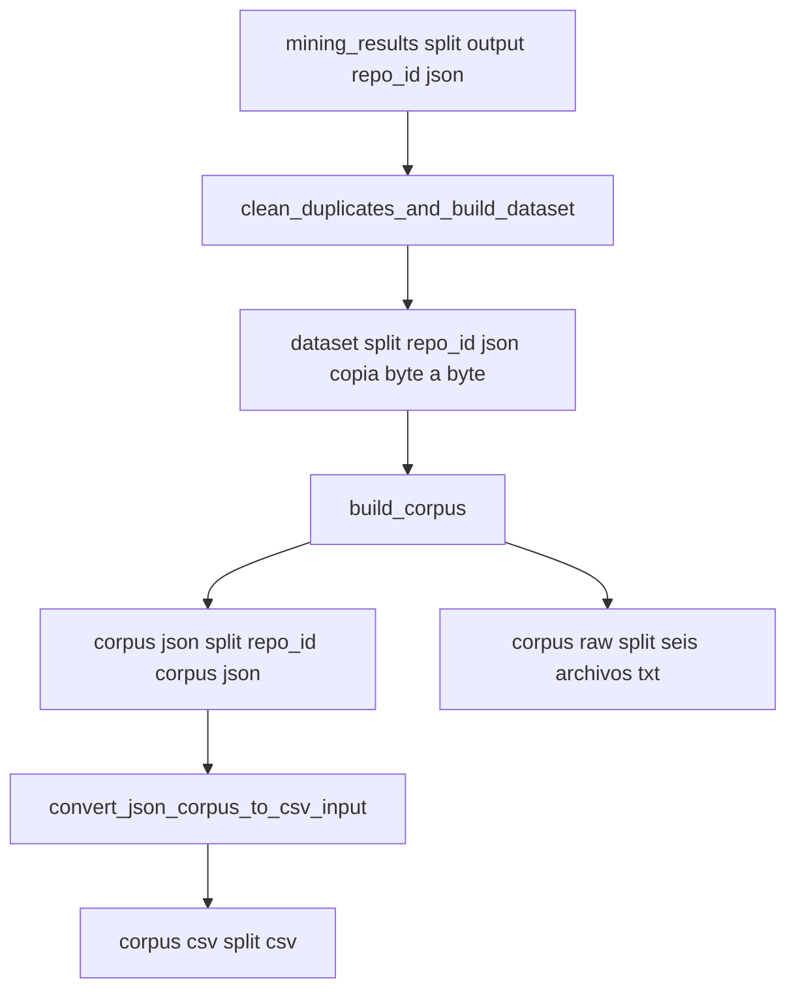

# 02 — Construcción del dataset y del corpus: etapas 2, 3 y 4

Sección de referencia sobre las tres etapas posteriores a la minería AST: la depuración de duplicados y construcción del dataset ([`clean_duplicates_and_build_dataset.py`](clean_duplicates_and_build_dataset.py)), la construcción del corpus en formato `source-target` ([`build_corpus.py`](build_corpus.py)) y la conversión del corpus a CSV ([`convert_json_corpus_to_csv_input.py`](convert_json_corpus_to_csv_input.py)).

Aclaración terminológica: las etiquetas conceptuales `FM_FC_MS_FF` y `FM_FC_DCTX` no existen como literales en el código. Corresponden a las claves y variables `src_fm_fc_ms_ff`, `src_fm_fc_dctx` y a la variante adicional `src_fm_fc_dctx_priv`, todas emitidas por [`build_format_corpus()`](build_corpus.py:416). La minería y el ensamblado de las representaciones se documentaron en [`01_ast_mapping.md`](docs/_sections/01_ast_mapping.md); esta sección no los redefine, sino que fija los contratos exactos entre etapas.

---

## 1) Script clean_duplicates_and_build_dataset.py

Script que recorre los JSON individuales producidos por la minería, agrupa los pares `test_case`-`focal_method` en un conjunto global de deduplicación, excluye los repositorios de Defects4J y copia los JSON supervivientes a una estructura `dataset/{split}/{repo_id}/`.

### 1.1 Configuración de módulo y dependencias

1.1.1 Se importan `os`, `argparse`, `json`, `shutil`, `time` y `tqdm` ([`clean_duplicates_and_build_dataset.py:1-6`](clean_duplicates_and_build_dataset.py:1)).

1.1.2 Se declara `DEFECTS4J_PROJECTS_BY_REPO_ID`, un diccionario de 17 entradas que mapea `repo_id` a `Nombre -> URL` ([`clean_duplicates_and_build_dataset.py:9-27`](clean_duplicates_and_build_dataset.py:9)). Esta constante **no se utiliza** en el flujo: no hay lectura de esta estructura en ninguna función del script. Es un residuo de trazabilidad documental.

1.1.3 Se declara `DEFECTS4J_PROJECTS_URLS`, un `set` con las 17 URLs de los proyectos Defects4J ([`clean_duplicates_and_build_dataset.py:29-47`](clean_duplicates_and_build_dataset.py:29)). Es la única estructura de Defects4J que participa del filtrado, descrito en 1.7.2.

1.1.4 Nótese que la URL de `Lang` se registra con barra final (`https://github.com/apache/commons-lang/`), por lo que la comparación por igualdad de cadena exige que el JSON de repositorios use exactamente ese literal.

### 1.2 Ejecución del método `parse_args()`

1.2.1 Se construye un `ArgumentParser` con dos parámetros ([`parse_args()`](clean_duplicates_and_build_dataset.py:172), líneas [176-190](clean_duplicates_and_build_dataset.py:176)).

1.2.2 `--mining_input` define la raíz de los resultados de minería, con valor por defecto `E:/000_Tesis/project_tesis_build_dataset/mining_results` ([`clean_duplicates_and_build_dataset.py:177-183`](clean_duplicates_and_build_dataset.py:177)).

1.2.3 `--output_dataset` define la raíz del dataset de salida, con valor por defecto `E:/000_Tesis/project_tesis_build_dataset/dataset` ([`clean_duplicates_and_build_dataset.py:184-189`](clean_duplicates_and_build_dataset.py:184)).

1.2.4 Se retorna `vars(parser.parse_args())` como diccionario ([`clean_duplicates_and_build_dataset.py:191`](clean_duplicates_and_build_dataset.py:191)). No existe parámetro de semilla, de proporciones de partición ni de encoding en esta etapa.

### 1.3 Ejecución del método `main()`

1.3.1 Se desempaquetan `mining_input` y `output_dataset` del diccionario de argumentos ([`main()`](clean_duplicates_and_build_dataset.py:194), líneas [196-197](clean_duplicates_and_build_dataset.py:196)).

1.3.2 Se registra el instante inicial y se delega todo el trabajo a [`clean_duplicates()`](clean_duplicates_and_build_dataset.py:142) ([`clean_duplicates_and_build_dataset.py:199-200`](clean_duplicates_and_build_dataset.py:199)).

1.3.3 Se imprime el tiempo total en segundos y en formato `HH:MM:SS` ([`clean_duplicates_and_build_dataset.py:203-207`](clean_duplicates_and_build_dataset.py:203)). Todo el reporte de esta etapa es salida por consola: no se genera archivo de log ni de estadísticas.

1.3.4 El bloque de arranque bajo `__main__` invoca `main()` sin envoltorio adicional ([`clean_duplicates_and_build_dataset.py:210-211`](clean_duplicates_and_build_dataset.py:210)).

### 1.4 Ejecución del método `clean_duplicates()`

1.4.1 Se fijan las tres rutas de entrada concatenando la raíz con las subcarpetas exactas `train/output`, `validation/output` y `test/output` ([`clean_duplicates()`](clean_duplicates_and_build_dataset.py:142), líneas [143-145](clean_duplicates_and_build_dataset.py:143)). Es decir, se espera que `--mining_input` apunte a la raíz `mining_results` producida por [`find_map_tests_cases_from_repo.py`](find_map_tests_cases_from_repo.py:850) con `--output "/mining_results/{split}/output"`.

1.4.2 Se fijan las tres rutas de salida como `dataset/train`, `dataset/validation` y `dataset/test` ([`clean_duplicates_and_build_dataset.py:147-149`](clean_duplicates_and_build_dataset.py:147)).

1.4.3 Las tres carpetas de salida se crean de forma incondicional con `os.makedirs(..., exist_ok=True)` **antes** de verificar la existencia de las entradas ([`clean_duplicates_and_build_dataset.py:151-153`](clean_duplicates_and_build_dataset.py:151)). Consecuencia: pueden quedar carpetas de split vacías cuando la entrada correspondiente no existe.

1.4.4 Se inicializan dos conjuntos globales compartidos por los tres splits: `unique_all_tests`, que almacena pares `método focal + caso de prueba`, y `unique_all_focal_methods`, que almacena cuerpos de métodos focales ([`clean_duplicates_and_build_dataset.py:155-156`](clean_duplicates_and_build_dataset.py:155)).

1.4.5 La deduplicación se ejecuta en el orden **train, validation, test** ([`clean_duplicates_and_build_dataset.py:158-162`](clean_duplicates_and_build_dataset.py:158)). Como los conjuntos son acumulativos, la precedencia efectiva es train > validation > test: un par presente en train se rechaza en los otros dos splits.

1.4.6 Se imprimen los totales de tests únicos, métodos focales únicos y aceptados/ignorados por split ([`clean_duplicates_and_build_dataset.py:165-169`](clean_duplicates_and_build_dataset.py:165)).

1.4.7 Observación: el orden del código contradice la descripción de [`README.md:255`](README.md:255), que anuncia depurar primero el subconjunto de `test`. En la implementación el primero en escribir es `train`.

### 1.5 Ejecución del método `extract_uniques()`

1.5.1 Si la ruta de entrada no existe, se imprime `Not exists path` y se retorna `0, 0` sin error ([`extract_uniques()`](clean_duplicates_and_build_dataset.py:68), líneas [69-71](clean_duplicates_and_build_dataset.py:69)). Por tanto, la ausencia de un split es tolerada y se refleja solo en las estadísticas.

1.5.2 Se cuenta el número de repositorios mediante [`get_total_repos()`](clean_duplicates_and_build_dataset.py:50), que cuenta subdirectorios del primer nivel ([`clean_duplicates_and_build_dataset.py:73-74`](clean_duplicates_and_build_dataset.py:73)).

1.5.3 Se inicializan los contadores `accepted_tests` e `ignored_tests` ([`clean_duplicates_and_build_dataset.py:76-77`](clean_duplicates_and_build_dataset.py:76)).

1.5.4 Se itera sobre los subdirectorios del primer nivel de la entrada con `next(os.walk(path_in))[1]`; cada subdirectorio corresponde a un `repo_id` de la minería ([`clean_duplicates_and_build_dataset.py:80-82`](clean_duplicates_and_build_dataset.py:80)).

1.5.5 Se itera sobre los archivos de cada carpeta de repositorio con `tqdm` y se seleccionan únicamente los que terminan en `.json` ([`clean_duplicates_and_build_dataset.py:85-88`](clean_duplicates_and_build_dataset.py:85)), es decir, los archivos `{repo_id}_{mtc_id}.json` descritos en [`01_ast_mapping.md`](docs/_sections/01_ast_mapping.md) (ítem 1.12.5).

1.5.6 Cada archivo se carga completo con `json.load` y se extraen exactamente tres campos: `data['test_case']['body']`, `data['focal_method']['body']` y `data['repository']` ([`clean_duplicates_and_build_dataset.py:90-97`](clean_duplicates_and_build_dataset.py:90)). El resto del JSON no se inspecciona ni se valida.

1.5.7 Filtro Defects4J: si `repository['url']` pertenece a `DEFECTS4J_PROJECTS_URLS`, el registro se cuenta como ignorado y se descarta ([`clean_duplicates_and_build_dataset.py:99-101`](clean_duplicates_and_build_dataset.py:99)). Es un filtro por igualdad exacta de URL, aplicado antes de cualquier deduplicación.

1.5.8 Clave de deduplicación: se construye `pair_test_and_focal = method_src_code + test_src_code` ([`clean_duplicates_and_build_dataset.py:103`](clean_duplicates_and_build_dataset.py:103)). La concatenación es directa, **sin delimitador**: el par se identifica por la yuxtaposición del valor de `focal_method['body']` y del valor de `test_case['body']`.

1.5.9 Precisión sobre el contenido de `body`: en el minero, `body` no es solo el bloque entre llaves, sino el texto completo del nodo de declaración del método, es decir, modificadores, anotaciones, firma y bloque de cuerpo ([`ClassParser.py:489`](ClassParser.py:489); véase [`01_ast_mapping.md`](docs/_sections/01_ast_mapping.md), ítem 2.4.1). En consecuencia, la clave de deduplicación incluye la firma de ambos métodos y conserva saltos de línea, tabulaciones y espacios originales, porque en esta etapa no se aplica ninguna normalización textual.

1.5.10 Dos bloques de deduplicación por dimensiones separadas (`test_src_code in unique_all_tests` y `method_src_code in unique_all_focal_methods`) permanecen comentados ([`clean_duplicates_and_build_dataset.py:105-113`](clean_duplicates_and_build_dataset.py:105) y [121-126](clean_duplicates_and_build_dataset.py:121)). La política vigente es la deduplicación conjunta del par, no la deduplicación de tests ni de métodos focales individuales. Esto implica que un mismo caso de prueba puede aparecer varias veces si se empareja con métodos focales distintos.

1.5.11 Condición de rechazo vigente: se descarta el registro si `test_src_code` es `None`, si `method_src_code` es `None` o si el par ya figura en `unique_all_tests` ([`clean_duplicates_and_build_dataset.py:115-119`](clean_duplicates_and_build_dataset.py:115)).

1.5.12 Aceptación: se crea la carpeta de destino del repositorio con `os.makedirs(..., exist_ok=True)`, se añade el par a `unique_all_tests`, se añade el cuerpo focal a `unique_all_focal_methods` y se copia el archivo con `shutil.copy` conservando el nombre original ([`clean_duplicates_and_build_dataset.py:128-133`](clean_duplicates_and_build_dataset.py:128)).

1.5.13 `unique_all_focal_methods` se puebla pero nunca se consulta como criterio de rechazo: se usa solo para imprimir el total de métodos focales únicos ([`clean_duplicates_and_build_dataset.py:130`](clean_duplicates_and_build_dataset.py:130) y [166](clean_duplicates_and_build_dataset.py:166)).

1.5.14 Se retorna la tupla `(accepted_tests, ignored_tests)` ([`clean_duplicates_and_build_dataset.py:139`](clean_duplicates_and_build_dataset.py:139)). `ignored_tests` agrega indistintamente exclusiones Defects4J, cuerpos nulos y duplicados, sin desagregación por motivo.

### 1.6 Naturaleza de la transformación y del archivo de salida

1.6.1 La operación es una **copia de bytes** (`shutil.copy`) del JSON de minería ([`clean_duplicates_and_build_dataset.py:132`](clean_duplicates_and_build_dataset.py:132)). No hay re-serialización, ni poda de claves, ni reordenamiento de campos.

1.6.2 El nombre del archivo se preserva (`{repo_id}_{mtc_id}.json`) y el destino es `{output_dataset}/{split}/{repo_id}/{repo_id}_{mtc_id}.json` ([`clean_duplicates_and_build_dataset.py:82`](clean_duplicates_and_build_dataset.py:82) y [132](clean_duplicates_and_build_dataset.py:132)).

1.6.3 Consecuencia de contrato: el JSON del dataset es estructuralmente idéntico al JSON producido por la minería, cuyo esquema se documenta en [`README.md:46-114`](README.md:46). Cualquier campo añadido o eliminado por la minería se propaga intacto a la etapa 3.

1.6.4 Ningún registro se reescribe para marcar su origen o su split: la partición se infiere únicamente por la carpeta contenedora.

1.6.5 El encoding no se especifica en `open(path_json_file_mining)` ([`clean_duplicates_and_build_dataset.py:90`](clean_duplicates_and_build_dataset.py:90)); se usa el encoding por defecto del sistema. En Windows corresponde a la página de códigos local (`cp1252`), lo que es coherente con el valor por defecto `cp1252` que [`build_corpus.py`](build_corpus.py:733) propone como alternativa a `utf-8`, pero introduce dependencia del entorno de ejecución.

### 1.7 Validaciones, filtros y umbrales

1.7.1 No existe validación de esquema: no se verifica la presencia de `test_class`, `focal_class`, `focal_method` ni de las claves de contexto dinámico. Solo se accede a `test_case`, `focal_method` y `repository`.

1.7.2 Filtros vigentes, en orden de aplicación: (a) extensión `.json`; (b) `repository['url']` fuera del conjunto Defects4J; (c) `test_case['body']` no nulo; (d) `focal_method['body']` no nulo; (e) par `método focal + test` no visto antes en la ejecución ([`clean_duplicates_and_build_dataset.py:87-119`](clean_duplicates_and_build_dataset.py:87)).

1.7.3 No hay umbrales de longitud, de número de tokens, de número de métodos por clase ni de tamaño de archivo. Tampoco hay validación sintáctica del código Java: la primera validación con `tree-sitter` ocurre en la etapa 3.

1.7.4 La partición train/validation/test **no se calcula** en este script. No existe proporción (80/10/10 u otra), ni `random.seed`, ni `sklearn.model_selection`. La asignación de split se hereda de las tres carpetas de entrada creadas previamente por la partición manual del listado de repositorios (`repos/train.json`, `repos/validation.json`, `repos/test.json`, según [`README.md:195`](README.md:195)). Este script únicamente depura cada split ya asignado.

### 1.8 Alcance de la validación Defects4J en esta etapa

1.8.1 La única comprobación relacionada con Defects4J es la exclusión por pertenencia de `repository['url']` al conjunto de 17 URLs ([`clean_duplicates_and_build_dataset.py:99-101`](clean_duplicates_and_build_dataset.py:99)).

1.8.2 No se cruza el contenido de los métodos focales contra el dataset Defects4J, no se lee `d4j_dataset`, no se compara `repo_id` y no se generan contadores por proyecto. El diccionario `DEFECTS4J_PROJECTS_BY_REPO_ID` está declarado pero no se consulta ([`clean_duplicates_and_build_dataset.py:9-27`](clean_duplicates_and_build_dataset.py:9)).

1.8.3 El cruce a nivel de cuerpo de método focal se realiza exclusivamente en la etapa 3, mediante [`get_focal_methods_by_d4j_project()`](build_corpus.py:680) (véase 2.4).

1.8.4 Riesgo de fuga: si el JSON de repositorios de entrada usa una URL con variante de mayúsculas, `http` o sin barra final respecto de [`clean_duplicates_and_build_dataset.py:29-47`](clean_duplicates_and_build_dataset.py:29), el repositorio Defects4J no se excluye en esta etapa y solo podría ser descartado por el cruce de cuerpos de la etapa 3.

### 1.9 Uso de las carpetas de clasificación de errores

1.9.1 Este script **no lee** las carpetas `1_repo_not_exists`, `2_does_not_have_tests`, `3_error_finding_files` ni `4_not_matching_tests` producidas por la minería en `--output_empty` ([`01_ast_mapping.md`](docs/_sections/01_ast_mapping.md), ítem 1.6.9).

1.9.2 La clasificación de fallos es, por tanto, puramente informativa para el operador y no tiene efecto sobre el contenido del dataset. Un repositorio sin resultados simplemente no tiene carpeta en `{split}/output` y no aparece en el conteo de `get_total_repos()` ([`clean_duplicates_and_build_dataset.py:50-65`](clean_duplicates_and_build_dataset.py:50)).

1.9.3 Consecuencia práctica: el dataset no registra cuántos repositorios fallaron ni por qué; esa trazabilidad solo existe en la salida de consola y en los archivos de log de la minería.

### 1.10 Observaciones y riesgos

1.10.1 La concatenación de 1.5.8 se evalúa en la línea [103](clean_duplicates_and_build_dataset.py:103), mientras que la comprobación de `None` ocurre en la línea [115-119](clean_duplicates_and_build_dataset.py:115). Si `body` fuera `None` en algún registro, la ejecución aborta con `TypeError` antes de llegar al filtro previsto.

1.10.2 La ausencia de delimitador en la clave de deduplicación permite colisiones teóricas entre pares distintos que generan la misma cadena concatenada (`"A" + "BC"` y `"AB" + "C"`). Como cada sumando es una declaración completa que cierra con `}`, la colisión exige que una declaración sea prefijo de otra hasta una llave de cierre interna, combinación prácticamente inviable en Java; el criterio no es inyectivo, pero el riesgo efectivo es ínfimo.

1.10.3 Un `KeyError` en `data['test_case']`, `data['focal_method']` o `data['repository']` aborta la ejecución completa: no hay captura de excepciones por archivo en [`extract_uniques()`](clean_duplicates_and_build_dataset.py:68).

1.10.4 La agresividad del filtro es **moderada**: solo se eliminan pares idénticos carácter a carácter en los cuerpos. Dos tests con el mismo cuerpo pero distinto nombre de método, o el mismo par con diferencias de espacios o comentarios, sobreviven como registros distintos. En sentido contrario, la deduplicación global hace que un par idéntico pierda su segunda ocurrencia aunque corresponda a otro repositorio.

1.10.5 No se registra en disco qué archivos fueron ignorados ni por qué motivo, lo que impide auditar la deduplicación posteriormente.

---

## 2) Script build_corpus.py

Script que transforma cada JSON del dataset en una entrada de corpus con la pareja `target` (caso de prueba) y tres representaciones de entrada, y que exporta simultáneamente el corpus en JSON por repositorio y en archivos de texto planos por split.

### 2.1 Configuración de módulo y dependencias

2.1.1 Se importan `argparse`, `copy`, `json`, `os`, `re`, `time`, `tqdm` y [`ParserUtils`](ParserUtils.py:13) ([`build_corpus.py:1-8`](build_corpus.py:1)). Importa `copy` pero no lo utiliza.

2.1.2 La cabecera de comentarios documenta las dos salidas esperadas: `corpus/json/{split}/{repo_id}/{repo_id}_{n}_corpus.json` con las seis claves del registro, y `corpus/raw/{split}/` con seis archivos de texto ([`build_corpus.py:11-37`](build_corpus.py:11)).

2.1.3 Se declaran seis listas globales de diagnóstico: `list_errors_methods_target`, `list_errors_methods_source`, `list_errors_focal_class_sig`, `list_errors_external_class_sig`, `list_errors_focal_signatures` y `list_errors_external_signatures` ([`build_corpus.py:40-45`](build_corpus.py:40)). Se acumulan durante toda la ejecución y solo se reportan por consola al final ([`build_corpus.py:210-225`](build_corpus.py:210)); no se escriben a disco.

### 2.2 Ejecución del método `parse_args()`

2.2.1 Se definen doce parámetros ([`parse_args()`](build_corpus.py:716), líneas [720-795](build_corpus.py:720)).

2.2.2 `--input_dataset` apunta a la carpeta de un split del dataset, por defecto `E:/000_Tesis/project_tesis_build_dataset/dataset/train` ([`build_corpus.py:721-728`](build_corpus.py:721)).

2.2.3 `--input_encoding` define el encoding de lectura de los JSON, con valor por defecto `utf-8` y la alternativa `cp1252` documentada para datasets construidos en Windows ([`build_corpus.py:729-735`](build_corpus.py:729)).

2.2.4 `--type_dataset` nombra el split, por defecto `train`, y determina el nombre de las carpetas de salida ([`build_corpus.py:736-741`](build_corpus.py:736)).

2.2.5 `--validate_against_d4j_dataset` activa el cruce con Defects4J, por defecto `True` ([`build_corpus.py:742-747`](build_corpus.py:742)).

2.2.6 `--d4j_dataset` define la raíz del dataset Defects4J, por defecto `/defects4j_with_dynamtests/corpus_only_public/data_by_project_and_version` ([`build_corpus.py:748-753`](build_corpus.py:748)).

2.2.7 `--output_corpus` define la raíz de salida, por defecto `E:/000_Tesis/project_tesis_build_dataset/corpus/` ([`build_corpus.py:754-759`](build_corpus.py:754)).

2.2.8 Los seis parámetros de delimitadores son `--tag_focal_context_start` (`<FCTX>`), `--tag_focal_context_end` (`</FCTX>`), `--tag_external_context_start` (`<ECTX>`), `--tag_external_context_end` (`</ECTX>`), `--tag_private_focal_context_start` (`<PRIVATE_FCTX>`) y `--tag_private_focal_context_end` (`</PRIVATE_FCTX>`) ([`build_corpus.py:760-795`](build_corpus.py:760)). Todos son configurables, de modo que el formato exacto de las cadenas depende de la invocación.

2.2.9 Riesgo de tipos: `--validate_against_d4j_dataset` se declara con `type=bool`, de modo que cualquier cadena no vacía —incluido `False`— se convierte en `True` ([`build_corpus.py:743-745`](build_corpus.py:743)). Para desactivar el cruce es necesario pasar una cadena vacía.

### 2.3 Ejecución del método `main()`

2.3.1 Se desempaquetan los doce argumentos en variables locales ([`main()`](build_corpus.py:800), líneas [802-813](build_corpus.py:802)).

2.3.2 Se registra el instante inicial y se instancia `ParserUtils(input_encoding)` ([`build_corpus.py:815-817`](build_corpus.py:815)).

2.3.3 Se construye el índice Defects4J con [`get_focal_methods_by_d4j_project()`](build_corpus.py:680) ([`build_corpus.py:819`](build_corpus.py:819)).

2.3.4 Se invoca [`build_corpus()`](build_corpus.py:80) con todos los parámetros y se imprime el tiempo total ([`build_corpus.py:821-841`](build_corpus.py:821)).

2.3.5 El bloque `__main__` conserva reinicializaciones de listas de error comentadas y llama a `main()` ([`build_corpus.py:844-850`](build_corpus.py:844)).

### 2.4 Ejecución de `get_focal_methods_by_d4j_project()`

2.4.1 Si `validate_against_d4j_dataset` es falso, se retorna un diccionario vacío ([`get_focal_methods_by_d4j_project()`](build_corpus.py:680), líneas [681-683](build_corpus.py:681)).

2.4.2 Si está activo, se recorren 17 proyectos codificados de forma literal en la lista `list_projects_d4j` ([`build_corpus.py:685-687`](build_corpus.py:685)).

2.4.3 Para cada proyecto se recorre `{d4j_dataset}/{Proyecto}/{version}/methods/{metodo}/metadata.json` ([`build_corpus.py:688-698`](build_corpus.py:688)).

2.4.4 De cada `metadata.json` existente se extrae `focal_method['body']` y se normaliza con [`clean_comments_in_code()`](build_corpus.py:655) más la cadena de reemplazos de puntuación ([`build_corpus.py:700-709`](build_corpus.py:700)).

2.4.5 El cuerpo normalizado se acumula en un `set` por proyecto y el diccionario resultante se indexa por nombre de proyecto ([`build_corpus.py:709-711`](build_corpus.py:709)).

2.4.6 Diferencia de normalización relevante: en el lado Defects4J **no** se aplica [`fix_type_parameters_inconsistences()`](ParserUtils.py:314), mientras que en el lado del dataset sí se aplica ([`build_corpus.py:358`](build_corpus.py:358)). Cuerpos que requieran esa corrección no coincidirán entre ambos lados.

### 2.5 Ejecución de `build_corpus()`

2.5.1 Se cuentan los repositorios de entrada y se preparan las dos carpetas de salida `{output_corpus}/json/{type_dataset}` y `{output_corpus}/raw/{type_dataset}`, ambas creadas con `os.makedirs` ([`build_corpus()`](build_corpus.py:80), líneas [93-102](build_corpus.py:93)).

2.5.2 Se inicializan las seis listas paralelas que alimentarán el corpus plano y el conjunto `unique_sources_targets` ([`build_corpus.py:114-122`](build_corpus.py:114)).

2.5.3 Se itera sobre las carpetas de repositorio con `next(os.walk(input_dataset))[1]` y se crea una carpeta de destino por repositorio, aunque no sobreviva ningún registro ([`build_corpus.py:126-129`](build_corpus.py:126)).

2.5.4 Por cada archivo `.json` se carga el documento con el encoding indicado y se invoca [`extract_data_from_mapped_test_case()`](build_corpus.py:328), que retorna siete valores ([`build_corpus.py:138-149`](build_corpus.py:138)).

2.5.5 Si `target` es `None`, el registro se descarta silenciosamente con `continue` ([`build_corpus.py:151-152`](build_corpus.py:151)). Este es el punto único de descarte por filtros y errores de sintaxis.

2.5.6 Cruce Defects4J de la etapa 3: se compara el cuerpo focal normalizado (`src_only_method_body`, devuelto como segundo elemento de la tupla) contra el `set` de cada proyecto; si coincide se marca `exists_in_d4j_dataset` y se incrementa el contador del proyecto ([`build_corpus.py:154-161`](build_corpus.py:154)).

2.5.7 Si el método focal existe en el corpus Defects4J, el registro se omite del corpus ([`build_corpus.py:163-164`](build_corpus.py:163)). Los conteos por proyecto se imprimen al final ([`build_corpus.py:204-206`](build_corpus.py:204)).

2.5.8 Segunda deduplicación, propia de esta etapa: `source_target = src_only_method_body + target`; si ya existe en `unique_sources_targets`, el registro se omite ([`build_corpus.py:166-170`](build_corpus.py:166)). La clave vuelve a ser una concatenación sin delimitador y el conjunto es local a la invocación, por lo que no elimina duplicados entre splits distintos.

2.5.9 El nombre del archivo de corpus se compone como `{nombre_sin_extension}_corpus.json` dentro de la carpeta del repositorio ([`build_corpus.py:174-176`](build_corpus.py:174)).

2.5.10 Se construye el diccionario de seis claves y se exporta con [`export_corpus_json()`](build_corpus.py:263) ([`build_corpus.py:178-187`](build_corpus.py:178)).

2.5.11 Se acumulan en orden los seis valores en sus listas paralelas ([`build_corpus.py:189-194`](build_corpus.py:189)). El orden de inserción es `target`, `src_fm_fc_ms_ff`, `src_fm_fc_dctx`, `src_fm_fc_dctx_priv`, `imports_focal_class`, `imports_test_class`.

2.5.12 `get_total_mapped_test_cases()` está implementado pero su invocación y su impresión están comentadas ([`build_corpus.py:64-77`](build_corpus.py:64) y [95-96](build_corpus.py:95)): es código muerto.

2.5.13 Al final de la ejecución se reportan los conteos de las seis listas de error y el total de errores de sintaxis ([`build_corpus.py:210-225`](build_corpus.py:210)), se exporta el corpus plano con [`export_corpus_raw()`](build_corpus.py:275) ([`build_corpus.py:229-239`](build_corpus.py:229)) y se imprime el total del split ([`build_corpus.py:259-260`](build_corpus.py:259)).

### 2.6 Ejecución de `extract_data_from_mapped_test_case()`

2.6.1 Se leen cuatro bloques del JSON: `test_class`, `test_case`, `focal_class` y `focal_method` ([`extract_data_from_mapped_test_case()`](build_corpus.py:328), líneas [336-339](build_corpus.py:336)). `repository` está comentado y no se usa.

2.6.2 Filtro estructural 1: se descarta el registro si la firma de la clase focal contiene ` interface ` o empieza con `interface ` ([`build_corpus.py:342-344`](build_corpus.py:342)).

2.6.3 Filtro estructural 2: se descarta si `abstract` aparece en los modificadores del método focal ([`build_corpus.py:346-347`](build_corpus.py:346)).

2.6.4 Filtro estructural 3: se descarta si `@Ignore` aparece en los modificadores del caso de prueba ([`build_corpus.py:349-350`](build_corpus.py:349)).

2.6.5 Normalización del `target`: se eliminan comentarios con [`clean_comments_in_code()`](build_corpus.py:655), se aplican los reemplazos de espaciado en torno a `.`, `(`, `)`, `[`, `]`, `){` y se corrigen inconsistencias de parámetros de tipo con [`fix_type_parameters_inconsistences()`](ParserUtils.py:314) ([`build_corpus.py:352-354`](build_corpus.py:352)). Dado que `test_case['body']` es la declaración completa del caso de prueba ([`ClassParser.py:489`](ClassParser.py:489)), el `target` final conserva la anotación `@Test` y la firma del método: la limpieza elimina comentarios, no anotaciones.

2.6.6 Normalización del método focal: idéntica secuencia, almacenada en `body_method` ([`build_corpus.py:356-358`](build_corpus.py:356)). Contiene la declaración completa del método focal (modificadores, anotaciones, firma y bloque de cuerpo), no solo el bloque entre llaves; de ahí que el nombre `body` resulte equívoco y que la envoltura de validación de 2.6.9 sea `public class AnyClass { <declaración> }`.

2.6.7 Filtro de vacío: se descarta el registro si [`method_body_is_empty()`](ParserUtils.py:66) resulta verdadero para el `target` o para el cuerpo focal ([`build_corpus.py:360-364`](build_corpus.py:360)).

2.6.8 Validación sintáctica del `target`: se envuelve en `public class AnyClass { ... }` y se valida en modo estricto (`validate_all_errors = True`); si hay error se registra en `list_errors_methods_target` y se descarta el registro ([`build_corpus.py:369-377`](build_corpus.py:369)).

2.6.9 Validación sintáctica del cuerpo focal: misma mecánica con `list_errors_methods_source` ([`build_corpus.py:380-388`](build_corpus.py:380)).

2.6.10 Se delega el ensamblado en [`build_format_corpus()`](build_corpus.py:416) y, si la representación estática es `None`, se descarta el registro ([`build_corpus.py:391-405`](build_corpus.py:391)).

2.6.11 Los imports se serializan uniendo la lista de strings con el delimitador `|` y limpiando comentarios y espaciado ([`build_corpus.py:407-411`](build_corpus.py:407)). Un caso de prueba sin imports produce cadena vacía, no `null`.

2.6.12 Se retorna la tupla de siete elementos `(target, body_method, src_fm_fc_ms_ff, src_fm_fc_dctx, src_fm_fc_dctx_priv, imports_test_class, imports_focal_class)` ([`build_corpus.py:413`](build_corpus.py:413)). El segundo elemento se nombra `src_only_method_body` en el consumidor ([`build_corpus.py:141`](build_corpus.py:141)).

2.6.13 Todos los filtros descartan el registro completo retornando siete `None`; no existe retorno parcial.

### 2.7 Ejecución de `build_format_corpus()`

2.7.1 Firma de clase: se obtiene con [`build_class_signature()`](build_corpus.py:631) y se valida de forma tolerante añadiendo `" { }"`, con `validate_all_errors = False`; si falla se registra en `list_errors_focal_class_sig` y se retorna `(None, None, None)` ([`build_corpus.py:436-446`](build_corpus.py:436)).

2.7.2 Se recuperan `focal_class['methods']` y `focal_class['fields']` y se fija `key_method_for_extract = 'full_signature'` ([`build_corpus.py:448-452`](build_corpus.py:448)). La alternativa `full_signature_parameters` está comentada.

2.7.3 Constructores de la clase focal: se toma `full_signature` de **todos** los métodos con `is_constructor == True`, se añade `;`, se unen con salto de línea, se limpian comentarios y se corrigen parámetros de tipo ([`build_corpus.py:454-457`](build_corpus.py:454)).

2.7.4 Métodos no privados de la clase focal: `full_signature` de los métodos no constructores cuyo `modifiers` no contiene `private`, con `;` añadido, limpieza y corrección ([`build_corpus.py:459-462`](build_corpus.py:459)).

2.7.5 Campos no privados de la clase focal: `original_string` de los campos cuyo `modifier` no contiene `private` ([`build_corpus.py:464-466`](build_corpus.py:464)). `protected` y de paquete se consideran no privados.

2.7.6 Ensamblado de `src_fm_fc_ms_ff` con la plantilla `'{} {{ {} {} {} {} }}'`, en el orden **firma de clase, declaración del método focal, constructores, métodos no privados, campos no privados** ([`build_corpus.py:469-476`](build_corpus.py:469)). La cadena resultante es literalmente `«firma» { «declaración del método focal» «constructores» «métodos no privados» «campos no privados» }`.

2.7.7 Normalización de la representación estática: [`clean_tabs_and_new_lines()`](build_corpus.py:661) y los reemplazos de espaciado en torno a `.`, `(`, `)`, `[`, `]` ([`build_corpus.py:477-478`](build_corpus.py:477)).

2.7.8 La representación estática **no incluye** firmas de métodos privados, ni firmas de campos privados, ni contexto de clases externas, ni delimitadores. Sí incluye, en cambio, la declaración completa del método focal —con su firma y su cuerpo— como primer elemento del cuerpo de la clase reconstruida, seguida de los constructores de la clase, los métodos no privados y los campos no privados. Esta es la diferencia estructural con la variante dinámica: aquí la clase se describe por exhaustividad, allí por uso efectivo.

2.7.9 Conjuntos de firmas usadas: se leen de `focal_method['class_private_deps_used']` y `focal_method['class_non_private_deps_used']`, cada uno con las subclaves `methods` y `fields` ([`build_corpus.py:481-483`](build_corpus.py:481) y [498-500](build_corpus.py:498)). Estos diccionarios los produce [`parse_potential_focal_and_external_dependencies()`](dependency_parser_utils.py:113) a partir de `class_fields_used`, `class_methods_used` y `class_method_references_used` con `allow_private = True` (véase [`01_ast_mapping.md`](docs/_sections/01_ast_mapping.md), ítems 3.2.5 a 3.2.9).

2.7.10 Firmas privadas usadas: se concatenan (a) **todos** los constructores privados de la clase focal, obtenidos de `focal_class['methods']`, (b) los métodos privados no constructores presentes en `class_private_deps_used['methods']` y (c) los campos privados de `class_private_deps_used['fields']` mediante `original_string` ([`build_corpus.py:486-489`](build_corpus.py:486)). Se limpian y se corrigen con `fix_type_parameters_inconsistences` ([`build_corpus.py:490-492`](build_corpus.py:490)).

2.7.11 Firmas no privadas usadas: se concatenan (a) **todos** los constructores no privados de la clase focal, (b) los métodos no privados no constructores de `class_non_private_deps_used['methods']` y (c) los campos no privados de `class_non_private_deps_used['fields']` ([`build_corpus.py:503-506`](build_corpus.py:503)), con la misma limpieza y corrección ([`build_corpus.py:507-509`](build_corpus.py:507)).

2.7.12 Asimetría relevante: los constructores se incluyen por exhaustividad de la clase, no por uso; en cambio, métodos y campos se incluyen solo si el método focal los usa. La separación privado/no privado se materializa en dos listas distintas y en la doble comprobación de `'private' in modifiers` / `'private' not in modifiers`.

2.7.13 Contexto externo: se itera sobre `focal_method['external_dependencies']` ([`build_corpus.py:518-519`](build_corpus.py:518)). Por cada dependencia: se limpia su `class_signature` de comentarios y anotaciones, se elimina la llave `{` y se corrige el cierre de parámetros de tipo con [`fix_close_type_parameter_sig_class()`](ParserUtils.py:277) ([`build_corpus.py:520-524`](build_corpus.py:520)).

2.7.14 La firma externa se valida de forma tolerante; si falla se registra en `list_errors_external_class_sig` y se aborta el ensamblado completo retornando `(None, None, None)` ([`build_corpus.py:528-536`](build_corpus.py:528)).

2.7.15 Cuerpo de la clase externa: se unen `original_string` de sus campos y `full_signature + ";"` de sus métodos, se limpian, se corrigen parámetros de tipo y se eliminan anotaciones de firma con [`clean_signatures_annotations()`](ParserUtils.py:220) ([`build_corpus.py:538-546`](build_corpus.py:538)). El conjunto se valida envolviéndolo en `public interface AnyClass { ... }`; si falla se registra en `list_errors_external_signatures` y se aborta ([`build_corpus.py:548-557`](build_corpus.py:548)).

2.7.16 Cada bloque externo se ensambla con la plantilla `'{} {{ {} }}'` —firma externa y cuerpo entre llaves—, se normaliza y se envuelve con las etiquetas de contexto externo ([`build_corpus.py:559-563`](build_corpus.py:559)). Si la lista queda vacía se emite el par de etiquetas vacío `<ECTX></ECTX>`; en caso contrario los bloques se unen con un espacio ([`build_corpus.py:565-568`](build_corpus.py:565)).

2.7.17 Validación conjunta de firmas focales: se compone `focal_sigs` en el orden **firmas no privadas usadas, firmas privadas usadas, campos no privados de toda la clase, constructores, métodos no privados de toda la clase** y se valida envolviéndolo en `public interface AnyClass { ... }`; si falla se registra en `list_errors_focal_signatures` y se aborta ([`build_corpus.py:587-596`](build_corpus.py:587)). Esta cadena de validación mezcla firmas usadas con firmas de clase completa y no forma parte de ninguna representación emitida.

2.7.18 Ensamblado de `src_fm_fc_dctx` con la plantilla `'{}{} {{ {} {} {} }}{} {}'` ([`build_corpus.py:599`](build_corpus.py:599)), con los argumentos en este orden exacto ([`build_corpus.py:600-608`](build_corpus.py:600)):

1. `tag_focal_context_start` (`<FCTX>`).
2. `class_signature` de la clase focal.
3. Llave de apertura `{`.
4. `body_method`, declaración normalizada del método focal (modificadores, anotaciones, firma y bloque de cuerpo).
5. `used_non_private_signatures_of_class_str`.
6. `used_private_signatures_of_class_str`.
7. Llave de cierre `}`.
8. `tag_focal_context_end` (`</FCTX>`).
9. `src_external_context` (bloque `<ECTX>...</ECTX>` o `<ECTX></ECTX>`).

2.7.19 Normalización de la variante dinámica: `clean_tabs_and_new_lines` y reemplazos de espaciado ([`build_corpus.py:609-610`](build_corpus.py:609)).

2.7.20 Ensamblado de `src_fm_fc_dctx_priv`: plantilla idéntica a 2.7.18, pero el bloque 6 se sustituye por `tag_private_focal_context_start + used_private_signatures_of_class_str + tag_private_focal_context_end` ([`build_corpus.py:613-622`](build_corpus.py:613)). Se normaliza con las mismas reglas ([`build_corpus.py:623-624`](build_corpus.py:623)).

2.7.21 Se retorna la terna `(src_fm_fc_ms_ff, src_fm_fc_dctx, src_fm_fc_dctx_priv)` ([`build_corpus.py:627`](build_corpus.py:627)). Las tres cadenas se emiten en una sola pasada y comparten la misma `class_signature`, el mismo `body_method` y el mismo `src_external_context`.

2.7.22 Recetas exactas resultantes, con los delimitadores por defecto de [`build_corpus.py:760-795`](build_corpus.py:760):

- `src_fm_fc_ms_ff` = `«class_signature» { «declaración del método focal» «constructores» «métodos no privados de la clase» «campos no privados de la clase» }`, sin etiquetas.
- `src_fm_fc_dctx` = `<FCTX>«class_signature» { «declaración del método focal» «firmas no privadas usadas» «firmas privadas usadas» }</FCTX> «contexto externo»`.
- `src_fm_fc_dctx_priv` = `<FCTX>«class_signature» { «declaración del método focal» «firmas no privadas usadas» <PRIVATE_FCTX>«firmas privadas usadas»</PRIVATE_FCTX> }</FCTX> «contexto externo»`.
- Cada bloque externo = `<ECTX>«firma de la clase externa» { «campos usados» «métodos usados con ;» }</ECTX>`.

En las tres recetas, `«declaración del método focal»` es el valor normalizado de `focal_method['body']` y, por tanto, incluye modificadores, anotaciones, firma, parámetros y bloque de cuerpo.

2.7.23 Las tres cadenas pasan por la misma normalización de espacios, por lo que los saltos de línea originales del código no se preservan en ninguna representación.

### 2.8 Ejecución de los helpers de limpieza

2.8.1 [`build_class_signature()`](build_corpus.py:631) lee `class_name`, `superclass` e `interfaces`; limpia comentarios y anotaciones de `class_signature`, elimina `{`, localiza la primera aparición de `class_name` y recompone la firma con la plantilla `'{} {} {} {}'` en el orden modificadores y tipo, nombre, extends, implements ([`build_corpus.py:632-646`](build_corpus.py:632)).

2.8.2 Si `class_name` no se encuentra en la firma, se retorna la firma limpia sin recomponer ([`build_corpus.py:641-646`](build_corpus.py:641)).

2.8.3 Riesgo: `find(class_name)` localiza la primera subcadena coincidente, que puede aparecer dentro de una anotación, de un parámetro de tipo o del propio nombre calificado, produciendo un prefijo de modificadores incorrecto. Los espacios dobles que generan `superclass` o `interfaces` vacíos se colapsan después en la normalización ([`build_corpus.py:665`](build_corpus.py:665)).

2.8.4 [`clean_comments_in_code()`](build_corpus.py:655) compone [`clean_comments()`](ParserUtils.py:101) con [`clean_tabs_and_new_lines()`](build_corpus.py:661) y `strip()` ([`build_corpus.py:656-658`](build_corpus.py:656)).

2.8.5 [`clean_tabs_and_new_lines()`](build_corpus.py:661) sustituye una o más apariciones de `\n` o `\t` por un espacio, colapsa dos o más espacios en blanco en uno y aplica `strip()` ([`build_corpus.py:663-666`](build_corpus.py:663)). No trata el retorno de carro aislado (`\r`) ni normaliza el contenido de literales de cadena.

2.8.6 [`clean_class_signature_annotations()`](build_corpus.py:669) y [`clean_methods_signatures_annotations()`](build_corpus.py:674) son envoltorios delgados de [`clean_annotations()`](ParserUtils.py:173) y [`clean_signatures_annotations()`](ParserUtils.py:220) respectivamente ([`build_corpus.py:670-676`](build_corpus.py:670)).

### 2.9 Helpers de `ParserUtils` utilizados

2.9.1 [`validate_if_code_has_errors()`](ParserUtils.py:30) se invoca en seis puntos: validación del `target` con modo estricto, del cuerpo focal con modo estricto, de la firma de la clase focal en modo tolerante, de la firma de la clase externa, de las firmas internas de la clase externa y del conjunto de firmas focales ([`build_corpus.py:370`](build_corpus.py:370), [381](build_corpus.py:381), [439](build_corpus.py:439), [529](build_corpus.py:529), [549](build_corpus.py:549), [589](build_corpus.py:589)). Los dos primeros son estrictos; los cuatro restantes son tolerantes.

2.9.2 [`method_body_is_empty()`](ParserUtils.py:66) se invoca sobre `target` y sobre `body_method` ([`build_corpus.py:360-361`](build_corpus.py:360)).

2.9.3 [`fix_type_parameters_inconsistences()`](ParserUtils.py:314) se invoca sobre `target`, `body_method`, `constructors_str`, `non_private_methods_str`, las firmas privadas usadas, las firmas no privadas usadas y las firmas internas de la clase externa ([`build_corpus.py:354`](build_corpus.py:354), [358](build_corpus.py:358), [457](build_corpus.py:457), [462](build_corpus.py:462), [492](build_corpus.py:492), [509](build_corpus.py:509), [545](build_corpus.py:545)). No se aplica a los cuerpos Defects4J (véase 2.4.6).

2.9.4 [`fix_close_type_parameter_sig_class()`](ParserUtils.py:277) se invoca solo sobre la firma de la clase externa ([`build_corpus.py:524`](build_corpus.py:524)).

2.9.5 [`clean_comments()`](ParserUtils.py:101), [`clean_annotations()`](ParserUtils.py:173) y [`clean_signatures_annotations()`](ParserUtils.py:220) se invocan indirectamente a través de los envoltorios de 2.8.4 y 2.8.6, incluida la carga del corpus Defects4J ([`build_corpus.py:706`](build_corpus.py:706)).

2.9.6 No se usan [`get_body_methods_from_class()`](ParserUtils.py:361) ni las utilidades de recorrido del árbol en este script.

### 2.10 Límites de tokens y truncamiento

2.10.1 **No existe truncamiento ni límite de longitud en ninguna representación.** No se aplica `max_length`, conteo de tokens, recorte por número de dependencias externas, por número de métodos o por tamaño de firma en [`build_format_corpus()`](build_corpus.py:416) ni en [`extract_data_from_mapped_test_case()`](build_corpus.py:328).

2.10.2 Tampoco existe cota al número de bloques `<ECTX>`: se emite un bloque por cada elemento de `external_dependencies`, sin límite superior ([`build_corpus.py:519-563`](build_corpus.py:519)).

2.10.3 Consecuencia: la longitud de `src_fm_fc_dctx` depende linealmente del número de dependencias externas usadas y del tamaño de sus firmas. El control de longitud solo puede ocurrir aguas abajo, en la tokenización del modelo, y de forma implícita por truncamiento del tokenizador.

2.10.4 El script [`analize_tokens_corpus.py`](analize_tokens_corpus.py) existe en el repositorio, pero no participa del pipeline descrito en [`README.md:266-318`](README.md:266).

### 2.11 Rutas y formatos de salida

2.11.1 Corpus JSON: un archivo por registro en `{output_corpus}/json/{type_dataset}/{repo_id}/{nombre_original}_corpus.json` ([`build_corpus.py:98-99`](build_corpus.py:98) y [175-176](build_corpus.py:175)).

2.11.2 El JSON se escribe con `json.dumps` sin `indent` y con `ensure_ascii` por defecto, es decir, una sola línea con escapes `\uXXXX` para caracteres no ASCII ([`export_corpus_json()`](build_corpus.py:263), líneas [267-272](build_corpus.py:267)).

2.11.3 Las seis claves del registro son `target`, `src_fm_fc_ms_ff`, `src_fm_fc_dctx`, `src_fm_fc_dctx_priv`, `imports_focal_class` e `imports_test_class`, en ese orden de inserción ([`build_corpus.py:178-185`](build_corpus.py:178)). La cabecera de módulo enumera las mismas claves ([`build_corpus.py:17-24`](build_corpus.py:17)).

2.11.4 Corpus plano: seis archivos en `{output_corpus}/raw/{type_dataset}/`, a saber `input_methods_src_fm_fc_ms_ff.txt`, `input_methods_src_fm_fc_dctx.txt`, `input_methods_src_fm_fc_dctx_priv.txt`, `output_tests.txt`, `imports_focal_class.txt` e `imports_test_class.txt` ([`build_corpus.py:284-289`](build_corpus.py:284)).

2.11.5 Los archivos previos se eliminan antes de escribir ([`build_corpus.py:292-308`](build_corpus.py:292)) y se abren simultáneamente en un único bloque `with` ([`build_corpus.py:311-318`](build_corpus.py:311)).

2.11.6 Se escribe una línea por registro, en el mismo orden e índice en los seis archivos, con `+ "\n"` ([`build_corpus.py:319-325`](build_corpus.py:319)). La alineación por índice es el invariante que sostiene la correspondencia entre archivos; cualquier registro descartado en la etapa 3 se descarta en los seis a la vez porque las listas se pueblan en el mismo punto.

2.11.7 El formato de una línea por registro solo es seguro porque [`clean_tabs_and_new_lines()`](build_corpus.py:661) elimina los saltos de línea de las tres representaciones y de `target`. Si se modificara esa normalización, el corpus plano quedaría desalineado.

### 2.12 Observaciones y riesgos

2.12.1 Descarte silencioso: doce condiciones distintas producen el descarte del registro con `continue`, sin registrar el motivo ([`build_corpus.py:151-152`](build_corpus.py:151)). Ocho pertenecen a [`extract_data_from_mapped_test_case()`](build_corpus.py:328) —firma de clase con `interface`, método focal `abstract`, caso de prueba `@Ignore`, cuerpo del `target` vacío, cuerpo focal vacío, error de sintaxis en el `target`, error de sintaxis en el cuerpo focal y ensamblado nulo— y cuatro a [`build_format_corpus()`](build_corpus.py:416) —firma de la clase focal inválida, firma de la clase externa inválida, firmas internas de la clase externa inválidas y conjunto de firmas focales inválido—. Los motivos solo son reconstruibles por las longitudes de las seis listas de error, que no distinguen registros individuales y no se exportan.

2.12.2 La verificación de `interface` en la firma de clase se hace por subcadena ([`build_corpus.py:342-343`](build_corpus.py:342)); una clase cuya firma contenga el literal ` interface ` por otra razón también se descarta.

2.12.3 La comprobación de `abstract` en `focal_method['modifiers']` descarta cualquier método con ese modificador, incluidos métodos de interfaces ya excluidas y clases abstractas cuyo método concreto no lo lleva.

2.12.4 El filtro de `@Ignore` se aplica sobre el texto de los modificadores del caso de prueba; variantes como `@Ignore("motivo")` o anotaciones personalizadas no se cubren más allá de la subcadena `@Ignore`.

2.12.5 Acoplamiento a claves internas: se accede de forma directa a `class_private_deps_used` y `class_non_private_deps_used` ([`build_corpus.py:481`](build_corpus.py:481) y [498](build_corpus.py:498)). Si un JSON de dataset carece de estas claves se produce `KeyError` y se aborta el split completo.

2.12.6 La deduplicación de 2.5.8 vuelve a usar concatenación sin separador y no incluye la representación: dos registros con cuerpos distintos pero el mismo par cuerpo-focal más test colisionan.

2.12.7 El orden de recorrido de `os.listdir` determina qué registro sobrevive cuando dos coinciden en la clave de deduplicación; no hay ordenamiento explícito en [`build_corpus.py:133`](build_corpus.py:133).

2.12.8 El corpus JSON y el corpus plano se generan en la misma ejecución y comparten la deduplicación, pero el plano no conserva el `repo_id` de origen; la procedencia solo se recupera desde el corpus JSON por el nombre del archivo.

---

## 3) Script convert_json_corpus_to_csv_input.py

Script que recorre el corpus JSON de un split, lo consolida en un `DataFrame` de `pandas`, lo reordena aleatoriamente con semilla fija y lo exporta a un único CSV.

### 3.1 Configuración de módulo y dependencias

3.1.1 Se importan `argparse`, `pandas`, `pathlib.Path`, `tqdm`, `os`, `json` y `time` ([`convert_json_corpus_to_csv_input.py:1-6`](convert_json_corpus_to_csv_input.py:1)). El import de `json` corresponde al código alternativo comentado ([`convert_json_corpus_to_csv_input.py:61-63`](convert_json_corpus_to_csv_input.py:61)).

3.1.2 Se declara `SEED = 42` como constante de módulo ([`convert_json_corpus_to_csv_input.py:8`](convert_json_corpus_to_csv_input.py:8)). No es un parámetro de línea de comandos y no puede alterarse sin editar el archivo.

3.1.3 [`get_total_repos()`](convert_json_corpus_to_csv_input.py:10) replica la utilidad de conteo de subdirectorios de los scripts anteriores y se usa solo para alimentar la barra de progreso ([`convert_json_corpus_to_csv_input.py:31-34`](convert_json_corpus_to_csv_input.py:31)).

### 3.2 Ejecución del método `parse_args()`

3.2.1 `--input_json_corpus` apunta a la raíz del corpus JSON, por defecto `E:/000_Tesis/project_tesis_build_dataset/corpus/json` ([`parse_args()`](convert_json_corpus_to_csv_input.py:126), líneas [131-136](convert_json_corpus_to_csv_input.py:131)).

3.2.2 `--input_encoding` tiene valor por defecto `cp1252`, con `utf-8` comentado ([`convert_json_corpus_to_csv_input.py:137-143`](convert_json_corpus_to_csv_input.py:137)).

3.2.3 `--type_corpus` nombra el split y determina tanto la carpeta de entrada como el nombre del CSV, por defecto `validation` ([`convert_json_corpus_to_csv_input.py:144-149`](convert_json_corpus_to_csv_input.py:144)).

3.2.4 `--output_csv_corpus` apunta a la carpeta del corpus CSV, por defecto `E:/000_Tesis/project_tesis_build_dataset/corpus/csv/` ([`convert_json_corpus_to_csv_input.py:150-155`](convert_json_corpus_to_csv_input.py:150)).

3.2.5 Se retorna `vars(parser.parse_args())` ([`convert_json_corpus_to_csv_input.py:157`](convert_json_corpus_to_csv_input.py:157)).

### 3.3 Ejecución del método `main()`

3.3.1 Se desempaquetan `type_corpus`, `input_json_corpus` y `output_csv_corpus`; el encoding se **descarta** y nunca se propaga a `convert()` ([`main()`](convert_json_corpus_to_csv_input.py:160), líneas [162-164](convert_json_corpus_to_csv_input.py:162)).

3.3.2 La ruta de entrada se compone como `{input_json_corpus}/{type_corpus}` ([`convert_json_corpus_to_csv_input.py:166`](convert_json_corpus_to_csv_input.py:166)). Esta es la única relación entre split y directorio: no hay renombrado ni cruce de splits.

3.3.3 Se delega en [`convert()`](convert_json_corpus_to_csv_input.py:25) y se imprime el tiempo total ([`convert_json_corpus_to_csv_input.py:168-177`](convert_json_corpus_to_csv_input.py:168)).

3.3.4 El bloque `__main__` invoca `main()` ([`convert_json_corpus_to_csv_input.py:180-181`](convert_json_corpus_to_csv_input.py:180)).

### 3.4 Ejecución del método `convert()`

3.4.1 Se crea la carpeta de salida con `os.makedirs(..., exist_ok=True)` y se fija la ruta `{output_csv_corpus}/{type_corpus}.csv`, de modo que los archivos resultantes son `train.csv`, `validation.csv` y `test.csv` ([`convert()`](convert_json_corpus_to_csv_input.py:25), líneas [26-27](convert_json_corpus_to_csv_input.py:26)).

3.4.2 Se recorre la carpeta de entrada con `Path(...).iterdir()` y se recogen los `.json` **de un solo nivel** de subdirectorio (`{repo_id}/`), sin recursión ([`convert_json_corpus_to_csv_input.py:36-39`](convert_json_corpus_to_csv_input.py:36)). Estructuras más profundas se ignoran en silencio.

3.4.3 La ruta se construye por concatenación de cadenas con `/` en lugar de `os.path.join`, lo que fija el separador pero funciona por la tolerancia de rutas en Windows ([`convert_json_corpus_to_csv_input.py:38`](convert_json_corpus_to_csv_input.py:38)).

3.4.4 Cada archivo se lee con `pd.read_json(file, typ='series', orient='records')` y la serie resultante se acumula en una lista ([`convert_json_corpus_to_csv_input.py:57-59`](convert_json_corpus_to_csv_input.py:57)). La lectura alternativa con `json.load` está comentada ([`convert_json_corpus_to_csv_input.py:61-63`](convert_json_corpus_to_csv_input.py:61)).

3.4.5 Se construye el `DataFrame` con `pd.DataFrame(json_data)`; cada serie aporta una fila y el índice de la serie aporta los nombres de columna ([`convert_json_corpus_to_csv_input.py:72`](convert_json_corpus_to_csv_input.py:72)). `pd.json_normalize` está comentado como alternativa ([`convert_json_corpus_to_csv_input.py:73`](convert_json_corpus_to_csv_input.py:73)).

3.4.6 Se imprimen `df.head()`, `df.columns` y las seis primeras celdas de la primera fila mediante `df.iloc[:1, 0]` a `df.iloc[:1, 5]` ([`convert_json_corpus_to_csv_input.py:78-102`](convert_json_corpus_to_csv_input.py:78)). Son restos de depuración y presuponen que existan al menos seis columnas.

3.4.7 Se reordena aleatoriamente con `df.sample(frac=1, random_state=SEED).reset_index(drop=True)` ([`convert_json_corpus_to_csv_input.py:109-110`](convert_json_corpus_to_csv_input.py:109)).

3.4.8 Se exporta con `df_shuffled.to_csv(out_path, index=False, encoding="utf-8")` ([`convert_json_corpus_to_csv_input.py:113-114`](convert_json_corpus_to_csv_input.py:113)).

3.4.9 Se relee el CSV con `pd.read_csv(out_path)` y se imprime `result.info()` como comprobación de parseabilidad ([`convert_json_corpus_to_csv_input.py:119-122`](convert_json_corpus_to_csv_input.py:119)). No se compara el número de filas con el número de JSON leídos.

3.4.10 No se renombran columnas: los `rename` hacia `source` están comentados ([`convert_json_corpus_to_csv_input.py:105-106`](convert_json_corpus_to_csv_input.py:105)).

### 3.5 Columnas y orden

3.5.1 Las columnas son exactamente `target`, `src_fm_fc_ms_ff`, `src_fm_fc_dctx`, `src_fm_fc_dctx_priv`, `imports_focal_class` e `imports_test_class`, en el orden de inserción de claves del JSON de la etapa 3 ([`build_corpus.py:178-185`](build_corpus.py:178)), que coincide con la lista comentada en este script ([`convert_json_corpus_to_csv_input.py:82-88`](convert_json_corpus_to_csv_input.py:82)).

3.5.2 No se aplica selección ni reordenamiento explícito de columnas (`df[cols]`): si un corpus JSON tuviera las claves en otro orden o con claves adicionales, el CSV cambiaría de esquema sin aviso.

3.5.3 No hay columna de identificador, de repositorio, de split ni de índice (`index=False`). El CSV es puramente `source-target` más los dos campos de imports.

### 3.6 Escapado y entrecomillado

3.6.1 El entrecomillado lo resuelve `pandas` con su política por defecto (`QUOTE_MINIMAL`): solo se entrecomillan los campos que contienen el separador, comillas o saltos de línea, y las comillas internas se duplican.

3.6.2 Las tres representaciones contienen comas con frecuencia (listas de parámetros, argumentos de invocación) y los campos de imports contienen comas por la unión con `|`; en ambos casos el campo se entrecomilla y el CSV sigue siendo parseable por `pandas` y por lectores RFC 4180.

3.6.3 El riesgo principal de desalineación por saltos de línea está mitigado en origen: [`clean_tabs_and_new_lines()`](build_corpus.py:661) elimina `\n` y `\t` de las tres representaciones y de `target` ([`build_corpus.py:477`](build_corpus.py:477), [609](build_corpus.py:609), [623](build_corpus.py:623), [352-358](build_corpus.py:352)). Un `\r` aislado, no contemplado por esa función, sí sobreviviría y obligaría a que el consumidor soporte comillas con retorno de carro embebido.

3.6.4 Las comillas dobles dentro del código Java se escapan por duplicación, pero un lector que no implemente RFC 4180 (por ejemplo, una lectura por `split(",")` o `split("\t")`) produciría campos corruptos.

### 3.7 Observaciones y riesgos

3.7.1 `--input_encoding` es un parámetro muerto: se parsea, se documenta en [`README.md:304`](README.md:304) y no se usa, porque `pd.read_json` decide el encoding por su cuenta ([`convert_json_corpus_to_csv_input.py:58`](convert_json_corpus_to_csv_input.py:58)). Un corpus escrito en `cp1252` puede fallar o decodificarse mal sin que el parámetro tenga efecto.

3.7.2 La reproducibilidad del orden de filas **no** está garantizada: `os.listdir` devuelve un orden dependiente del sistema de archivos y `sample` con semilla fija aplica una permutación sobre esa secuencia, de modo que el mismo corpus en dos máquinas puede producir órdenes distintos. La semilla fija solo garantiza reproducibilidad dentro del mismo orden de entrada.

3.7.3 Un split vacío produce un `DataFrame` sin columnas y el bloque de impresión `df.iloc[:1, 5]` falla con `IndexError` antes de llegar a la escritura ([`convert_json_corpus_to_csv_input.py:91-102`](convert_json_corpus_to_csv_input.py:91)).

3.7.4 `pd.read_json` infiere tipos por valor: valores que parezcan numéricos o booleanos pueden dejar de ser cadenas, alterando el esquema respecto del JSON original. El uso de `orient='records'` no evita esa inferencia.

3.7.5 La comprobación final es solo informativa ([`convert_json_corpus_to_csv_input.py:119-122`](convert_json_corpus_to_csv_input.py:119)): no se verifica que el número de filas coincida con el número de JSON, ni que ninguna columna sea completamente nula, ni que no existan registros duplicados.

3.7.6 No hay escritura por bloques ni control de memoria: todos los registros del split se materializan en una lista de series y después en un único `DataFrame`, lo que es viable solo porque la etapa 3 ya descartó registros; sigue siendo el punto de mayor consumo de memoria del pipeline.

---

## 4) Contrato de datos entre etapas (2 -> 3 -> 4)

### 4.1 Etapa 1 -> etapa 2: JSON de minería consumido por `clean_duplicates_and_build_dataset.py`

4.1.1 Estructura de entrada: `{mining_input}/{split}/output/{repo_id}/{repo_id}_{mtc_id}.json`, un archivo por par mapeado ([`clean_duplicates_and_build_dataset.py:143-145`](clean_duplicates_and_build_dataset.py:143) y [80-88](clean_duplicates_and_build_dataset.py:80)).

4.1.2 Campos efectivamente leídos: `test_case.body`, `focal_method.body` y `repository.url` ([`clean_duplicates_and_build_dataset.py:93-97`](clean_duplicates_and_build_dataset.py:93)). Todos los demás campos son opacos para esta etapa.

4.1.3 Campos que la etapa 2 requiere implícitamente para no abortar: los tres bloques de primer nivel `test_case`, `focal_method` y `repository`.

4.1.4 Salida: copia byte a byte en `{output_dataset}/{split}/{repo_id}/{mismo_nombre}.json` ([`clean_duplicates_and_build_dataset.py:128-132`](clean_duplicates_and_build_dataset.py:128)). El esquema no se modifica: no hay campos añadidos, eliminados ni renombrados.

### 4.2 Etapa 2 -> etapa 3: JSON de dataset consumido por `build_corpus.py`

4.2.1 Estructura de entrada: `{input_dataset}/{repo_id}/*.json`, con `--input_dataset` apuntando directamente a un split ([`build_corpus.py:126-135`](build_corpus.py:126)).

4.2.2 Campos de `test_class`: `imports`, lista de cadenas que se unen con `|` ([`build_corpus.py:407`](build_corpus.py:407)).

4.2.3 Campos de `test_case`: `body` (semilla del `target`) y `modifiers` (filtro `@Ignore`) ([`build_corpus.py:349`](build_corpus.py:349) y [352](build_corpus.py:352)).

4.2.4 Campos de `focal_class`: `class_signature`, `class_name`, `superclass`, `interfaces`, `methods` (cada uno con `full_signature`, `modifiers`, `is_constructor`), `fields` (cada uno con `original_string` y `modifier`) e `imports` ([`build_corpus.py:342`](build_corpus.py:342), [448-449](build_corpus.py:448), [454-466](build_corpus.py:454), [632-634](build_corpus.py:632), [410](build_corpus.py:410)).

4.2.5 Campos de `focal_method`: `modifiers`, `body` (declaración completa del método, no solo el bloque de cuerpo), `class_private_deps_used` con `methods` y `fields`, `class_non_private_deps_used` con `methods` y `fields`, y `external_dependencies`, cada elemento con `class_signature`, `fields` y `methods` ([`build_corpus.py:346`](build_corpus.py:346), [356](build_corpus.py:356), [481-500](build_corpus.py:481), [518-541](build_corpus.py:518)).

4.2.6 Campos documentados en [`README.md:46-114`](README.md:46) que esta etapa **no** consume: `focal_class.class_modifier`, `has_constructor`, `package`, `file`, `test_class.package`, `file`, y prácticamente todo el diccionario del caso de prueba salvo `body` y `modifiers` (`method_name`, `parameters`, `signature`, `full_signature`, `is_testcase`, `test_use_mockito`, etc.). El nombre del método de prueba no se usa en ninguna representación.

4.2.7 Campos ausentes en el JSON pero tolerados: `repository` (comentado en el consumidor), `signatures_of_external_dependencies` (bloque de código comentado en [`build_corpus.py:570-585`](build_corpus.py:570)).

4.2.8 Campos internos del minero que ya no llegan a esta etapa por la poda de exportación: `used_private_signatures_of_class`, `used_non_private_signatures_of_class`, `signatures_of_external_dependencies` y `external_dependencies` a nivel de método focal fueron eliminados en la exportación de la etapa 1 ([`01_ast_mapping.md`](docs/_sections/01_ast_mapping.md), ítem 1.12.4), de modo que la etapa 3 reconstruye esas firmas desde `class_private_deps_used`, `class_non_private_deps_used` y `methods`/`fields` de la clase.

### 4.3 Etapa 3 -> etapa 4: JSON de corpus consumido por `convert_json_corpus_to_csv_input.py`

4.3.1 Estructura de entrada: `{input_json_corpus}/{type_corpus}/{repo_id}/*_corpus.json`, un nivel de subdirectorio ([`convert_json_corpus_to_csv_input.py:36-39`](convert_json_corpus_to_csv_input.py:36)).

4.3.2 Contrato de claves, en orden: `target`, `src_fm_fc_ms_ff`, `src_fm_fc_dctx`, `src_fm_fc_dctx_priv`, `imports_focal_class`, `imports_test_class`, todas de tipo cadena ([`build_corpus.py:178-185`](build_corpus.py:178)).

4.3.3 Salida: `{output_csv_corpus}/{type_corpus}.csv`, con encabezado y las seis columnas en el mismo orden, sin índice ([`convert_json_corpus_to_csv_input.py:27`](convert_json_corpus_to_csv_input.py:27) y [114](convert_json_corpus_to_csv_input.py:114)).

4.3.4 Correspondencia de splits: el nombre de la carpeta de entrada y el nombre del archivo de salida se derivan ambos de `type_corpus`, sin validación cruzada ([`convert_json_corpus_to_csv_input.py:166`](convert_json_corpus_to_csv_input.py:166) y [27](convert_json_corpus_to_csv_input.py:27)).

### 4.4 Tabla resumen del contrato

| Etapa | Entrada | Clave de agrupación | Transformación | Salida |
|---|---|---|---|---|
| 2 | `{mining_input}/{split}/output/{repo_id}/*.json` | `focal_method.body + test_case.body` sin separador; conjuntos compartidos train > validation > test | Filtro Defects4J por `repository.url`, filtro de cuerpos nulos, dedup por par, copia byte a byte | `{output_dataset}/{split}/{repo_id}/*.json` |
| 3 | `{input_dataset}/{repo_id}/*.json` | `body_method + target` normalizados, por invocación | Limpieza, validación sintáctica, filtros, cruce Defects4J por cuerpo focal, ensamblado de tres representaciones | `{output_corpus}/json/{split}/{repo_id}/*_corpus.json` y `{output_corpus}/raw/{split}/*.txt` |
| 4 | `{corpus_json}/{split}/{repo_id}/*_corpus.json` | ninguna | Consolidación en `DataFrame`, mezcla con `random_state=42` | `{corpus_csv}/{split}.csv` |

### 4.5 Trazabilidad y puntos de pérdida de información

4.5.1 La etapa 2 conserva el identificador de repositorio solo por el nombre de la carpeta; la etapa 3 lo conserva igual; la etapa 4 lo pierde por completo en el CSV.

4.5.2 El identificador del par mapeado (`{repo_id}_{mtc_id}`) se conserva en el nombre del archivo JSON de la etapa 3 (`{nombre}_corpus.json`) y desaparece en el corpus plano y en el CSV ([`build_corpus.py:174-176`](build_corpus.py:174)).

4.5.3 No hay campo de versión ni de esquema en ninguno de los tres formatos, por lo que un cambio en las claves de la etapa 3 no es detectable por la etapa 4.

4.5.4 Los descartes no se materializan en ningún artefacto persistente: las seis listas de error de la etapa 3 viven en memoria ([`build_corpus.py:40-45`](build_corpus.py:40)) y los contadores de la etapa 2 se imprimen por consola ([`clean_duplicates_and_build_dataset.py:165-169`](clean_duplicates_and_build_dataset.py:165)).
