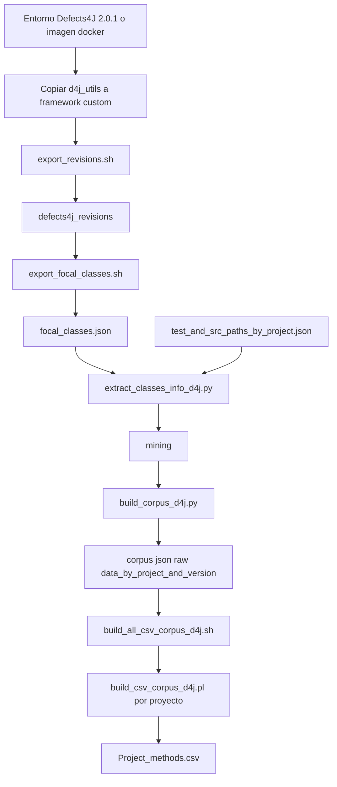

# 03 — Corpus de evaluación Defects4J

Sección de referencia sobre la construcción del corpus de **evaluación**, independiente del corpus de entrenamiento documentado en [`01_ast_mapping.md`](docs/_sections/01_ast_mapping.md) y [`02_clean_and_corpus.md`](docs/_sections/02_clean_and_corpus.md). El corpus de evaluación se construye a partir de Defects4J y se diferencia del flujo principal en tres puntos estructurales:

1. No existe trazabilidad test ↔ método focal: no se emparejan casos de prueba con métodos focales ([`parse_focal_methods()`](extract_classes_info_d4j.py:335) descarta los casos de prueba).
2. Las clases a procesar se reciben de forma explícita, exportadas por los scripts de [`d4j_utils/`](d4j_utils) antes de invocar los scripts Python ([`find_focal_classes()`](extract_classes_info_d4j.py:101), líneas [221-250](extract_classes_info_d4j.py:221)).
3. Existe una secuencia previa obligatoria de comandos sobre el framework de Defects4J que debe ejecutarse antes de los scripts Python ([`DEFECTS4J_README.md`](DEFECTS4J_README.md:32)).

Archivos cubiertos: [`extract_classes_info_d4j.py`](extract_classes_info_d4j.py), [`build_corpus_d4j.py`](build_corpus_d4j.py), [`DEFECTS4J_README.md`](DEFECTS4J_README.md), [`d4j_utils/export_revisions.sh`](d4j_utils/export_revisions.sh), [`d4j_utils/export_focal_classes.sh`](d4j_utils/export_focal_classes.sh), [`d4j_utils/build_all_csv_corpus_d4j.sh`](d4j_utils/build_all_csv_corpus_d4j.sh) y [`d4j_utils/build_csv_corpus_d4j.pl`](d4j_utils/build_csv_corpus_d4j.pl).



---

## 1) Prerrequisitos Defects4J (secuencia previa obligatoria)

### 1.1 Secuencia ordenada de ejecución

1.1.1 **Entorno.** Disponer de Defects4J `2.0.1` instalado o de la imagen `eljavatar/d4j_tests_benchmark:version11` ([`DEFECTS4J_README.md`](DEFECTS4J_README.md:36), [38-42](DEFECTS4J_README.md:38)).

```shell
docker pull eljavatar/d4j_tests_benchmark:version11
```

1.1.2 **Dependencias.** Python `>= 3.9`, Git `>= 2.34` ([`DEFECTS4J_README.md`](DEFECTS4J_README.md:49)) y los paquetes `pandas`, `scikit-learn`, `packaging`, `command-runner`, `GitPython`, `tree-sitter==0.21.0`, `tree-sitter-java==0.21.0` ([`DEFECTS4J_README.md`](DEFECTS4J_README.md:52)). No se declaran en el README las dependencias de los envoltorios de shell y Perl identificadas en 1.2.4, 1.4.4 y 1.8.1.

1.1.3 **Colocación de los scripts.** Crear `/defects4j/framework/custom` y copiar allí el contenido de [`d4j_utils/`](d4j_utils) ([`DEFECTS4J_README.md`](DEFECTS4J_README.md:63), [71](DEFECTS4J_README.md:71)).

```shell
cd /defects4j/framework
mkdir custom
# copiar d4j_utils/* en /defects4j/framework/custom
```

1.1.4 **Paso 1 — exportar revisiones.** Ejecutar [`export_revisions.sh`](d4j_utils/export_revisions.sh:1) desde `/defects4j/framework/custom` ([`DEFECTS4J_README.md`](DEFECTS4J_README.md:81)).

```shell
cd /defects4j/framework/custom
./export_revisions.sh
```

1.1.5 **Paso 2 — exportar clases focales.** Ejecutar [`export_focal_classes.sh`](d4j_utils/export_focal_classes.sh:1) desde la misma carpeta ([`DEFECTS4J_README.md`](DEFECTS4J_README.md:97)).

```shell
cd /defects4j/framework/custom
./export_focal_classes.sh
```

1.1.6 **Paso 3 — extraer métodos focales y contexto.** Ejecutar [`extract_classes_info_d4j.py`](extract_classes_info_d4j.py:530) con los parámetros documentados ([`DEFECTS4J_README.md`](DEFECTS4J_README.md:116)).

```shell
cd /DynaMTests
python3 extract_classes_info_d4j.py \
	--repos_path "/defects4j_revisions" \
	--project_id "all" \
	--focal_classes_json_file "/defects4j/framework/custom/focal_classes.json" \
	--test_and_src_paths_json_file "/defects4j/framework/custom/test_and_src_paths_by_project.json" \
	--output "/defects4j_with_dynamtests/mining" \
	--output_empty "/defects4j_with_dynamtests/mining_empty"
```

1.1.7 **Paso 4 — generar el corpus JSON y raw.** Ejecutar [`build_corpus_d4j.py`](build_corpus_d4j.py:696) ([`DEFECTS4J_README.md`](DEFECTS4J_README.md:136)).

```shell
cd /DynaMTests
python3 build_corpus_d4j.py \
	--input_dataset "/defects4j_with_dynamtests/mining" \
	--input_encoding "utf-8" \
	--project_id "all" \
	--output_corpus "/defects4j_with_dynamtests/corpus"
```

1.1.8 **Paso 5 — generar el CSV.** Ejecutar [`build_all_csv_corpus_d4j.sh`](d4j_utils/build_all_csv_corpus_d4j.sh:1) ([`DEFECTS4J_README.md`](DEFECTS4J_README.md:149)).

```shell
cd /defects4j/framework/custom
./build_all_csv_corpus_d4j.sh \
	-d /defects4j_with_dynamtests/corpus/data_by_project_and_version \
	-o /defects4j_with_dynamtests/corpus/csv \
	-t /tmp/checkouts
```

### 1.2 Observaciones sobre la secuencia

1.2.1 El orden es estricto: el paso 2 consume las rutas creadas por el paso 1 ([`export_focal_classes.sh:14`](d4j_utils/export_focal_classes.sh:14) consulta `defects4j query`, que requiere el framework operativo); el paso 3 consume `focal_classes.json` producido por el paso 2 ([`extract_classes_info_d4j.py:548`](extract_classes_info_d4j.py:548)); el paso 4 consume la carpeta `mining` producida por el paso 3 ([`build_corpus_d4j.py:724`](build_corpus_d4j.py:724)); y el paso 5 consume `data_by_project_and_version` producido por el paso 4 ([`build_all_csv_corpus_d4j.sh:58`](d4j_utils/build_all_csv_corpus_d4j.sh:58), [`build_csv_corpus_d4j.pl:87`](d4j_utils/build_csv_corpus_d4j.pl:87)).

1.2.2 El README asume que el paso 2 se ejecuta antes de todos los Python únicamente por dependencia de datos; no existe verificación de que `focal_classes.json` corresponda a las revisiones realmente descargadas, de modo que una revisión ausente se traduce en un directorio de salida vacío y en clasificación `1_repo_not_exists/` o `3_not_mapping_focal_methods/` ([`extract_classes_info_d4j.py:81-89`](extract_classes_info_d4j.py:81)).

1.2.3 La entrada `test_and_src_paths_by_project.json` del paso 3 **no se produce en ningún script del repositorio** ni se documenta en [`DEFECTS4J_README.md`](DEFECTS4J_README.md:116). Es un prerrequisito externo; su ausencia aborta la ejecución en [`extract_classes_info_d4j.py:553`](extract_classes_info_d4j.py:553).

---

### 1.3 Paso 1: [`export_revisions.sh`](d4j_utils/export_revisions.sh:1)

1.3.1 Se declara la lista `repos` con los 17 proyectos de Defects4J: `Closure Cli Codec Collections Compress Csv JxPath Lang Math Gson JacksonCore JacksonDatabind JacksonXml Chart Time Jsoup Mockito` ([`export_revisions.sh:3`](d4j_utils/export_revisions.sh:3)). Las variantes reducidas están comentadas ([`export_revisions.sh:4-6`](d4j_utils/export_revisions.sh:4)).

1.3.2 Se fija `revisions_dir=/defects4j_revisions` y `repo_type=f` (versiones con el bug corregido) ([`export_revisions.sh:10-11`](d4j_utils/export_revisions.sh:10)); la ruta de Windows usada en desarrollo permanece comentada ([`export_revisions.sh:9`](d4j_utils/export_revisions.sh:9)).

1.3.3 Por cada proyecto se cambia el directorio a `revisions_dir` y se consultan los identificadores de bug con `defects4j query -p ${repo} -q "bug.id"` ([`export_revisions.sh:17-18`](d4j_utils/export_revisions.sh:17)).

1.3.4 Por cada identificador se compone `repo_name=${repo}_${id}_${repo_type}` y `repo_path=${revisions_dir}/${repo_name}` ([`export_revisions.sh:20-21`](d4j_utils/export_revisions.sh:20)).

1.3.5 La descarga se realiza con `defects4j checkout -p $repo -v ${id}${repo_type} -w ${revisions_dir}/${repo_name}` ([`export_revisions.sh:22`](d4j_utils/export_revisions.sh:22)). La barra `|| continue` hace que un fallo de checkout se omita sin registro y sin abortar el proyecto.

1.3.6 A continuación se compila la revisión con `cd $repo_name && defects4j compile` ([`export_revisions.sh:23`](d4j_utils/export_revisions.sh:23)). El `cd` es relativo porque el bucle ya se encuentra en `revisions_dir`; la alternativa con ruta absoluta está comentada ([`export_revisions.sh:24`](d4j_utils/export_revisions.sh:24)).

1.3.7 Resultado: `/defects4j_revisions/` contiene una carpeta por revisión, cada una con el árbol de trabajo completo de la versión fija del bug ([`DEFECTS4J_README.md`](DEFECTS4J_README.md:87)). El nombre de carpeta es exactamente el valor de la clave `project` de `focal_classes.json` (véase 1.4.4), condición que el paso 3 compara por igualdad de cadena ([`extract_classes_info_d4j.py:223`](extract_classes_info_d4j.py:223) y [573](extract_classes_info_d4j.py:573)).

1.3.8 Dependencias reales del script: binario `defects4j` en `PATH` y una instalación operativa del framework, incluido su fichero de inicialización de entorno ([`export_revisions.sh:18`](d4j_utils/export_revisions.sh:18), [22](d4j_utils/export_revisions.sh:22), [23](d4j_utils/export_revisions.sh:23)). El README no menciona `DEFECTS4J_HOME` ni el `source` del script de entorno.

---

### 1.4 Paso 2: [`export_focal_classes.sh`](d4j_utils/export_focal_classes.sh:1)

1.4.1 Se reutiliza la misma lista de 17 proyectos y la misma marca `repo_type=f` ([`export_focal_classes.sh:3`](d4j_utils/export_focal_classes.sh:3), [7](d4j_utils/export_focal_classes.sh:7)).

1.4.2 Por cada proyecto se consultan las clases modificadas al corregir cada bug con `defects4j query -p ${repo} -q "classes.modified"` ([`export_focal_classes.sh:14`](d4j_utils/export_focal_classes.sh:14)).

1.4.3 La salida se normaliza eliminando comillas y se itera registro por registro ([`export_focal_classes.sh:15-16`](d4j_utils/export_focal_classes.sh:15)). De cada registro, el campo 1 es el identificador de bug y el campo 2 la lista de clases separadas por `;` ([`export_focal_classes.sh:17-18`](d4j_utils/export_focal_classes.sh:17)).

1.4.4 La lista de clases se convierte en array JSON con `jq -R -s -c 'split(";")'` y se compone la clave de revisión `revision=${repo}_${bugid}_${repo_type}` ([`export_focal_classes.sh:20-21`](d4j_utils/export_focal_classes.sh:20)). El objeto `{"project": ..., "classes": [...]}` se acumula con `jq` ([`export_focal_classes.sh:23`](d4j_utils/export_focal_classes.sh:23)).

1.4.5 El resultado se escribe como `focal_classes.json` en el directorio de trabajo actual, es decir, `/defects4j/framework/custom/focal_classes.json` ([`export_focal_classes.sh:26`](d4j_utils/export_focal_classes.sh:26), [`DEFECTS4J_README.md`](DEFECTS4J_README.md:103)).

1.4.6 Esquema producido: un array de objetos con las claves `project` (cadena `{Proyecto}_{bugId}_f`) y `classes` (array de nombres plenamente calificados, con puntos como separador de paquete). El paso 3 consume solo estas dos claves ([`extract_classes_info_d4j.py:222-224`](extract_classes_info_d4j.py:222), [550](extract_classes_info_d4j.py:550)).

1.4.7 Dependencias reales del script: `defects4j` en `PATH` ([`export_focal_classes.sh:14`](d4j_utils/export_focal_classes.sh:14)) y `jq` ([`export_focal_classes.sh:20`](d4j_utils/export_focal_classes.sh:20), [23](d4j_utils/export_focal_classes.sh:23)). `jq` no figura entre las dependencias del README ([`DEFECTS4J_README.md`](DEFECTS4J_README.md:45)), lo que impide reproducir la secuencia con el único listado de paquetes documentado.

1.4.8 Riesgo de formato: la separación en campos se realiza con `cut -d ","`, de modo que cualquier coma adicional en la salida de `defects4j query` truncaría la lista de clases ([`export_focal_classes.sh:17-18`](d4j_utils/export_focal_classes.sh:17)). Además, si un bug no modifica ninguna clase en `classes.modified`, el array resultante puede contener una cadena vacía que el paso 3 convertiría en una ruta `.java` inválida ([`extract_classes_info_d4j.py:240`](extract_classes_info_d4j.py:240)).

---

### 1.5 Entrada auxiliar [`test_and_src_paths_by_project.json`](extract_classes_info_d4j.py:498)

1.5.1 Se declara como parámetro `--test_and_src_paths_json_file`, con valor por defecto `E:/000_Tesis/custom_scripts_d4j/test_and_src_paths_by_project.json` ([`extract_classes_info_d4j.py:498-504`](extract_classes_info_d4j.py:498)).

1.5.2 Se carga de forma incondicional, sin comprobar su existencia ([`extract_classes_info_d4j.py:552-554`](extract_classes_info_d4j.py:552)), de modo que un fichero ausente produce `FileNotFoundError` antes de procesar ninguna revisión.

1.5.3 Estructura esperada: un diccionario indexado por el nombre del proyecto y versión **en minúsculas y sin sufijo `_f`/`_b`** ([`extract_classes_info_d4j.py:230-232`](extract_classes_info_d4j.py:230)); por ejemplo, la revisión `Gson_1_f` se consulta como `gson_1`. Cada entrada debe contener al menos la clave `src` ([`extract_classes_info_d4j.py:233`](extract_classes_info_d4j.py:233)); la clave `test` no se lee en este script.

1.5.4 `src` se antepone a la ruta derivada del nombre de clase para localizar el archivo dentro del árbol de trabajo ([`extract_classes_info_d4j.py:243`](extract_classes_info_d4j.py:243)). Si la clave no existe, se lanza `KeyError` en la línea [232](extract_classes_info_d4j.py:232); si el valor es `None`, se usa cadena vacía ([`extract_classes_info_d4j.py:233-235`](extract_classes_info_d4j.py:233)).

1.5.5 Ambigüedad documental: ni [`DEFECTS4J_README.md`](DEFECTS4J_README.md:116) ni los envoltorios de [`d4j_utils/`](d4j_utils) generan este fichero; su contenido debe prepararse manualmente y no hay validación de esquema.

---

### 1.6 Paso 3: [`extract_classes_info_d4j.py`](extract_classes_info_d4j.py:530)

1.6.1 Parámetros usados en la secuencia documentada ([`DEFECTS4J_README.md`](DEFECTS4J_README.md:116)): `--repos_path /defects4j_revisions`, `--project_id all`, `--focal_classes_json_file`, `--test_and_src_paths_json_file`, `--output /defects4j_with_dynamtests/mining`, `--output_empty /defects4j_with_dynamtests/mining_empty` (detalle en 2.2).

1.6.2 El script procesa en paralelo todas las revisiones presentes en `repos_path` que figuren en `focal_classes.json` y que coincidan con el filtro `project_id` ([`extract_classes_info_d4j.py:559-588`](extract_classes_info_d4j.py:559)).

1.6.3 Salida: un directorio por revisión dentro de `output` ([`extract_classes_info_d4j.py:56`](extract_classes_info_d4j.py:56)), con un JSON por método focal, los logs y, cuando existen resultados, una copia de las clases focales ([`extract_classes_info_d4j.py:306-314`](extract_classes_info_d4j.py:306)). Las revisiones sin métodos focales se copian a `output_empty` clasificadas por tipo de fallo y se eliminan de `output` ([`extract_classes_info_d4j.py:81-91`](extract_classes_info_d4j.py:81)).

---

### 1.7 Paso 4: [`build_corpus_d4j.py`](build_corpus_d4j.py:696)

1.7.1 Parámetros usados ([`DEFECTS4J_README.md`](DEFECTS4J_README.md:136)): `--input_dataset /defects4j_with_dynamtests/mining`, `--input_encoding utf-8`, `--project_id all`, `--output_corpus /defects4j_with_dynamtests/corpus` (detalle en 3.2).

1.7.2 Salida: tres árboles bajo `output_corpus`: `data_by_project_and_version/`, `json/` y `raw/` ([`build_corpus_d4j.py:106-113`](build_corpus_d4j.py:106)), descritos en 3.8.

1.7.3 `data_by_project_and_version` es un artefacto intermedio obligatorio para el paso 5, no un subproducto opcional: el script Perl lo usa como `path_data` ([`build_csv_corpus_d4j.pl:39`](d4j_utils/build_csv_corpus_d4j.pl:39), [87](d4j_utils/build_csv_corpus_d4j.pl:87)).

---

### 1.8 Paso 5: [`build_all_csv_corpus_d4j.sh`](d4j_utils/build_all_csv_corpus_d4j.sh:1) y [`build_csv_corpus_d4j.pl`](d4j_utils/build_csv_corpus_d4j.pl:1)

1.8.1 El envoltorio de shell parsea cuatro opciones: `-s` scaffoldings, `-d` datos del corpus, `-o` salida CSV y `-t` directorio temporal de checkouts ([`build_all_csv_corpus_d4j.sh:14-33`](d4j_utils/build_all_csv_corpus_d4j.sh:14)). Las opciones desconocidas o sin argumento invocan `usage`, que no está definida en el archivo ([`build_all_csv_corpus_d4j.sh:24-31`](d4j_utils/build_all_csv_corpus_d4j.sh:24)).

1.8.2 Se reutiliza la lista de 17 proyectos ([`build_all_csv_corpus_d4j.sh:3`](d4j_utils/build_all_csv_corpus_d4j.sh:3)) y se invoca el Perl una vez por proyecto ([`build_all_csv_corpus_d4j.sh:45-61`](d4j_utils/build_all_csv_corpus_d4j.sh:45)). Si `scaffoldings_dir` está definido se pasa `-s`; en caso contrario se omite ([`build_all_csv_corpus_d4j.sh:57-61`](d4j_utils/build_all_csv_corpus_d4j.sh:57)). La invocación documentada no usa `-s`, por lo que `USE_SCAFFOLDING` queda desactivado.

1.8.3 El Perl declara las opciones `p:v:t:s:d:o:S` ([`build_csv_corpus_d4j.pl:21`](d4j_utils/build_csv_corpus_d4j.pl:21)). `-p` es obligatorio ([`build_csv_corpus_d4j.pl:23`](d4j_utils/build_csv_corpus_d4j.pl:23)); `-v` es opcional y restringe el proceso a una única versión ([`build_csv_corpus_d4j.pl:25`](d4j_utils/build_csv_corpus_d4j.pl:25), [49-53](d4j_utils/build_csv_corpus_d4j.pl:49)); `-s` es la raíz de scaffoldings ([`build_csv_corpus_d4j.pl:26`](d4j_utils/build_csv_corpus_d4j.pl:26)); `-d` es la raíz de datos ([`build_csv_corpus_d4j.pl:27`](d4j_utils/build_csv_corpus_d4j.pl:27)); `-o` es el directorio CSV ([`build_csv_corpus_d4j.pl:28`](d4j_utils/build_csv_corpus_d4j.pl:28)); `-S` activa la generación de tests mediante scaffoldings ([`build_csv_corpus_d4j.pl:29`](d4j_utils/build_csv_corpus_d4j.pl:29)); `-t` determina el directorio temporal ([`build_csv_corpus_d4j.pl:31`](d4j_utils/build_csv_corpus_d4j.pl:31)).

1.8.4 El Perl importa la biblioteca del framework de Defects4J desde `$FindBin::Bin/../core` (`Constants`, `Project`) ([`build_csv_corpus_d4j.pl:15-17`](d4j_utils/build_csv_corpus_d4j.pl:15)); por ello el script solo funciona ubicado en `/defects4j/framework/custom` (1.1.3). Usa además `JSON` y `Text::CSV` ([`build_csv_corpus_d4j.pl:10-11`](d4j_utils/build_csv_corpus_d4j.pl:10)), este último instalable con `cpan Text::CSV` según el comentario del propio archivo ([`build_csv_corpus_d4j.pl:12-13`](d4j_utils/build_csv_corpus_d4j.pl:12)).

1.8.5 Se crea el objeto de proyecto con `Project::create_project($PID)` y se le asigna el directorio temporal como raíz de ejecución ([`build_csv_corpus_d4j.pl:34-35`](d4j_utils/build_csv_corpus_d4j.pl:34)). Se derivan `$project_dir = "$PROJECTS_DIR/$PID"` y `$path_input_corpus = "$path_data/${PID}"` ([`build_csv_corpus_d4j.pl:37-39`](d4j_utils/build_csv_corpus_d4j.pl:37)). `$PROJECTS_DIR` y `Utils::get_tmp_dir` provienen de las bibliotecas del framework y no se declaran en el archivo ([`build_csv_corpus_d4j.pl:31`](d4j_utils/build_csv_corpus_d4j.pl:31), [37](d4j_utils/build_csv_corpus_d4j.pl:37)).

1.8.6 Las versiones a procesar son las de `-v` o, en su defecto, todos los bugs del proyecto (`get_bug_ids`) ([`build_csv_corpus_d4j.pl:49-56`](d4j_utils/build_csv_corpus_d4j.pl:49)). Por cada versión se forma `vid="${id}f"` ([`build_csv_corpus_d4j.pl:63`](d4j_utils/build_csv_corpus_d4j.pl:63)); si se usa scaffolding se exige el archivo `${PID}-${vid}-scaffolding.tar.bz2` y se omite la versión cuando no existe ([`build_csv_corpus_d4j.pl:66-76`](d4j_utils/build_csv_corpus_d4j.pl:66)).

1.8.7 Se cargan las clases modificadas del framework con `open(IN, "<${project_dir}/modified_classes/${id}.src")` ([`build_csv_corpus_d4j.pl:79-85`](d4j_utils/build_csv_corpus_d4j.pl:79)). Si el directorio `${path_data}/${PID}/${id}/methods` no existe, la versión se omite con aviso ([`build_csv_corpus_d4j.pl:87-95`](d4j_utils/build_csv_corpus_d4j.pl:87)).

1.8.8 Se recorre cada subcarpeta de método y se decodifica `${path_methods}/${method_number}/corpus.json` ([`build_csv_corpus_d4j.pl:99-137`](d4j_utils/build_csv_corpus_d4j.pl:99)). La lectura de un `corpus.txt` alternativo está comentada ([`build_csv_corpus_d4j.pl:105-117`](d4j_utils/build_csv_corpus_d4j.pl:105)).

1.8.9 El emparejamiento se hace por **nombre simple de clase**: se deriva `focal_class_name` del último punto del nombre calificado ([`build_csv_corpus_d4j.pl:141-149`](d4j_utils/build_csv_corpus_d4j.pl:141)) y se compara con el nombre de archivo de `path_focal_class` contenido en `corpus.json` ([`build_csv_corpus_d4j.pl:171-188`](d4j_utils/build_csv_corpus_d4j.pl:171)).

1.8.10 Se construye una fila por método aceptado con `id`, `project`, `version`, `number_method_by_version`, `modified_class`, `focal_method`, `focal_class`, `path_focal_class_in_project`, `test_class`, `path_test_class`, `package_focal_class`, `imports_focal_class`, `src_fm_fc_ms_ff`, `src_fm_fc_dctx` y `src_fm_fc_dctx_priv` ([`build_csv_corpus_d4j.pl:198-216`](d4j_utils/build_csv_corpus_d4j.pl:198)). El identificador es `${PID}_${id}_${method_number}_${focal_class_name}` ([`build_csv_corpus_d4j.pl:190`](d4j_utils/build_csv_corpus_d4j.pl:190)).

1.8.11 La clase de prueba se nombra por convención: `${focal_class_name}Test` con ruta `${file_class}Test.java`, o `${focal_class_name}_ESTest` y `${file_class}_ESTest.java` cuando se usa scaffolding ([`build_csv_corpus_d4j.pl:151-160`](d4j_utils/build_csv_corpus_d4j.pl:151)).

1.8.12 Las filas se ordenan por `version` y luego por `number_method_by_version` ([`build_csv_corpus_d4j.pl:227-233`](d4j_utils/build_csv_corpus_d4j.pl:227)) y se escriben en `${out_dir}/${PID}_methods.csv` con `Text::CSV` en modo `binary` ([`build_csv_corpus_d4j.pl:236-267`](d4j_utils/build_csv_corpus_d4j.pl:236)). Las 15 columnas se declaran en [242-259](d4j_utils/build_csv_corpus_d4j.pl:242). El directorio temporal se elimina al final ([`build_csv_corpus_d4j.pl:270`](d4j_utils/build_csv_corpus_d4j.pl:270)).

1.8.13 Filtro efectivo del CSV: solo se emiten métodos cuya clase focal figure en `modified_classes/{id}.src`. Un método focal extraído de una clase no registrada como modificada en el metadato de Defects4J desaparece del CSV sin aviso ([`build_csv_corpus_d4j.pl:80-85`](d4j_utils/build_csv_corpus_d4j.pl:80), [141](d4j_utils/build_csv_corpus_d4j.pl:141)). Es una pérdida de registros que no ocurre en el corpus JSON/raw.

1.8.14 `-t` solo se usa para crear y borrar `TMP_DIR` ([`build_csv_corpus_d4j.pl:31-32`](d4j_utils/build_csv_corpus_d4j.pl:31), [270](d4j_utils/build_csv_corpus_d4j.pl:270)); no interviene en la lectura de datos ni en la generación de tests. La opción `-S` es la única que altera los nombres de clase de prueba esperados.

---

### 1.9 Layout resultante de la secuencia

| Ruta | Productor | Contenido |
|---|---|---|
| `/defects4j_revisions/{Proyecto}_{bugId}_f/` | [`export_revisions.sh:22`](d4j_utils/export_revisions.sh:22) | Árbol de trabajo compilado de la versión fija |
| `/defects4j/framework/custom/focal_classes.json` | [`export_focal_classes.sh:26`](d4j_utils/export_focal_classes.sh:26) | Array de `{project, classes}` |
| `/defects4j/framework/custom/test_and_src_paths_by_project.json` | externo | Diccionario `{proyecto_version: {src, ...}}` |
| `{output}/{Proyecto}_{bugId}_f/` | [`extract_classes_info_d4j.py:56`](extract_classes_info_d4j.py:56) | JSON por método focal, `log.txt`, `focal_classes/` |
| `{output_empty}/1_repo_not_exists/` | [`extract_classes_info_d4j.py:85`](extract_classes_info_d4j.py:85) | Logs de revisiones sin ruta |
| `{output_empty}/2_error_finding_java_files/` | [`extract_classes_info_d4j.py:87`](extract_classes_info_d4j.py:87) | Logs de fallo de inventario Java |
| `{output_empty}/3_not_mapping_focal_methods/` | [`extract_classes_info_d4j.py:89`](extract_classes_info_d4j.py:89) | Logs de revisiones sin métodos focales |
| `{output_corpus}/data_by_project_and_version/{Proyecto}/{version}/` | [`build_corpus_d4j.py:106`](build_corpus_d4j.py:106) | `focal_classes/` y `methods/{i}/` |
| `{output_corpus}/json/{Proyecto}/{Proyecto}_{n}_f/` | [`build_corpus_d4j.py:109`](build_corpus_d4j.py:109) | JSON de corpus por método |
| `{output_corpus}/raw/{Proyecto}/` | [`build_corpus_d4j.py:112`](build_corpus_d4j.py:112) | Siete archivos de texto |
| `{csv}/{Proyecto}_methods.csv` | [`build_csv_corpus_d4j.pl:240`](d4j_utils/build_csv_corpus_d4j.pl:240) | CSV de 15 columnas |

---

### 1.10 Riesgos de los prerrequisitos

1.10.1 **Dependencia no declarada de `jq`** en la exportación de clases focales ([`export_focal_classes.sh:20`](d4j_utils/export_focal_classes.sh:20), [23](d4j_utils/export_focal_classes.sh:23)), ausente del listado de dependencias del README ([`DEFECTS4J_README.md`](DEFECTS4J_README.md:45)).

1.10.2 **Dependencia no declarada de módulos Perl** (`JSON`, `Text::CSV`) y de las bibliotecas internas del framework (`Constants`, `Project`) ([`build_csv_corpus_d4j.pl:10-17`](d4j_utils/build_csv_corpus_d4j.pl:10)). Sin `Text::CSV` el script aborta en la importación.

1.10.3 **Dependencia de la instalación de Defects4J**: `defects4j` en `PATH` ([`export_revisions.sh:18`](d4j_utils/export_revisions.sh:18)), `PROJECTS_DIR` correctamente apuntado a los metadatos del framework ([`build_csv_corpus_d4j.pl:37`](d4j_utils/build_csv_corpus_d4j.pl:37)) y el directorio `core` accesible en `../core` ([`build_csv_corpus_d4j.pl:15`](d4j_utils/build_csv_corpus_d4j.pl:15)). Ninguna de estas variables se valida.

1.10.4 **Fallos silenciosos de checkout**: `|| continue` omite revisiones sin dejar constancia ([`export_revisions.sh:22`](d4j_utils/export_revisions.sh:22)), lo que puede reducir el corpus sin que la secuencia reporte un error.

1.10.5 **Layout asumido**: el paso 3 asume nombres de carpeta exactamente `{Proyecto}_{bugId}_f` ([`extract_classes_info_d4j.py:577`](extract_classes_info_d4j.py:577)); el paso 4 asume el mismo formato al extraer la versión numérica ([`build_corpus_d4j.py:129-130`](build_corpus_d4j.py:129)); el Perl asume `data_by_project_and_version/{Proyecto}/{id}/methods` ([`build_csv_corpus_d4j.pl:87`](d4j_utils/build_csv_corpus_d4j.pl:87)). Cualquier cambio de estructura rompe la cadena en un punto distinto.

1.10.6 **Separador de rutas**: la comparación de rutas en [`get_class_path()`](extract_classes_info_d4j.py:23) usa `endswith` entre una ruta construida con `/` y una ruta de `os.walk` con el separador del sistema ([`extract_classes_info_d4j.py:27`](extract_classes_info_d4j.py:27)); en Windows la coincidencia puede fallar sistemáticamente, a diferencia del entorno Linux del contenedor documentado.

---

## 2) Script extract_classes_info_d4j.py

Script que recorre las revisiones exportadas de Defects4J y, para cada clase focal indicada explícitamente, extrae los métodos focales con su contexto focal y dinámico, exportando un JSON por método. No existe clase de prueba en ninguna etapa.

### 2.1 Configuración de módulo y dependencias

2.1.1 Se importan las dependencias del sistema: `argparse`, `shutil`, `subprocess`, `copy`, `json`, `stat`, `os`, `sys`, `traceback`, `time`, `functools`, `multiprocessing.Pool`, `functools.partial`, `tqdm`, `typing`, `textwrap` y `glob` ([`extract_classes_info_d4j.py:1-19`](extract_classes_info_d4j.py:1)).

2.1.2 Se importan las tres piezas del analizador: [`ClassParser`](extract_classes_info_d4j.py:16), [`DependencyClassParser`](extract_classes_info_d4j.py:17) y [`DependencyParserUtils`](extract_classes_info_d4j.py:20).

2.1.3 `stat`, `sys`, `functools`, `partial`, `textwrap` y `typing` se importan sin uso efectivo en el flujo; el script no define constantes globales de configuración regional.

2.1.4 A diferencia de [`find_map_tests_cases_from_repo.py`](find_map_tests_cases_from_repo.py:32), no se leen credenciales de GitHub: el material ya está en disco, resultado de la secuencia de la sección 1.

### 2.2 Ejecución del método `parse_args()`

2.2.1 Se construye un `ArgumentParser` con siete parámetros ([`parse_args()`](extract_classes_info_d4j.py:473), líneas [477-525](extract_classes_info_d4j.py:477)).

2.2.2 `--repos_path` define la raíz de las revisiones, por defecto `E:/000_Tesis/000_d4j_revisions` ([`extract_classes_info_d4j.py:478-483`](extract_classes_info_d4j.py:478)).

2.2.3 `--project_id` define el proyecto o el literal `all`, por defecto `all` ([`extract_classes_info_d4j.py:484-490`](extract_classes_info_d4j.py:484)).

2.2.4 `--focal_classes_json_file` define el JSON producido por [`export_focal_classes.sh`](d4j_utils/export_focal_classes.sh:26), por defecto `E:/000_Tesis/custom_scripts_d4j/focal_classes.json` ([`extract_classes_info_d4j.py:491-497`](extract_classes_info_d4j.py:491)).

2.2.5 `--test_and_src_paths_json_file` define el JSON de rutas por proyecto y versión, por defecto `E:/000_Tesis/custom_scripts_d4j/test_and_src_paths_by_project.json` ([`extract_classes_info_d4j.py:498-504`](extract_classes_info_d4j.py:498)).

2.2.6 `--extract_only_focal_classes` se declara con `type=bool` y valor por defecto `True` ([`extract_classes_info_d4j.py:505-511`](extract_classes_info_d4j.py:505)). Por la semántica de `bool` sobre cadenas, cualquier valor no vacío produce `True`; solo la cadena vacía produce `False`. El parámetro no aparece en la invocación del README.

2.2.7 `--output` y `--output_empty` definen la carpeta de resultados y la de clasificación de fallos, por defecto rutas `E:/000_Tesis/custom_scripts_d4j/...` ([`extract_classes_info_d4j.py:512-525`](extract_classes_info_d4j.py:512)).

2.2.8 Se retorna `vars(parser.parse_args())` como diccionario ([`extract_classes_info_d4j.py:527`](extract_classes_info_d4j.py:527)).

### 2.3 Ejecución del método `main()`

2.3.1 Se desempaqueta el diccionario en variables locales ([`main()`](extract_classes_info_d4j.py:530), líneas [532-538](extract_classes_info_d4j.py:532)).

2.3.2 Si `extract_only_focal_classes` es verdadero se validan las rutas del JSON de clases focales y se carga con `json.load` ([`extract_classes_info_d4j.py:542-549`](extract_classes_info_d4j.py:542)). Las comprobaciones usan `raise` con un literal de cadena ([`extract_classes_info_d4j.py:544`](extract_classes_info_d4j.py:544), [546](extract_classes_info_d4j.py:546)), lo que en Python 3 produce `TypeError` en lugar del mensaje previsto.

2.3.3 Se construye `list_projects_version_names` con la clave `project` de cada entrada ([`extract_classes_info_d4j.py:550`](extract_classes_info_d4j.py:550)).

2.3.4 Se carga siempre el JSON de rutas de src y test ([`extract_classes_info_d4j.py:552-554`](extract_classes_info_d4j.py:552)), sin comprobación previa de existencia.

2.3.5 Se fija la lista literal de 17 proyectos ([`extract_classes_info_d4j.py:557`](extract_classes_info_d4j.py:557)) y se inicializa el diccionario `projects_paths` según `project_id` ([`extract_classes_info_d4j.py:559-568`](extract_classes_info_d4j.py:559)); un identificador distinto de `all` y fuera de la lista aborta con `raise` de cadena ([`extract_classes_info_d4j.py:568`](extract_classes_info_d4j.py:568)).

2.3.6 Se recorre el primer nivel de `repos_path` con `next(os.walk(...))[1]` ([`extract_classes_info_d4j.py:572`](extract_classes_info_d4j.py:572)); las revisiones que no figuran en `focal_classes.json` se descartan ([`extract_classes_info_d4j.py:573-574`](extract_classes_info_d4j.py:573)).

2.3.7 El nombre del proyecto se obtiene cortando la revisión por `_` ([`extract_classes_info_d4j.py:577`](extract_classes_info_d4j.py:577)) y la ruta se agrega a `projects_paths` cuando coincide con `project_id` ([`extract_classes_info_d4j.py:579-581`](extract_classes_info_d4j.py:579)).

2.3.8 Se delega en [`analyze_projects()`](extract_classes_info_d4j.py:438) ([`extract_classes_info_d4j.py:588`](extract_classes_info_d4j.py:588)).

### 2.4 Ejecución del método `analyze_projects()`

2.4.1 Se calcula el número de procesos como `os.cpu_count()` ([`extract_classes_info_d4j.py:447-448`](extract_classes_info_d4j.py:447)).

2.4.2 Por cada proyecto se crea un `Pool` y se itera sobre la lista de rutas de versión con `imap_unordered` sobre [`analyze_project_wrapper()`](extract_classes_info_d4j.py:433) ([`extract_classes_info_d4j.py:454-462`](extract_classes_info_d4j.py:454)).

2.4.3 Cada tarea recibe la tupla completa `(project_path, project_id, focal_classes_content, test_and_src_paths_by_project_and_version, output, output_empty)` ([`extract_classes_info_d4j.py:460`](extract_classes_info_d4j.py:460)), de modo que el contenido de `focal_classes.json` se serializa y se transfiere a cada proceso.

2.4.4 El paralelismo es por proyecto y por versión: se crea un pool nuevo por proyecto y se reutiliza para todas sus versiones ([`extract_classes_info_d4j.py:457`](extract_classes_info_d4j.py:457)).

2.4.5 Se mide y reporta el tiempo total ([`extract_classes_info_d4j.py:465-470`](extract_classes_info_d4j.py:465)).

### 2.5 Ejecución del método `analyze_project()`

2.5.1 `project_name_version` se obtiene como el nombre base de la ruta de la revisión ([`analyze_project()`](extract_classes_info_d4j.py:39), línea [50](extract_classes_info_d4j.py:50)).

2.5.2 La carpeta de salida es `{output}/{project_name_version}` y se crea con `os.makedirs` ([`extract_classes_info_d4j.py:56`](extract_classes_info_d4j.py:56), [65](extract_classes_info_d4j.py:65)). No se crea una carpeta por `project_id`; el primer nivel de salida es la revisión.

2.5.3 Se invoca [`find_focal_classes()`](extract_classes_info_d4j.py:101) con el lenguaje fijo `'java'` ([`extract_classes_info_d4j.py:68-78`](extract_classes_info_d4j.py:68)) y se desempaqueta la tupla `(tot_fclasses, tot_mfm_by_focal, tot_mfm, repo_exists, error_finding_java_files)` ([`extract_classes_info_d4j.py:79`](extract_classes_info_d4j.py:79)).

2.5.4 Si no se extrajo ningún método focal, se listan los archivos del directorio y se copian al subdirectorio de clasificación con [`copy_error_files()`](extract_classes_info_d4j.py:32): `1_repo_not_exists/` si la ruta no existe, `2_error_finding_java_files/` si falló el inventario de archivos Java y `3_not_mapping_focal_methods/` en el resto ([`extract_classes_info_d4j.py:81-89`](extract_classes_info_d4j.py:81)).

2.5.5 El directorio de la revisión se elimina con `shutil.rmtree(..., ignore_errors=True)` tras clasificar el fallo ([`extract_classes_info_d4j.py:91`](extract_classes_info_d4j.py:91)). Consecuencia: las revisiones sin resultados no dejan rastro en `--output`.

2.5.6 Se imprimen las estadísticas de la revisión ([`extract_classes_info_d4j.py:94-98`](extract_classes_info_d4j.py:94)). No se escribe ningún resumen por consola a archivo.

2.5.7 `copy_error_files()` construye `{output_empty}/{tipo}/{project_name_version}` y copia cada archivo ([`extract_classes_info_d4j.py:32-36`](extract_classes_info_d4j.py:32)).

### 2.6 Ejecución del método `find_focal_classes()`

2.6.1 Se abre `{output}/log.txt` y se escribe la cabecera con `project_id` y revisión ([`find_focal_classes()`](extract_classes_info_d4j.py:101), líneas [113-116](extract_classes_info_d4j.py:113)).

2.6.2 Se inicializan `repo_exists = True` y `error_finding_java_files = False` ([`extract_classes_info_d4j.py:118-119`](extract_classes_info_d4j.py:118)).

2.6.3 Si la ruta de la revisión existe se cambia el directorio de trabajo a ella; en caso contrario se registra en el log, se cierra y se retorna `0, 0, 0, False, True` ([`extract_classes_info_d4j.py:122-129`](extract_classes_info_d4j.py:122)).

2.6.4 Detección de archivos con `@Test`: `subprocess.check_output(r'grep -l -r @Test --include \*.java', shell=True)` y decodificación ASCII ([`extract_classes_info_d4j.py:132-135`](extract_classes_info_d4j.py:132)).

2.6.5 Un `CalledProcessError` con código distinto de 1 se registra con traza, pero la marca de error está comentada ([`extract_classes_info_d4j.py:136-144`](extract_classes_info_d4j.py:136), asignación comentada en [140](extract_classes_info_d4j.py:140)). Lo mismo ocurre en el manejador genérico ([`extract_classes_info_d4j.py:147-155`](extract_classes_info_d4j.py:147), asignación comentada en [150](extract_classes_info_d4j.py:150)). En ambos casos `tests` queda vacío y el flujo continúa.

2.6.6 Inventario de archivos Java con `glob.glob('**/*.java', recursive=True)`, normalización de barras a `/` y eliminación del prefijo `./` ([`extract_classes_info_d4j.py:162-176`](extract_classes_info_d4j.py:162)). Este es el único punto que activa `error_finding_java_files`, que retorna la tupla de ceros ([`extract_classes_info_d4j.py:177-184`](extract_classes_info_d4j.py:177)).

2.6.7 El conjunto de clases focales candidatas es la diferencia entre todos los `.java` y los archivos de test, descartando cualquier ruta que contenga `src/test` ([`extract_classes_info_d4j.py:190-192`](extract_classes_info_d4j.py:190)). A diferencia del flujo principal, este conjunto **no** es la fuente de las clases a procesar; solo se usa como universo para resolver dependencias y como lista de candidatas que luego se filtra por la lista explícita.

2.6.8 Se registran los totales en el log e inicializan `tot_fclasses` y `tot_mfm` ([`extract_classes_info_d4j.py:195-203`](extract_classes_info_d4j.py:195)).

2.6.9 Se instancian `ClassParser(language)`, `DependencyClassParser(language)` y `DependencyParserUtils()` ([`extract_classes_info_d4j.py:209-211`](extract_classes_info_d4j.py:209)) y se abre `log_error_mapping.txt` ([`extract_classes_info_d4j.py:215-219`](extract_classes_info_d4j.py:215)).

2.6.10 Se seleccionan las clases de la revisión desde `focal_classes_content` comparando `repo['project']` con `project_name_version` ([`extract_classes_info_d4j.py:221-224`](extract_classes_info_d4j.py:221)). Si no hay coincidencia, la lista queda vacía y ninguna clase se procesa; el resultado se clasifica como `3_not_mapping_focal_methods/`.

2.6.11 Se deriva la clave de búsqueda en el JSON de rutas quitando los sufijos `_f` y `_b` y pasando a minúsculas ([`extract_classes_info_d4j.py:230-231`](extract_classes_info_d4j.py:230)), y se obtiene la ruta `src` ([`extract_classes_info_d4j.py:232-235`](extract_classes_info_d4j.py:232)).

2.6.12 Por cada nombre de clase explícito se construye la ruta relativa convirtiendo puntos en barras, se antepone `src` y se localiza el archivo con [`get_class_path()`](extract_classes_info_d4j.py:23) ([`extract_classes_info_d4j.py:238-250`](extract_classes_info_d4j.py:238)). Las clases no encontradas se omiten con `continue` sin registro ([`extract_classes_info_d4j.py:246-247`](extract_classes_info_d4j.py:246)).

2.6.13 Se itera sobre todas las clases focales candidatas del repositorio con `tqdm` y se filtra por coincidencia de subcadena entre la ruta candidata y alguna de las rutas explícitas ([`extract_classes_info_d4j.py:256-268`](extract_classes_info_d4j.py:256)).

2.6.14 Para las clases conservadas se invoca [`parse_focal_methods()`](extract_classes_info_d4j.py:335) y [`get_mapped_focal_methods()`](extract_classes_info_d4j.py:372), se acumula `tot_mfm` y se guarda la lista cuando no está vacía ([`extract_classes_info_d4j.py:274-288`](extract_classes_info_d4j.py:274)).

2.6.15 Cualquier excepción se registra en ambos logs y se **re-lanza** ([`extract_classes_info_d4j.py:289-301`](extract_classes_info_d4j.py:289)). Esto difiere del flujo principal, que captura y continúa con el siguiente par ([`find_map_tests_cases_from_repo.py:365-376`](find_map_tests_cases_from_repo.py:365)): aquí un solo fallo aborta la revisión y, por propagación a través del pool, la ejecución completa.

2.6.16 Si existen resultados se exportan con [`export_mfm()`](extract_classes_info_d4j.py:385) y se copian las clases focales a `{output}/focal_classes/` ([`extract_classes_info_d4j.py:306-314`](extract_classes_info_d4j.py:306)). Esta carpeta es la que consume [`build_corpus_d4j.py`](build_corpus_d4j.py:142).

2.6.17 Se escribe el resumen en `log.txt`, se cierran ambos logs y se elimina `log_error_mapping.txt` si no hubo errores ([`extract_classes_info_d4j.py:317-326`](extract_classes_info_d4j.py:317)).

2.6.18 Se retorna `(tot_fclasses, len(mfm_by_focal_list), tot_mfm, repo_exists, error_finding_java_files)` ([`extract_classes_info_d4j.py:328`](extract_classes_info_d4j.py:328)).

2.6.19 La coincidencia de 2.6.13 se decide con `match_focal_class_to_extract` asignado en cada iteración interna ([`extract_classes_info_d4j.py:257-265`](extract_classes_info_d4j.py:257)); el valor final depende del último elemento evaluado salvo que se produzca un `break` por coincidencia. El resultado es correcto solo porque la coincidencia rompe el bucle, mientras que una lista de rutas explícitas sin coincidencia deja el valor en `False`.

### 2.7 Ejecución del método `get_class_path()`

2.7.1 Recorre el árbol con `os.walk` y busca un archivo cuyo nombre base coincida con el solicitado ([`get_class_path()`](extract_classes_info_d4j.py:23), líneas [24-26](extract_classes_info_d4j.py:24)).

2.7.2 Confirma la coincidencia con `path_find.endswith(path_focal_class)` y retorna la primera ruta válida; si no encuentra ninguna retorna `None` ([`extract_classes_info_d4j.py:27-29`](extract_classes_info_d4j.py:27)).

2.7.3 La comparación es por sufijo de ruta, no por paquete resuelto: dos clases con el mismo nombre simple en paquetes distintos pueden quedar indistinguibles si sus sufijos coinciden, y en Windows la mezcla de separadores descrita en 1.10.6 puede impedir toda coincidencia.

### 2.8 Ejecución del método `parse_focal_methods()` (extracción sin clase de prueba)

2.8.1 Se invoca [`ClassParser.parse_file()`](ClassParser.py:32) sobre el archivo focal ([`parse_focal_methods()`](extract_classes_info_d4j.py:335), línea [339](extract_classes_info_d4j.py:339)). No se parsea ningún archivo de prueba.

2.8.2 Se enriquece la metadata con el contexto dinámico mediante [`DependencyParserUtils.parse_potential_focal_and_external_dependencies()`](dependency_parser_utils.py:113), pasando el `DependencyClassParser` y la lista completa de archivos focales del repositorio ([`extract_classes_info_d4j.py:340`](extract_classes_info_d4j.py:340)). Esta es exactamente la misma función que usa el flujo principal ([`find_map_tests_cases_from_repo.py:558`](find_map_tests_cases_from_repo.py:558)), de modo que la semántica de `class_private_deps_used`, `class_non_private_deps_used`, `signatures_of_external_dependencies` y `external_dependencies` es idéntica (véase [`01_ast_mapping.md`](docs/_sections/01_ast_mapping.md), sección 3).

2.8.3 El filtro de métodos es más restrictivo que en el flujo principal: se conservan únicamente métodos que no son caso de prueba, no son constructores, no son `abstract` y contienen el modificador `public` ([`extract_classes_info_d4j.py:354-357`](extract_classes_info_d4j.py:354)). En particular, la exclusión de constructores está **activa**, a diferencia de [`find_map_tests_cases_from_repo.py:562-565`](find_map_tests_cases_from_repo.py:562), donde el filtro está comentado.

2.8.4 Se copia el diccionario de la clase, se elimina `argument_list` y se agrega la clave `file` con la ruta del archivo focal ([`extract_classes_info_d4j.py:359-364`](extract_classes_info_d4j.py:359)). `fields` y `methods` se conservan intactos, igual que en el flujo principal ([`find_map_tests_cases_from_repo.py:568-573`](find_map_tests_cases_from_repo.py:568)).

2.8.5 La clase focal se anida en `method['class']` y el método se agrega a la lista de candidatos ([`extract_classes_info_d4j.py:365-367`](extract_classes_info_d4j.py:365)).

2.8.6 Consecuencia estructural: al no existir caso de prueba, no hay emparejamiento, ni heurística de invocación única, ni `target`; cada método público no abstracto de cada clase focal explícita se convierte directamente en un registro.

### 2.9 Ejecución del método `get_mapped_focal_methods()`

2.9.1 Por cada método focal se construye un diccionario con `project_name_version`, `focal_class` (la ruta del archivo como cadena) y `focal_method` ([`get_mapped_focal_methods()`](extract_classes_info_d4j.py:372), líneas [374-380](extract_classes_info_d4j.py:374)).

2.9.2 Se retorna la lista de diccionarios ([`extract_classes_info_d4j.py:382`](extract_classes_info_d4j.py:382)). El nombre `mapped_focal_methods` conserva la terminología del flujo de emparejamiento aunque aquí no exista emparejamiento alguno.

### 2.10 Ejecución de los métodos `export_mfm()` y `export()`

2.10.1 Se itera por cada lista y por cada elemento, con copia profunda ([`export_mfm()`](extract_classes_info_d4j.py:385), líneas [391-393](extract_classes_info_d4j.py:391)).

2.10.2 `focal_class` se sustituye por el diccionario extraído con `pop('class')` del método focal ([`extract_classes_info_d4j.py:394`](extract_classes_info_d4j.py:394)).

2.10.3 Cada método del diccionario de la clase focal se poda de ocho claves: `body`, `class`, `used_private_signatures_of_class`, `used_non_private_signatures_of_class`, `class_private_deps_used`, `class_non_private_deps_used`, `signatures_of_external_dependencies` y `external_dependencies` ([`extract_classes_info_d4j.py:397-405`](extract_classes_info_d4j.py:397)). La poda afecta a **todos** los métodos de la clase, incluidos los privados y los constructores que no fueron seleccionados como focales.

2.10.4 El nombre del archivo es `{project_name_version}_{mfm_id}.json` y el identificador se incrementa por método ([`extract_classes_info_d4j.py:411-414`](extract_classes_info_d4j.py:411)). No se reutiliza el nombre del método ni de la clase focal en el nombre del archivo.

2.10.5 [`export()`](extract_classes_info_d4j.py:417) elimina el archivo previo y escribe `json.dumps(data)` en UTF-8, sin `indent` y con `ensure_ascii` por defecto ([`extract_classes_info_d4j.py:421-429`](extract_classes_info_d4j.py:421)).

### 2.11 Esquema de salida campo por campo

2.11.1 Archivo: `{output}/{Proyecto}_{bugId}_f/{Proyecto}_{bugId}_f_{n}.json`, un documento JSON de una sola línea por método focal ([`extract_classes_info_d4j.py:411`](extract_classes_info_d4j.py:411)).

2.11.2 `project_name_version` — cadena, por ejemplo `Gson_1_f`; se asigna en [`get_mapped_focal_methods()`](extract_classes_info_d4j.py:376).

2.11.3 `focal_class` — diccionario de la clase focal, construido por [`get_class_metadata()`](ClassParser.py:300) y completado por [`parse_file()`](ClassParser.py:32), sin `argument_list` ([`extract_classes_info_d4j.py:360`](extract_classes_info_d4j.py:360)). Campos:

| Campo | Origen | Contenido |
|---|---|---|
| `class_name` | [`ClassParser.py:304`](ClassParser.py:304) | Nombre simple de la clase |
| `superclass` | [`ClassParser.py:319-322`](ClassParser.py:319) | Texto de la superclase o vacío |
| `interfaces` | [`ClassParser.py:324-326`](ClassParser.py:324) | Texto de las interfaces o vacío |
| `class_signature` | [`ClassParser.py:328`](ClassParser.py:328) | Cabecera de la clase |
| `class_modifier` | [`ClassParser.py:331-346`](ClassParser.py:331) | Modificadores normalizados |
| `has_constructor` | [`ClassParser.py:98-108`](ClassParser.py:98) | Booleano |
| `fields` | [`ClassParser.py:349-350`](ClassParser.py:349) | Lista de campos (esquema en 2.11.5) |
| `methods` | [`ClassParser.py:113`](ClassParser.py:113) | Lista de métodos podada (esquema en 2.11.6) |
| `imports` | [`ClassParser.py:70-72`](ClassParser.py:70) | Lista de importaciones |
| `package` | [`ClassParser.py:115-117`](ClassParser.py:115) | Paquete declarado |
| `file` | [`extract_classes_info_d4j.py:364`](extract_classes_info_d4j.py:364) | Ruta absoluta del archivo focal en la revisión |

2.11.4 `focal_method` — diccionario del método focal. Conserva las claves de firma y clasificación producidas por [`get_function_metadata()`](ClassParser.py:443): `method_name`, `parameters`, `parameters_list`, `modifiers`, `type_parameters`, `return`, `body`, `signature`, `full_signature`, `full_signature_parameters`, `class_method_signature`, `is_testcase`, `test_use_mockito`, `is_constructor`, `is_get_or_set` (véase [`01_ast_mapping.md`](docs/_sections/01_ast_mapping.md), 2.3.3), más las claves añadidas por el enriquecimiento de dependencias:

| Campo | Origen | Contenido |
|---|---|---|
| `class_private_deps_used` | [`dependency_parser_utils.py:158-174`](dependency_parser_utils.py:158) | Diccionario `{methods, fields}` con los objetos usados de la propia clase que son privados |
| `class_non_private_deps_used` | [`dependency_parser_utils.py:158-174`](dependency_parser_utils.py:158) | Diccionario `{methods, fields}` con los objetos usados no privados |
| `used_private_signatures_of_class` | [`dependency_parser_utils.py:150-151`](dependency_parser_utils.py:150) | Lista de firmas de campos y métodos privados usados |
| `used_non_private_signatures_of_class` | [`dependency_parser_utils.py:153-156`](dependency_parser_utils.py:153) | Lista de firmas de campos y métodos no privados usados |
| `signatures_of_external_dependencies` | [`dependency_parser_utils.py:283`](dependency_parser_utils.py:283) | Mapa firma de clase externa → firmas usadas |
| `external_dependencies` | [`dependency_parser_utils.py:284`](dependency_parser_utils.py:284) | Lista de clases externas usadas (esquema en 2.11.7) |

2.11.5 `focal_class.fields[i]` — diccionario de campo de [`get_class_fields()`](ClassParser.py:368): `original_string`, `modifier`, `field_use_mockito_annotations`, `type`, `declarator`, `var_name` ([`ClassParser.py:377-417`](ClassParser.py:377)).

2.11.6 `focal_class.methods[i]` — método podado: conserva las claves de firma y clasificación de [`ClassParser.py:453-486`](ClassParser.py:453) y las claves de dependencias, pero sin `body`, sin `class` y sin las seis claves de contexto eliminadas en [`extract_classes_info_d4j.py:398-405`](extract_classes_info_d4j.py:398). La clase focal del JSON no expone, por tanto, los cuerpos de sus métodos distintos del focal, pero sí sus firmas completas y sus conjuntos de dependencias.

2.11.7 `focal_method.external_dependencies[i]` — diccionario de [`extract_info_from_dependency()`](dependency_parser_utils.py:322): `class_name`, `external_dependency`, `superclass`, `interfaces`, `class_signature`, `has_constructor`, `fields`, `methods`, `undefined_methods` ([`dependency_parser_utils.py:410-425`](dependency_parser_utils.py:410)). `fields` y `methods` contienen únicamente los miembros usados, más los constructores no privados.

2.11.8 Diferencia de esquema respecto del JSON del flujo principal: no existe `test_class`, `test_case` ni `repository` (véase la exportación equivalente en [`find_map_tests_cases_from_repo.py:679-708`](find_map_tests_cases_from_repo.py:679)). El consumidor [`build_corpus_d4j.py`](build_corpus_d4j.py:327) lee exactamente `focal_class` y `focal_method`.

### 2.12 Manejo de fallos

2.12.1 **Revisión inexistente**: se registra en `log.txt` y se retorna la tupla con `repo_exists = False` ([`extract_classes_info_d4j.py:122-129`](extract_classes_info_d4j.py:122)); la revisión se clasifica en `1_repo_not_exists/` ([`extract_classes_info_d4j.py:84-85`](extract_classes_info_d4j.py:84)).

2.12.2 **Error de inventario Java**: se registra con traza, se marca `error_finding_java_files = True` y se retorna la tupla de ceros ([`extract_classes_info_d4j.py:177-184`](extract_classes_info_d4j.py:177)); se clasifica en `2_error_finding_java_files/` ([`extract_classes_info_d4j.py:86-87`](extract_classes_info_d4j.py:86)).

2.12.3 **Error de `grep`**: se registra pero no altera las banderas, porque las asignaciones están comentadas ([`extract_classes_info_d4j.py:140`](extract_classes_info_d4j.py:140), [150](extract_classes_info_d4j.py:150)). En la práctica, `2_error_finding_java_files/` solo puede alcanzarse por el fallo de 2.12.2.

2.12.4 **Error de parseo de una clase focal**: se escriben tipo, mensaje y traza en `log.txt` y en `log_error_mapping.txt` y la excepción se re-lanza ([`extract_classes_info_d4j.py:289-301`](extract_classes_info_d4j.py:289)). El `raise` interrumpe la revisión y propaga el fallo al pool, abortando [`analyze_projects()`](extract_classes_info_d4j.py:438).

2.12.5 **Clase explícita no localizada**: se omite mediante `continue`, sin escritura en log ([`extract_classes_info_d4j.py:246-247`](extract_classes_info_d4j.py:246)).

2.12.6 **Clase focal sin métodos válidos**: la lista queda vacía y no se exporta nada; si ninguna clase produce métodos, la revisión se clasifica en `3_not_mapping_focal_methods/` ([`extract_classes_info_d4j.py:88-89`](extract_classes_info_d4j.py:88)).

2.12.7 **Fallos en la exportación**: [`export_mfm()`](extract_classes_info_d4j.py:385) no captura excepciones; un `KeyError` en la poda de 2.10.3 aborta el proceso de la revisión y no se clasifica en `output_empty`.

2.12.8 **Ficheros de entrada ausentes**: `focal_classes_json_file` se valida solo con `raise` de cadena ([`extract_classes_info_d4j.py:543-546`](extract_classes_info_d4j.py:543)); `test_and_src_paths_json_file` no se valida ([`extract_classes_info_d4j.py:553`](extract_classes_info_d4j.py:553)).

### 2.13 Observaciones y riesgos

2.13.1 **Sin trazabilidad de test**: al no parsear archivos de prueba y al excluir constructores y métodos no públicos ([`extract_classes_info_d4j.py:354-357`](extract_classes_info_d4j.py:354)), el corpus no puede generar `target`; el script produce solo contextos de entrada.

2.13.2 **Selección por subcadena**: la pertenencia de una clase candidata a la lista explícita se decide con `if focal in _path` ([`extract_classes_info_d4j.py:259`](extract_classes_info_d4j.py:259)); una clase como `FooBar.java` satisface la subcadena `Foo.java` solo si la ruta contiene íntegramente el nombre, pero nombres de paquete pueden producir coincidencias inesperadas.

2.13.3 **Estado de directorio de trabajo en el pool**: [`find_focal_classes()`](extract_classes_info_d4j.py:101) ejecuta `os.chdir(root)` ([`extract_classes_info_d4j.py:123`](extract_classes_info_d4j.py:123)) y no restaura el directorio al terminar, a diferencia de [`find_map_tests_cases_from_repo.py:167`](find_map_tests_cases_from_repo.py:167). Como el pool reutiliza procesos entre revisiones, el directorio de trabajo de un worker persiste entre tareas.

2.13.4 **Uso de `grep` con `shell=True`**: la detección de archivos de prueba depende de un binario Unix ([`extract_classes_info_d4j.py:133`](extract_classes_info_d4j.py:133)). Aunque el resultado de `tests` ya no determina la lista de clases a procesar, sí afecta a `focals`, que se pasa como universo de resolución de dependencias ([`extract_classes_info_d4j.py:275`](extract_classes_info_d4j.py:275)).

2.13.5 **Parámetros con `type=bool`**: `--extract_only_focal_classes` no admite un `False` textual ([`extract_classes_info_d4j.py:505-511`](extract_classes_info_d4j.py:505)); para desactivarlo hay que pasar la cadena vacía.

2.13.6 **Rutas por defecto de Windows** en todos los parámetros ([`extract_classes_info_d4j.py:481`](extract_classes_info_d4j.py:481), [495](extract_classes_info_d4j.py:495), [502](extract_classes_info_d4j.py:502), [516](extract_classes_info_d4j.py:516), [523](extract_classes_info_d4j.py:523)); la secuencia documentada las sobrescribe explícitamente.

---

## 3) Script build_corpus_d4j.py

Script que transforma cada JSON de la minería Defects4J en tres representaciones de entrada, sin `target`, y exporta simultáneamente el corpus JSON por proyecto y versión, el corpus plano por proyecto y el árbol `data_by_project_and_version` que consume el paso CSV.

### 3.1 Configuración de módulo y dependencias

3.1.1 Se importan `argparse`, `copy`, `json`, `os`, `re`, `shutil`, `time`, `tqdm` y [`ParserUtils`](build_corpus_d4j.py:9) ([`build_corpus_d4j.py:1-9`](build_corpus_d4j.py:1)). `copy` se importa sin uso efectivo.

3.1.2 La cabecera de comentarios documenta el árbol de salida: `data_by_project_and_version/{Proyecto}/{version}/focal_classes/` y `methods/{i}/`, `json/{Proyecto}/{Proyecto}_{n}_f/` y `raw/{Proyecto}/` ([`build_corpus_d4j.py:34-85`](build_corpus_d4j.py:34)). El comentario menciona `all_metadata.json` ([`build_corpus_d4j.py:44`](build_corpus_d4j.py:44)), pero el código escribe `metadata.json` ([`build_corpus_d4j.py:212`](build_corpus_d4j.py:212)); el nombre real es el que consume la validación cruzada del flujo principal ([`build_corpus.py:698`](build_corpus.py:698)).

3.1.3 Se declaran cinco listas globales de diagnóstico, sin la lista de errores de `target` que sí existe en el flujo principal ([`build_corpus_d4j.py:12-16`](build_corpus_d4j.py:12), contraste con [`build_corpus.py:40-45`](build_corpus.py:40)).

3.1.4 [`get_total_repos()`](build_corpus_d4j.py:19) se replica desde el flujo principal pero no se invoca: el total se obtiene de la longitud de la lista de rutas ([`build_corpus_d4j.py:102-103`](build_corpus_d4j.py:102)).

### 3.2 Ejecución del método `parse_args()`

3.2.1 Se definen diez parámetros ([`parse_args()`](build_corpus_d4j.py:625), líneas [629-691](build_corpus_d4j.py:629)).

3.2.2 `--input_dataset` define la raíz de la minería, por defecto `E:/000_Tesis/custom_scripts_d4j/output_fc_only_public` ([`build_corpus_d4j.py:630-635`](build_corpus_d4j.py:630)).

3.2.3 `--input_encoding` define el encoding de lectura, por defecto `utf-8`, con `cp1252` mencionado en la ayuda ([`build_corpus_d4j.py:636-642`](build_corpus_d4j.py:636)).

3.2.4 `--project_id` define el proyecto o `all`, por defecto `all` ([`build_corpus_d4j.py:643-649`](build_corpus_d4j.py:643)).

3.2.5 `--output_corpus` define la raíz de salida, por defecto `E:/000_Tesis/custom_scripts_d4j/corpus_only_public/` ([`build_corpus_d4j.py:650-655`](build_corpus_d4j.py:650)).

3.2.6 Los seis parámetros de delimitadores son `--tag_focal_context_start` (`<FCTX>`), `--tag_focal_context_end` (`</FCTX>`), `--tag_external_context_start` (`<ECTX>`), `--tag_external_context_end` (`</ECTX>`), `--tag_private_focal_context_start` (`<PRIVATE_FCTX>`) y `--tag_private_focal_context_end` (`</PRIVATE_FCTX>`) ([`build_corpus_d4j.py:656-691`](build_corpus_d4j.py:656)).

3.2.7 No existen los parámetros `--type_dataset`, `--validate_against_d4j_dataset` ni `--d4j_dataset` del flujo principal ([`build_corpus.py:736-753`](build_corpus.py:736)). El script no conoce particiones ni validación de fuga.

3.2.8 Se retorna `vars(parser.parse_args())` ([`build_corpus_d4j.py:693`](build_corpus_d4j.py:693)).

### 3.3 Ejecución del método `main()`

3.3.1 Se desempaquetan los diez argumentos ([`main()`](build_corpus_d4j.py:696), líneas [698-707](build_corpus_d4j.py:698)).

3.3.2 Se fija la lista literal de 17 proyectos ([`build_corpus_d4j.py:710`](build_corpus_d4j.py:710)) y se inicializa `projects_paths` según `project_id`, con `raise` de cadena para identificadores desconocidos ([`build_corpus_d4j.py:712-721`](build_corpus_d4j.py:712)).

3.3.3 Se recorre el primer nivel de `input_dataset` con `next(os.walk(...))[1]`; cada subcarpeta es una revisión `{Proyecto}_{bugId}_f` ([`build_corpus_d4j.py:724-731`](build_corpus_d4j.py:724)).

3.3.4 El proyecto se deriva cortando la revisión por `_` y se agregan las rutas al diccionario ([`build_corpus_d4j.py:726-730`](build_corpus_d4j.py:726)). A diferencia del flujo principal, no se recorre un split sino el conjunto de revisiones presentes.

3.3.5 Se invoca [`build_corpus()`](build_corpus_d4j.py:88) por cada proyecto y se acumulan los totales ([`build_corpus_d4j.py:739-755`](build_corpus_d4j.py:739)).

3.3.6 Se calculan y reportan los errores de sintaxis de las cinco listas y el total de métodos por proyecto ([`build_corpus_d4j.py:757-774`](build_corpus_d4j.py:757)), y el tiempo total ([`build_corpus_d4j.py:776-782`](build_corpus_d4j.py:776)).

### 3.4 Ejecución del método `build_corpus()`

3.4.1 Se instancia `ParserUtils(input_encoding)` ([`build_corpus()`](build_corpus_d4j.py:88), línea [100](build_corpus_d4j.py:100)).

3.4.2 El total de versiones se toma de `len(list_paths_by_project_id)`, sin recorrer el disco ([`build_corpus_d4j.py:102-104`](build_corpus_d4j.py:102)).

3.4.3 Se crean tres raíces de salida: `{output_corpus}/data_by_project_and_version/{project}`, `{output_corpus}/json/{project}` y `{output_corpus}/raw/{project}` ([`build_corpus_d4j.py:106-113`](build_corpus_d4j.py:106)).

3.4.4 Se inicializan siete listas paralelas: las tres representaciones, imports, paquete, ruta de la clase focal y nombre del método focal ([`build_corpus_d4j.py:115-121`](build_corpus_d4j.py:115)).

3.4.5 Por cada ruta de revisión se obtiene `project_name_version` y la versión numérica con `split("_")[1]` ([`build_corpus_d4j.py:128-130`](build_corpus_d4j.py:128)). El sufijo `_f` se descarta en la ruta de `data_by_project_and_version`, que queda indexada por el identificador numérico del bug.

3.4.6 Se crean `focal_classes/` y `methods/` dentro de `data_by_project_and_version/{project}/{version}` ([`build_corpus_d4j.py:132-139`](build_corpus_d4j.py:132)) y se copian las clases focales exportadas por la minería ([`build_corpus_d4j.py:142-146`](build_corpus_d4j.py:142)).

3.4.7 Se itera sobre los archivos de primer nivel de la revisión y se procesan solo los `.json` ([`build_corpus_d4j.py:154-159`](build_corpus_d4j.py:154)). La carpeta `focal_classes/` no se recorre porque no aporta archivos `.json` en ese nivel.

3.4.8 Se invoca [`extract_data_from_mapped_test_case()`](build_corpus_d4j.py:319), que retorna siete valores ([`build_corpus_d4j.py:161-169`](build_corpus_d4j.py:161)); si la representación estática es `None` el registro se descarta con `continue` ([`build_corpus_d4j.py:171-172`](build_corpus_d4j.py:171)). Este es el único punto de descarte por filtros y errores de sintaxis.

3.4.9 El archivo de corpus se nombra `{project_name_version}_{i}_corpus.json`, con `i` propio de la revisión e incrementado solo para registros aceptados ([`build_corpus_d4j.py:176`](build_corpus_d4j.py:176), [214](build_corpus_d4j.py:214)).

3.4.10 Se construye el diccionario de siete claves —`src_fm_fc_ms_ff`, `src_fm_fc_dctx`, `src_fm_fc_dctx_priv`, `imports_focal_class`, `package_focal_class`, `path_focal_class`, `focal_method_name`— ([`build_corpus_d4j.py:179-187`](build_corpus_d4j.py:179)) y se escribe en `json/{project}/{project_name_version}/` ([`build_corpus_d4j.py:189`](build_corpus_d4j.py:189)).

3.4.11 El mismo diccionario se escribe como `corpus.json` dentro de `methods/{i}/` ([`build_corpus_d4j.py:191-194`](build_corpus_d4j.py:191)); es el archivo que lee el paso CSV ([`build_csv_corpus_d4j.pl:119`](d4j_utils/build_csv_corpus_d4j.pl:119)). Hay, por tanto, duplicación del mismo contenido en dos rutas.

3.4.12 Se escriben siete archivos de texto, uno por campo, en `methods/{i}/`: `src_fm_fc_ms_ff.txt`, `src_fm_fc_dctx.txt`, `src_fm_fc_dctx_priv.txt`, `imports_focal_class.txt`, `package_focal_class.txt`, `path_focal_class.txt` y `focal_method_name.txt` ([`build_corpus_d4j.py:195-201`](build_corpus_d4j.py:195)).

3.4.13 Se acumulan los siete valores en las listas paralelas, en el mismo orden ([`build_corpus_d4j.py:203-209`](build_corpus_d4j.py:203)).

3.4.14 Se copia el JSON original de minería como `metadata.json` dentro de `methods/{i}/` ([`build_corpus_d4j.py:212`](build_corpus_d4j.py:212)). Este archivo conserva el esquema completo de la sección 2.11 y es el que relee la validación cruzada del corpus principal ([`build_corpus.py:698-704`](build_corpus.py:698)).

3.4.15 Al terminar todas las revisiones se exporta el corpus plano con [`export_corpus_raw()`](build_corpus_d4j.py:259) ([`build_corpus_d4j.py:218-229`](build_corpus_d4j.py:218)) y se retorna el número de registros ([`build_corpus_d4j.py:231-233`](build_corpus_d4j.py:231)).

3.4.16 No existe deduplicación: ni por par fuente-target, ni por método focal, ni entre versiones. Cada método focal público no abstracto de cada clase explícita genera un registro.

### 3.5 Ejecución de `extract_data_from_mapped_test_case()`

3.5.1 Se leen `data['focal_class']` y `data['focal_method']`; no se accede a `test_class`, `test_case` ni `repository` ([`extract_data_from_mapped_test_case()`](build_corpus_d4j.py:319), líneas [327-332](build_corpus_d4j.py:327)).

3.5.2 Se extraen `path_focal_class` desde `focal_class['file']`, `package_focal_class` desde `focal_class['package']` y `focal_method_name` desde `focal_method['method_name']` ([`build_corpus_d4j.py:329-332`](build_corpus_d4j.py:329)).

3.5.3 Normalización del método focal: [`clean_comments_in_code()`](build_corpus_d4j.py:601), los reemplazos de espaciado en torno a `.`, `(`, `)`, `[`, `]` y `){`, y [`fix_type_parameters_inconsistences()`](ParserUtils.py:314) ([`build_corpus_d4j.py:334-336`](build_corpus_d4j.py:334)). Es la misma secuencia que el flujo principal aplica al cuerpo focal ([`build_corpus.py:356-358`](build_corpus.py:356)).

3.5.4 Filtro de vacío: si [`method_body_is_empty()`](ParserUtils.py:66) resulta verdadero se retornan siete `None` ([`build_corpus_d4j.py:338-341`](build_corpus_d4j.py:338)).

3.5.5 Validación sintáctica estricta: el método se envuelve en `public class AnyClass { ... }` y se valida con `validate_all_errors = True`; si falla se registra en `list_errors_methods_source` y se descarta ([`build_corpus_d4j.py:343-351`](build_corpus_d4j.py:343)).

3.5.6 Se delega el ensamblado en [`build_format_corpus()`](build_corpus_d4j.py:375) y, si la representación estática es `None`, se descarta el registro ([`build_corpus_d4j.py:353-367`](build_corpus_d4j.py:353)).

3.5.7 Los imports se serializan uniendo `focal_class['imports']` con `|` y limpiando comentarios y espaciado ([`build_corpus_d4j.py:369-370`](build_corpus_d4j.py:369)).

3.5.8 Se retorna `(focal_method_name, src_fm_fc_ms_ff, src_fm_fc_dctx, src_fm_fc_dctx_priv, imports_focal_class, package_focal_class, path_focal_class)` ([`build_corpus_d4j.py:372`](build_corpus_d4j.py:372)).

3.5.9 Ausencia de filtros del flujo principal: no se descartan clases con `interface` en la firma, no se descartan métodos `abstract` y no existe el filtro `@Ignore` ([`build_corpus.py:342-350`](build_corpus.py:342)). La primera y segunda condiciones ya están garantizadas parcialmente por el minero, que solo recorre `class_declaration` ([`ClassParser.py:65-67`](ClassParser.py:65)) y solo conserva métodos públicos no abstractos ([`extract_classes_info_d4j.py:354-357`](extract_classes_info_d4j.py:354)).

### 3.6 Ejecución de `build_format_corpus()`

3.6.1 La lógica es réplica de [`build_format_corpus()`](build_corpus.py:416): misma estructura, mismos literales de plantilla y misma secuencia de validaciones, con desplazamiento de líneas ([`build_format_corpus()`](build_corpus_d4j.py:375), líneas [386-573](build_corpus_d4j.py:386)).

3.6.2 Firma de clase: se compone con [`build_class_signature()`](build_corpus_d4j.py:577) y se valida de forma tolerante añadiendo `" { }"`; si falla se registra en `list_errors_focal_class_sig` y se retorna `(None, None, None)` ([`build_corpus_d4j.py:392-402`](build_corpus_d4j.py:392)).

3.6.3 Se fija `key_method_for_extract = 'full_signature'` y se recuperan `methods` y `fields` de la clase focal ([`build_corpus_d4j.py:404-408`](build_corpus_d4j.py:404)).

3.6.4 Constructores de la clase focal: `full_signature` de todos los métodos con `is_constructor == True`, con `;`, limpieza y corrección de parámetros de tipo ([`build_corpus_d4j.py:410-413`](build_corpus_d4j.py:410)).

3.6.5 Métodos no privados de la clase focal: `full_signature` de los no constructores sin `private`, con `;`, limpieza y corrección ([`build_corpus_d4j.py:415-418`](build_corpus_d4j.py:415)).

3.6.6 Campos no privados de la clase focal: `original_string` de los campos sin `private` ([`build_corpus_d4j.py:420-422`](build_corpus_d4j.py:420)).

3.6.7 Ensamblado de `src_fm_fc_ms_ff` con la plantilla `'{} {{ {} {} {} {} }}'` en el orden **firma de clase, declaración del método focal, constructores, métodos no privados, campos no privados**, seguido de la normalización de saltos de línea y espaciado ([`build_corpus_d4j.py:425-434`](build_corpus_d4j.py:425)).

3.6.8 Firmas privadas usadas: constructores privados de la clase focal, métodos privados de `class_private_deps_used['methods']` y campos privados de `class_private_deps_used['fields']` ([`build_corpus_d4j.py:437-448`](build_corpus_d4j.py:437)).

3.6.9 Firmas no privadas usadas: constructores no privados de la clase focal, métodos no privados de `class_non_private_deps_used['methods']` y campos no privados de `class_non_private_deps_used['fields']` ([`build_corpus_d4j.py:450-461`](build_corpus_d4j.py:450)). Los constructores se incluyen por exhaustividad de la clase, no por uso.

3.6.10 Contexto externo: por cada elemento de `focal_method['external_dependencies']` se limpia la firma externa, se elimina `{`, se corrige el cierre de parámetros de tipo y se valida de forma tolerante ([`build_corpus_d4j.py:464-482`](build_corpus_d4j.py:464)). Las firmas internas de la clase externa unen campos y métodos usados, se limpian, se corrigen y se validan como interfaz auxiliar ([`build_corpus_d4j.py:484-503`](build_corpus_d4j.py:484)).

3.6.11 Cada bloque externo se ensambla con `'{} {{ {} }}'` y se envuelve con las etiquetas de contexto externo; si no hay dependencias se emite `<ECTX></ECTX>` ([`build_corpus_d4j.py:505-514`](build_corpus_d4j.py:505)).

3.6.12 Validación conjunta de firmas focales: se concatenan firmas no privadas, firmas privadas, campos no privados, constructores y métodos no privados, y se validan dentro de una interfaz auxiliar; si falla se registra en `list_errors_focal_signatures` y se aborta ([`build_corpus_d4j.py:534-543`](build_corpus_d4j.py:534)).

3.6.13 `src_fm_fc_dctx` se compone con la plantilla `'{}{} {{ {} {} {} }}{} {}'` y los argumentos `<FCTX>`, firma de clase, cuerpo del método focal, firmas no privadas usadas, firmas privadas usadas, `</FCTX>` y bloque externo ([`build_corpus_d4j.py:546-557`](build_corpus_d4j.py:546)).

3.6.14 `src_fm_fc_dctx_priv` usa la misma plantilla, pero envuelve las firmas privadas con `<PRIVATE_FCTX>` y `</PRIVATE_FCTX>` ([`build_corpus_d4j.py:560-571`](build_corpus_d4j.py:560)).

3.6.15 Se retorna la terna `(src_fm_fc_ms_ff, src_fm_fc_dctx, src_fm_fc_dctx_priv)` ([`build_corpus_d4j.py:573`](build_corpus_d4j.py:573)). Las tres cadenas comparten firma de clase, cuerpo del método focal y bloque externo, igual que en el corpus principal (véase [`02_clean_and_corpus.md`](docs/_sections/02_clean_and_corpus.md), 2.7.22).

3.6.16 Con los delimitadores por defecto, las recetas resultantes son las mismas de [`02_clean_and_corpus.md`](docs/_sections/02_clean_and_corpus.md), 2.7.22, con la salvedad de que el cuerpo incluido es siempre un método focal público no abstracto y nunca una pareja test-método.

### 3.7 Helpers de limpieza y firma de clase

3.7.1 [`build_class_signature()`](build_corpus_d4j.py:577) reproduce la implementación del flujo principal: limpia comentarios y anotaciones de `class_signature`, elimina `{`, localiza `class_name` y recompone con `'{} {} {} {}'` ([`build_corpus_d4j.py:578-598`](build_corpus_d4j.py:578)).

3.7.2 [`clean_comments_in_code()`](build_corpus_d4j.py:601) compone [`clean_comments()`](ParserUtils.py:101) con [`clean_tabs_and_new_lines()`](build_corpus_d4j.py:607) y `strip()` ([`build_corpus_d4j.py:602-604`](build_corpus_d4j.py:602)).

3.7.3 [`clean_tabs_and_new_lines()`](build_corpus_d4j.py:607) sustituye `\n` y `\t` por espacio, colapsa espacios múltiples y aplica `strip()` ([`build_corpus_d4j.py:609-612`](build_corpus_d4j.py:609)); no trata `\r` aislado.

3.7.4 [`clean_class_signature_annotations()`](build_corpus_d4j.py:615) y [`clean_methods_signatures_annotations()`](build_corpus_d4j.py:620) son envoltorios de [`clean_annotations()`](ParserUtils.py:173) y [`clean_signatures_annotations()`](ParserUtils.py:220) ([`build_corpus_d4j.py:616-622`](build_corpus_d4j.py:616)).

3.7.5 Helpers de `ParserUtils` utilizados: [`validate_if_code_has_errors()`](ParserUtils.py:30) en cinco puntos —validación estricta del cuerpo focal y validaciones tolerantes de firma focal, externa, firmas externas y firmas focales ([`build_corpus_d4j.py:344`](build_corpus_d4j.py:344), [395](build_corpus_d4j.py:395), [475](build_corpus_d4j.py:475), [495](build_corpus_d4j.py:495), [536](build_corpus_d4j.py:536))—; [`method_body_is_empty()`](ParserUtils.py:66) ([`build_corpus_d4j.py:338`](build_corpus_d4j.py:338)); [`fix_type_parameters_inconsistences()`](ParserUtils.py:314) ([`build_corpus_d4j.py:336`](build_corpus_d4j.py:336), [413](build_corpus_d4j.py:413), [418](build_corpus_d4j.py:418), [448](build_corpus_d4j.py:448), [461](build_corpus_d4j.py:461), [491](build_corpus_d4j.py:491)); y [`fix_close_type_parameter_sig_class()`](ParserUtils.py:277) ([`build_corpus_d4j.py:472`](build_corpus_d4j.py:472)).

3.7.6 No se usa [`get_body_methods_from_class()`](ParserUtils.py:361) ni se aplica truncamiento o límite de tokens en ninguna representación, igual que en el corpus principal (véase [`02_clean_and_corpus.md`](docs/_sections/02_clean_and_corpus.md), 2.10).

### 3.8 Salidas y formatos

3.8.1 **Corpus JSON por registro**: `{output_corpus}/json/{Proyecto}/{Proyecto}_{n}_f/{Proyecto}_{n}_f_{i}_corpus.json`, escrito con `json.dumps` sin `indent` ([`build_corpus_d4j.py:149-150`](build_corpus_d4j.py:149), [176-189](build_corpus_d4j.py:176), [236-245](build_corpus_d4j.py:236)). Claves, en orden: `src_fm_fc_ms_ff`, `src_fm_fc_dctx`, `src_fm_fc_dctx_priv`, `imports_focal_class`, `package_focal_class`, `path_focal_class`, `focal_method_name` ([`build_corpus_d4j.py:179-187`](build_corpus_d4j.py:179)).

3.8.2 **Corpus por método**: `{output_corpus}/data_by_project_and_version/{Proyecto}/{version}/methods/{i}/` contiene `corpus.json` (mismas siete claves), los siete `.txt` de una línea y `metadata.json` copiado del JSON de minería ([`build_corpus_d4j.py:191-212`](build_corpus_d4j.py:191)). `{version}` es el identificador numérico del bug, sin sufijo `_f` ([`build_corpus_d4j.py:130-133`](build_corpus_d4j.py:130)).

3.8.3 **Clases focales copiadas**: `{output_corpus}/data_by_project_and_version/{Proyecto}/{version}/focal_classes/*.java` ([`build_corpus_d4j.py:135-146`](build_corpus_d4j.py:135)).

3.8.4 **Corpus plano**: `{output_corpus}/raw/{Proyecto}/` con siete archivos, uno por campo, escritos en paralelo y alineados por índice ([`build_corpus_d4j.py:259-316`](build_corpus_d4j.py:259)). No existen `output_tests.txt` ni `imports_test_class.txt`, presentes en el corpus principal ([`build_corpus.py:284-289`](build_corpus.py:284)).

3.8.5 El nombre de archivo de cada `.txt` es el nombre de la clave correspondiente ([`build_corpus_d4j.py:269-275`](build_corpus_d4j.py:269)), con la diferencia de que `focal_method_name` reemplaza a `target`.

3.8.6 **CSV** (paso 5): 15 columnas, `id`, `project`, `version`, `number_method_by_version`, `modified_class`, `focal_method`, `focal_class`, `path_focal_class_in_project`, `test_class`, `path_test_class`, `package_focal_class`, `imports_focal_class`, `src_fm_fc_ms_ff`, `src_fm_fc_dctx` y `src_fm_fc_dctx_priv` ([`build_csv_corpus_d4j.pl:242-259`](d4j_utils/build_csv_corpus_d4j.pl:242)).

3.8.7 Invariante de alineación: las siete listas se pueblan en el mismo bloque y solo cuando el registro fue aceptado ([`build_corpus_d4j.py:189-209`](build_corpus_d4j.py:189)), de modo que las siete salidas conservan el mismo índice. El formato de una línea por registro es seguro porque [`clean_tabs_and_new_lines()`](build_corpus_d4j.py:607) elimina los saltos de línea de las tres representaciones ([`build_corpus_d4j.py:433`](build_corpus_d4j.py:433), [508](build_corpus_d4j.py:508), [556](build_corpus_d4j.py:556), [570](build_corpus_d4j.py:570)).

### 3.9 Diferencias respecto de build_corpus.py

3.9.1 **Entrada**: el corpus principal recorre `{input_dataset}/{repo_id}/*.json` de un split ya depurado ([`build_corpus.py:126-139`](build_corpus.py:126)); el de evaluación recorre una lista explícita de revisiones recibida por parámetro ([`build_corpus_d4j.py:128-159`](build_corpus_d4j.py:128)).

3.9.2 **Target**: el corpus principal obtiene `target` de `test_case['body']` ([`build_corpus.py:352-354`](build_corpus.py:352)); el de evaluación no tiene `target` y devuelve siete valores sin caso de prueba ([`build_corpus_d4j.py:327-372`](build_corpus_d4j.py:327)).

3.9.3 **Imports**: el corpus principal emite `imports_focal_class` e `imports_test_class` ([`build_corpus.py:407-411`](build_corpus.py:407)); el de evaluación emite solo `imports_focal_class` y agrega `package_focal_class` y `path_focal_class` ([`build_corpus_d4j.py:329-330`](build_corpus_d4j.py:329), [369-372](build_corpus_d4j.py:369)).

3.9.4 **Filtros estructurales**: el corpus principal descarta clases `interface`, métodos `abstract` y tests `@Ignore` ([`build_corpus.py:342-350`](build_corpus.py:342)); el de evaluación no aplica esos filtros porque el minero ya restringió el universo ([`extract_classes_info_d4j.py:354-357`](extract_classes_info_d4j.py:354)).

3.9.5 **Validación cruzada**: el corpus principal indexa los cuerpos focales del corpus Defects4J y omite los registros presentes ([`build_corpus.py:680-713`](build_corpus.py:680), [154-164](build_corpus.py:154)); el de evaluación no realiza ninguna validación de fuga, porque su corpus es el propio benchmark.

3.9.6 **Deduplicación**: el corpus principal elimina pares repetidos mediante `unique_sources_targets` ([`build_corpus.py:166-170`](build_corpus.py:166)); el de evaluación no deduplica en ningún nivel ([`build_corpus_d4j.py:171-214`](build_corpus_d4j.py:171)).

3.9.7 **Particiones**: el corpus principal recibe `--type_dataset` y escribe en `json/{split}` y `raw/{split}` ([`build_corpus.py:736-741`](build_corpus.py:736), [98-102](build_corpus.py:98)); el de evaluación escribe en `json/{Proyecto}` y `raw/{Proyecto}`, sin noción de split ([`build_corpus_d4j.py:109-113`](build_corpus_d4j.py:109)).

3.9.8 **Artefactos adicionales**: el de evaluación agrega el árbol `data_by_project_and_version` con `methods/{i}/` y `metadata.json` ([`build_corpus_d4j.py:106-146`](build_corpus_d4j.py:106), [191-212](build_corpus_d4j.py:191)), necesario para el ensamblado CSV en Perl.

3.9.9 **Código compartido**: [`build_format_corpus()`](build_corpus_d4j.py:375), [`build_class_signature()`](build_corpus_d4j.py:577), [`clean_comments_in_code()`](build_corpus_d4j.py:601), [`clean_tabs_and_new_lines()`](build_corpus_d4j.py:607), [`clean_class_signature_annotations()`](build_corpus_d4j.py:615) y [`clean_methods_signatures_annotations()`](build_corpus_d4j.py:620) son copias literales de sus equivalentes en [`build_corpus.py`](build_corpus.py:416), [631](build_corpus.py:631), [655](build_corpus.py:655), [661](build_corpus.py:661), [669](build_corpus.py:669) y [674](build_corpus.py:674). La duplicación es total: no hay importación entre ambos módulos.

3.9.10 **Listas de error**: el de evaluación omite `list_errors_methods_target` y conserva las otras cinco ([`build_corpus_d4j.py:12-16`](build_corpus_d4j.py:12)).

### 3.10 Observaciones y riesgos

3.10.1 **`version` sin validación de formato**: `project_name_version.split("_")[1]` presupone `{Proyecto}_{bugId}_f` y lanza `IndexError` si el nombre no contiene guion bajo ([`build_corpus_d4j.py:130`](build_corpus_d4j.py:130)).

3.10.2 **Colisión de carpetas por versión**: `data_by_project_and_version/{Proyecto}/{version}` usa solo el identificador numérico ([`build_corpus_d4j.py:132`](build_corpus_d4j.py:132)). Al procesar únicamente versiones `f`, no hay colisión con versiones `b`, pero el sufijo se pierde y no se conserva en las rutas de `corpus.json` ni de `metadata.json`.

3.10.3 **Duplicación de escritura**: el mismo diccionario se serializa en `json/...` y en `methods/{i}/corpus.json` ([`build_corpus_d4j.py:189`](build_corpus_d4j.py:189), [194](build_corpus_d4j.py:194)), lo que duplica el espacio del corpus sin ventaja funcional inmediata.

3.10.4 **Descarte silencioso**: seis condiciones producen descarte sin registro del motivo: cuerpo focal vacío ([`build_corpus_d4j.py:340-341`](build_corpus_d4j.py:340)), error de sintaxis del cuerpo focal ([`build_corpus_d4j.py:350-351`](build_corpus_d4j.py:350)), ensamblado nulo ([`build_corpus_d4j.py:366-367`](build_corpus_d4j.py:366)), firma focal inválida ([`build_corpus_d4j.py:401-402`](build_corpus_d4j.py:401)), firma externa inválida ([`build_corpus_d4j.py:481-482`](build_corpus_d4j.py:481)) y firmas externas inválidas ([`build_corpus_d4j.py:502-503`](build_corpus_d4j.py:502)). Solo se agregan a listas en memoria que se imprimen al final ([`build_corpus_d4j.py:757-770`](build_corpus_d4j.py:757)).

3.10.5 **Dependencia de claves internas**: se accede directamente a `class_private_deps_used`, `class_non_private_deps_used`, `external_dependencies`, `class_signature`, `package` y `file` ([`build_corpus_d4j.py:327-330`](build_corpus_d4j.py:327), [437](build_corpus_d4j.py:437), [450](build_corpus_d4j.py:450), [466](build_corpus_d4j.py:466)). Un JSON de minería generado con otra versión del minero aborta el proyecto con `KeyError`.

3.10.6 **Sin límite de longitud ni de dependencias**: `src_fm_fc_dctx` crece linealmente con el número de clases externas usadas ([`build_corpus_d4j.py:464-514`](build_corpus_d4j.py:464)); el control de longitud queda delegado al tokenizador del modelo.

3.10.7 **Encoding**: `input_encoding` se usa al leer los JSON ([`build_corpus_d4j.py:158`](build_corpus_d4j.py:158)) y al instanciar `ParserUtils` ([`build_corpus_d4j.py:100`](build_corpus_d4j.py:100)), pero todas las escrituras fijan `utf-8` ([`build_corpus_d4j.py:243`](build_corpus_d4j.py:243), [255](build_corpus_d4j.py:255), [301-307](build_corpus_d4j.py:301)).

3.10.8 **Rutas por defecto de Windows** en `--input_dataset` y `--output_corpus` ([`build_corpus_d4j.py:633`](build_corpus_d4j.py:633), [653](build_corpus_d4j.py:653)); la secuencia documentada las sobrescribe.

3.10.9 **`raise` de cadenas**: tanto el identificador de proyecto inválido como el `input_dataset` inexistente se manejan con `raise 'Project_id not defined'` ([`build_corpus_d4j.py:721`](build_corpus_d4j.py:721)), que produce `TypeError` y no un mensaje de error controlado.

3.10.10 **Sin validación del corpus vacío**: si `list_paths_by_project_id` está vacío o ningún JSON sobrevive, se generan las carpetas y los siete archivos vacíos sin error ([`build_corpus_d4j.py:106-113`](build_corpus_d4j.py:106), [218-229](build_corpus_d4j.py:218)).

---

## 4) Comparación con el flujo principal

### 4.1 Tabla por etapa

| Etapa | Flujo principal | Equivalente Defects4J | Qué se agrega | Qué se elimina |
|---|---|---|---|---|
| Obtención del código | Clonado superficial desde GitHub con `git.Repo.clone_from` ([`find_map_tests_cases_from_repo.py:82-86`](find_map_tests_cases_from_repo.py:82)) | `defects4j checkout` de la versión fija y compilación ([`d4j_utils/export_revisions.sh:22-23`](d4j_utils/export_revisions.sh:22)) | Fijación exacta al commit de corrección y compilación previa | Credenciales de GitHub, clonado superficial, borrado posterior del clon |
| Selección de clases | Todas las clases menos las de test, por diferencia de conjuntos ([`find_map_tests_cases_from_repo.py:274-276`](find_map_tests_cases_from_repo.py:274)) | Lista explícita de clases modificadas por bug ([`d4j_utils/export_focal_classes.sh:14-23`](d4j_utils/export_focal_classes.sh:14)) | Criterio de selección reproducible y acotado al bug | Cálculo de candidatas por convención `src/test` ↔ `src/main` |
| Emparejamiento test ↔ focal | [`match_test_cases()`](find_map_tests_cases_from_repo.py:581) con coincidencia por nombre e invocación única | No existe: cada método público no abstracto es un registro ([`extract_classes_info_d4j.py:354-367`](extract_classes_info_d4j.py:354)) | — | Toda la trazabilidad test-focal, la heurística de invocación única y el descarte por ambigüedad |
| Minería AST | [`find_map_tests_cases_from_repo.py`](find_map_tests_cases_from_repo.py:850) | [`extract_classes_info_d4j.py`](extract_classes_info_d4j.py:530) | Filtro `public` explícito y exclusión activa de constructores | Parseo de archivos de prueba, `parse_test_cases()`, `match_test_cases()`, exportación de `test_class` y `test_case` |
| Contexto dinámico | [`DependencyParserUtils.parse_potential_focal_and_external_dependencies()`](dependency_parser_utils.py:113) desde [`find_map_tests_cases_from_repo.py:558`](find_map_tests_cases_from_repo.py:558) | La misma función desde [`extract_classes_info_d4j.py:340`](extract_classes_info_d4j.py:340) | — | — |
| Depuración y dataset | [`clean_duplicates_and_build_dataset.py`](clean_duplicates_and_build_dataset.py:142), con dedup y exclusión de URLs Defects4J | No existe etapa equivalente: [`build_corpus_d4j.py`](build_corpus_d4j.py:158) consume la minería directamente | — | Deduplicación por par, filtro por URL y estructura `dataset/{split}/{repo_id}` |
| Construcción del corpus | [`build_corpus()`](build_corpus.py:80) y [`build_format_corpus()`](build_corpus.py:416) | [`build_corpus()`](build_corpus_d4j.py:88) y [`build_format_corpus()`](build_corpus_d4j.py:375) | `package_focal_class`, `path_focal_class`, `focal_method_name` y el árbol `data_by_project_and_version` | `target`, `imports_test_class`, filtro `@Ignore`, cruce contra el corpus Defects4J, dedup y split |
| Validación de fuga | [`get_focal_methods_by_d4j_project()`](build_corpus.py:680) indexa cuerpos del benchmark y omite coincidencias | No aplica ([`build_corpus_d4j.py:757-770`](build_corpus_d4j.py:757)) | — | Validación cruzada (el corpus evaluado es el propio benchmark) |
| Particiones | `--type_dataset` determina `json/{split}` y `raw/{split}` ([`build_corpus.py:736-741`](build_corpus.py:736)) | Indexación por proyecto y versión, sin split ([`build_corpus_d4j.py:109-113`](build_corpus_d4j.py:109)) | — | Train/validation/test y las semillas de mezcla |
| Conversión a CSV | [`convert_json_corpus_to_csv_input.py`](convert_json_corpus_to_csv_input.py:25) con `pandas`, columnas `target` y seis campos | [`build_all_csv_corpus_d4j.sh`](d4j_utils/build_all_csv_corpus_d4j.sh:1) y [`build_csv_corpus_d4j.pl`](d4j_utils/build_csv_corpus_d4j.pl:1) con `Text::CSV`, 15 columnas | Identificadores de proyecto, versión, bug, clase modificada, clase y ruta de test esperada | `target`, `imports_test_class` y el mezclado aleatorio |

### 4.2 Contraste de esquemas de salida

| Artefacto | Flujo principal | Flujo Defects4J |
|---|---|---|
| JSON de corpus | `target`, `src_fm_fc_ms_ff`, `src_fm_fc_dctx`, `src_fm_fc_dctx_priv`, `imports_focal_class`, `imports_test_class` ([`build_corpus.py:178-185`](build_corpus.py:178)) | `src_fm_fc_ms_ff`, `src_fm_fc_dctx`, `src_fm_fc_dctx_priv`, `imports_focal_class`, `package_focal_class`, `path_focal_class`, `focal_method_name` ([`build_corpus_d4j.py:179-187`](build_corpus_d4j.py:179)) |
| Texto plano | Seis archivos por split ([`build_corpus.py:284-289`](build_corpus.py:284)) | Siete archivos por proyecto ([`build_corpus_d4j.py:269-275`](build_corpus_d4j.py:269)) |
| CSV | Seis columnas, una fila por registro, mezcla con `SEED = 42` ([`convert_json_corpus_to_csv_input.py:109-114`](convert_json_corpus_to_csv_input.py:109)) | Quince columnas, ordenadas por versión y número de método ([`build_csv_corpus_d4j.pl:227-259`](d4j_utils/build_csv_corpus_d4j.pl:227)) |
| Trazabilidad de origen | Solo por nombre de carpeta hasta el CSV, donde se pierde ([`02_clean_and_corpus.md`](docs/_sections/02_clean_and_corpus.md:545)) | Explícita en el CSV mediante `id`, `project`, `version` y `modified_class` ([`build_csv_corpus_d4j.pl:198-216`](d4j_utils/build_csv_corpus_d4j.pl:198)) |
| Ausencia de `target` | — | El corpus no es apto para entrenamiento supervisado directo; su función es alimentar la generación y la ejecución de tests en el framework Defects4J ([`DEFECTS4J_README.md`](DEFECTS4J_README.md:3-5)) |

### 4.3 Riesgos específicos de la comparación

4.3.1 **Divergencia de filtros**: el corpus de entrenamiento admite constructores como métodos focales (filtro comentado en [`find_map_tests_cases_from_repo.py:565`](find_map_tests_cases_from_repo.py:565)), mientras el de evaluación los excluye siempre ([`extract_classes_info_d4j.py:355`](extract_classes_info_d4j.py:355)). Las distribuciones de entrada de ambos corpus no son, por tanto, estrictamente comparables.

4.3.2 **Divergencia de visibilidad**: el corpus de evaluación restringe a métodos `public` ([`extract_classes_info_d4j.py:357`](extract_classes_info_d4j.py:357)); el de entrenamiento no impone esa condición, ya que el emparejamiento puede asociar tests a métodos no públicos ([`find_map_tests_cases_from_repo.py:562-565`](find_map_tests_cases_from_repo.py:562)).

4.3.3 **Pérdida en el CSV**: el filtro por `modified_classes/{id}.src` descarta métodos focales que sí existen en el corpus JSON/raw ([`build_csv_corpus_d4j.pl:80-85`](d4j_utils/build_csv_corpus_d4j.pl:80), [141](d4j_utils/build_csv_corpus_d4j.pl:141)). El corpus JSON y el CSV no tienen, por tanto, el mismo número de registros.

4.3.4 **Correspondencia de prueba esperada**: el CSV no contiene tests reales; contiene el nombre y la ruta que el test generado debería adoptar para poder ejecutarse en Defects4J ([`build_csv_corpus_d4j.pl:151-160`](d4j_utils/build_csv_corpus_d4j.pl:151)). Con `-S` el nombre cambia a `_ESTest` y la ruta a `_ESTest.java`, de modo que el consumidor debe conocer la bandera usada en la generación.

4.3.5 **Duplicación de código mantenida**: seis funciones están duplicadas entre [`build_corpus.py`](build_corpus.py:416) y [`build_corpus_d4j.py`](build_corpus_d4j.py:375); cualquier corrección de normalización debe replicarse en ambos archivos para que entrenamiento y evaluación compartan el mismo formato.
