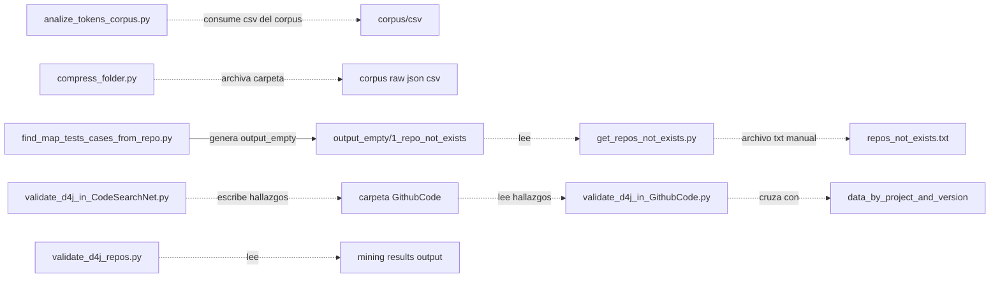

# 04 — Utilitarios fuera de pipeline

Sección de referencia sobre seis scripts que **no forman parte del flujo principal** (`find_map_tests_cases_from_repo.py` → `clean_duplicates_and_build_dataset.py` → `build_corpus.py` → `convert_json_corpus_to_csv_input.py`, documentado en [`01_ast_mapping.md`](docs/_sections/01_ast_mapping.md) y [`02_clean_and_corpus.md`](docs/_sections/02_clean_and_corpus.md)) ni del flujo de evaluación Defects4J (documentado en [`03_d4j_corpus.md`](docs/_sections/03_d4j_corpus.md)).

Archivos cubiertos: [`analize_tokens_corpus.py`](analize_tokens_corpus.py), [`compress_folder.py`](compress_folder.py), [`get_repos_not_exists.py`](get_repos_not_exists.py), [`validate_d4j_in_CodeSearchNet.py`](validate_d4j_in_CodeSearchNet.py), [`validate_d4j_in_GithubCode.py`](validate_d4j_in_GithubCode.py) y [`validate_d4j_repos.py`](validate_d4j_repos.py).

Caracterización común a los seis:

1. **Sin invocador aguas arriba.** Ningún script del repositorio los importa ni los ejecuta: no aparecen en invocaciones de `subprocess`, `os.system`, `run` ni `Popen` en el flujo principal, y ninguno expone una función consumida por otro módulo del repositorio.
2. **Sin consumidor aguas abajo.** Ninguna etapa del pipeline lee sus salidas. `analize_tokens_corpus.py` produce un JSON de estadísticas que solo se interpreta de forma manual; `compress_folder.py` archiva carpetas para transporte; las tres validaciones escriben únicamente a `stdout` o a JSON auxiliares fuera del árbol del corpus.
3. **Invocación manual.** Se ejecutan a mano en momentos puntuales de la investigación (auditoría de longitudes, empaquetado de artefactos, reintentos de minería, verificación de fuga de datos frente a corpus públicos).

Ninguna de las flechas discontinuas corresponde a una llamada automática dentro del repositorio.

---

## 1) Script analize_tokens_corpus.py

Utilitario que cuantifica la longitud en tokens de cada representación serializada del corpus para decidir la ventana de contexto (`max_length`) del modelo, se ejecuta una vez construido un corpus en formato CSV y antes de fijar la configuración de entrenamiento o de inferencia.

No se invoca desde ningún script del pipeline; se ejecuta manualmente.

### 1.1 `parse_args()`

[`parse_args()`](analize_tokens_corpus.py:110) define seis parámetros, todos con valor por defecto apuntando a un entorno Linux/WSL ajeno al workspace:

1.1.1 `--path_all_csv_corpus` (`type=str`): carpeta con los CSV del corpus; por defecto `/defects4j_with_dynamtests/corpus_only_public/csv` ([`analize_tokens_corpus.py:118-123`](analize_tokens_corpus.py:118)). La variante `/DynaMTests_project/corpus/csv` existe solo como línea comentada ([`121`](analize_tokens_corpus.py:121)).

1.1.2 `--corpus_type` (`type=str`, por defecto `all`): corpus a analizar; acepta `train`, `validation`, `test` o `all` ([`125-129`](analize_tokens_corpus.py:125)). No se valida el dominio: un valor distinto de `all` se usa literalmente como nombre de archivo.

1.1.3 `--analyzing_d4j_corpus` (`type=lambda x: bool(strtobool(x))`, por defecto `True`): indica si el corpus proviene del conjunto de evaluación Defects4J ([`131-135`](analize_tokens_corpus.py:131)). A diferencia de otros scripts, aquí se usa `strtobool`, por lo que la cadena `False` sí se convierte en falso.

1.1.4 `--output_file` (`type=str`): ruta del JSON de resultados; por defecto `/defects4j_with_dynamtests/corpus_only_public/corpus_token_analysis.json` ([`137-142`](analize_tokens_corpus.py:137)).

1.1.5 `--encoding` (`type=str`, por defecto `utf-8`): declarado y leído ([`144-148`](analize_tokens_corpus.py:144), asignado en [`170`](analize_tokens_corpus.py:170)) pero **nunca aplicado**: `pd.read_csv` se invoca sin `encoding` ([`27`](analize_tokens_corpus.py:27)). Es un parámetro inerte.

1.1.6 `--model_base` (`type=str`, por defecto `Salesforce/codet5p-220m`) y `--cacheDirHuggingFace` (`type=str`, por defecto `/huggingface_models/`) ([`150-160`](analize_tokens_corpus.py:150)).

### 1.2 Entradas

1.2.1 Nombres de archivo esperados dentro de `path_all_csv_corpus` ([`analize_tokens_corpus.py:23-24`](analize_tokens_corpus.py:23)): con `analyzing_d4j_corpus = True` se usa `<Proyecto>_methods.csv`; con `False`, `<split>.csv`.

1.2.2 Lista de proyectos en modo Defects4J ([`180`](analize_tokens_corpus.py:180)): `Closure`, `Cli`, `Codec`, `Collections`, `Compress`, `Csv`, `JxPath`, `Lang`, `Math`, `Gson`, `JacksonCore`, `JacksonDatabind`, `JacksonXml`, `Chart`, `Time`, `Jsoup`, `Mockito`. Lista de particiones en modo corpus principal ([`182`](analize_tokens_corpus.py:182)): `train`, `validation`, `test`.

1.2.3 Columnas requeridas por fila ([`33-39`](analize_tokens_corpus.py:33), usadas en [`57-61`](analize_tokens_corpus.py:57)): `target`, `src_fm_fc_ms_ff`, `src_fm_fc_dctx`, `src_fm_fc_dctx_priv`.

### 1.3 Procesamiento

1.3.1 [`analize_count_tokens()`](analize_tokens_corpus.py:22) lee el CSV completo con `pandas` ([`27`](analize_tokens_corpus.py:27)), sustituye `pd.NA` por `None` ([`28`](analize_tokens_corpus.py:28)) y materializa todas las filas en memoria con `df.to_dict(orient='records')` ([`30`](analize_tokens_corpus.py:30)). El tamaño por campo CSV se eleva a `10**6` caracteres con `csv.field_size_limit(10**6)` ([`14`](analize_tokens_corpus.py:14)) para evitar el límite por defecto de 131072.

1.3.2 Se inicializa un contador por representación con cuatro intervalos: `less_than_or_equal_512`, `in_range_512_and_1024`, `in_range_1024_and_2048`, `greater_than_2048` ([`41-53`](analize_tokens_corpus.py:41)).

1.3.3 Recorrido con `tqdm` ([`55`](analize_tokens_corpus.py:55)): en modo corpus principal se tokeniza también `target` ([`56-57`](analize_tokens_corpus.py:56), [`63-64`](analize_tokens_corpus.py:63)); en modo Defects4J `target` se omite por completo y al final se elimina la clave del resultado ([`70-71`](analize_tokens_corpus.py:70)).

1.3.4 [`analize_using_tokenizer()`](analize_tokens_corpus.py:76) tokeniza cada representación con `add_special_tokens=False` y `return_attention_mask=False` ([`77`](analize_tokens_corpus.py:77)) y clasifica la longitud resultante en uno de los cuatro intervalos ([`82-93`](analize_tokens_corpus.py:82)). La clasificación es acumulativa por intervalo cerrado-abierto: `<= 512`, `(512, 1024]`, `(1024, 2048]`, `> 2048`.

1.3.5 **Padding y truncamiento.** No se aplica ninguno de los dos: cada representación se tokeniza como una única secuencia, sin `padding`, sin `truncation` y sin `max_length` en la llamada. La asignación `tokenizer.model_max_length = 1024` ([`176`](analize_tokens_corpus.py:176)) solo modifica el atributo y se imprime ([`177`](analize_tokens_corpus.py:177)); no recorta las secuencias medidas. Por tanto, las longitudes registradas son las longitudes reales completas, lo que hace que el histograma mida la cola larga real del corpus.

1.3.6 **Percentiles.** No se calculan percentiles ni cuantiles: el script no usa `numpy.percentile` ni `pandas.Series.quantile`. El equivalente funcional es el histograma acumulado de cuatro intervalos, que permite leer de forma directa qué fracción del corpus cabe en 512, en 1024 y en 2048 tokens.

1.3.7 Cada tokenización hace `copy.deepcopy` del diccionario de conteos ([`95`](analize_tokens_corpus.py:95)), por lo que el utilitario es **intensivo en tokens y en memoria**: cuatro pases completos del tokenizador por fila (tres en modo Defects4J) más copias por celda. Se declara explícitamente como utilitario pesado y de ejecución puntual.

### 1.4 Dependencias externas

1.4.1 `transformers` (`AutoTokenizer`; `T5Config` se importa pero no se usa) ([`10`](analize_tokens_corpus.py:10)), `pandas` ([`6`](analize_tokens_corpus.py:6)), `tqdm` ([`9`](analize_tokens_corpus.py:9)) y `distutils.util.strtobool` ([`8`](analize_tokens_corpus.py:8)).

1.4.2 **Modelo requerido:** `Salesforce/codet5p-220m` ([`152`](analize_tokens_corpus.py:152)), cargado con `AutoTokenizer.from_pretrained(model_base, cache_dir=cache_dir_hf)` ([`175`](analize_tokens_corpus.py:175)). Es decir, el tokenizador de CodeT5+, no el de T5 estándar. Requiere acceso al caché local en `/huggingface_models/` o descarga desde Hugging Face Hub la primera vez.

### 1.5 Salidas

1.5.1 Un único JSON en `--output_file` ([`227`](analize_tokens_corpus.py:227)), escrito con `indent=4` y borrando el archivo previo si existe ([`98-107`](analize_tokens_corpus.py:98)).

1.5.2 Forma del JSON (solo claves): en el nivel superior, una clave por corpus procesado (`train`, `validation`, `test`, o cada proyecto Defects4J según `--corpus_type`); cada valor contiene las claves `total_rows` y `counts_by_input_type` ([`195-198`](analize_tokens_corpus.py:195)); `counts_by_input_type` contiene las claves de representación (`target`, `src_fm_fc_ms_ff`, `src_fm_fc_dctx`, `src_fm_fc_dctx_priv`; `target` ausente en modo Defects4J); cada representación contiene las cuatro claves de intervalo (`less_than_or_equal_512`, `in_range_512_and_1024`, `in_range_1024_and_2048`, `greater_than_2048`).

1.5.3 Además imprime el mismo contenido por `stdout` ([`214-222`](analize_tokens_corpus.py:214)) y los tiempos totales en segundos y formateados ([`230-235`](analize_tokens_corpus.py:230)).

### 1.6 Manejo de fallos y casos límite

1.6.1 No hay manejo de errores: un CSV inexistente produce `FileNotFoundError` de `pandas`; una columna faltante produce `KeyError` en [`59-61`](analize_tokens_corpus.py:59); una carpeta de salida inexistente produce `FileNotFoundError` al escribir ([`105`](analize_tokens_corpus.py:105)), porque no se crean directorios.

1.6.2 La sustitución de ausentes se declara sobre `pd.NA` ([`28`](analize_tokens_corpus.py:28)), no sobre `NaN`; si las columnas de texto contienen `NaN` (comportamiento típico de `pandas` en columnas `object`), ese valor llegaría al tokenizador y provocaría `TypeError`.

1.6.3 Con `--analyzing_d4j_corpus` en su valor por defecto (`True`), una ejecución sin argumentos busca `<Proyecto>_methods.csv` en una ruta absoluta externa; no hay detección de corpus vacío ni advertencia si `total_rows` es cero.

---

## 2) Script compress_folder.py

Utilitario que empaqueta una carpeta (o un archivo) en un archivo `.tar.bz2` para transportar o archivar artefactos del corpus, se usa al publicar o mover el corpus entre entornos (por ejemplo, del entorno Linux de minería al almacenamiento definitivo).

No se invoca desde ningún script del pipeline; se ejecuta manualmente.

### 2.1 `parse_args()`

[`parse_args()`](compress_folder.py:36) define tres parámetros:

2.1.1 `--input_folder_path` (`type=str`, **sin valor por defecto**): ruta de la carpeta (o del archivo, según `--type_input`) a comprimir ([`41-45`](compress_folder.py:41)). Si se omite, llega como `None` y falla en la comprobación de existencia.

2.1.2 `--output_path` (`type=str`, **sin valor por defecto**): ruta del `.tar.bz2` de salida ([`46-50`](compress_folder.py:46)).

2.1.3 `--type_input` (`type=str`, por defecto `folder`): selector de modo; cualquier valor distinto de `folder` activa el modo archivo único ([`51-56`](compress_folder.py:51), ramificación en [`69-72`](compress_folder.py:69)). El texto de ayuda contiene la errata `file or older` ([`55`](compress_folder.py:55)).

### 2.2 Entradas

2.2.1 Modo carpeta: un directorio existente ([`18-21`](compress_folder.py:18)).

2.2.2 Modo archivo: un archivo regular existente ([`6-9`](compress_folder.py:6)).

2.2.3 **Suposición de estructura:** no se inspecciona el contenido. Cualquier jerarquía es válida, pero el nombre del elemento de primer nivel dentro del archivo es siempre `os.path.basename` de la ruta recibida ([`14`](compress_folder.py:14), [`26`](compress_folder.py:26)).

### 2.3 Procesamiento

2.3.1 [`main()`](compress_folder.py:61) lee los tres parámetros ([`62-65`](compress_folder.py:62)) y delega en [`compress_folder_to_tar_bz2()`](compress_folder.py:18) o [`compress_file_to_tar_bz2()`](compress_folder.py:6) según `type_input` ([`69-72`](compress_folder.py:69)).

2.3.2 La compresión se realiza con `tarfile.open(output_path, "w:bz2")` ([`12`](compress_folder.py:12), [`24`](compress_folder.py:24)) y una única llamada a `tar.add()` ([`14`](compress_folder.py:14), [`26`](compress_folder.py:26)).

2.3.3 **Formato generado:** exclusivamente `.tar.bz2` (bzip2). No hay soporte para `.zip`, `.gz`, `.xz` ni niveles de compresión configurables.

2.3.4 **Sobrescritura:** `"w:bz2"` trunca el archivo de salida si ya existe; no hay comprobación previa ni mensaje de advertencia. Tampoco se crean los directorios intermedios de `output_path`.

2.3.5 **Relación con el árbol del corpus:** el uso previsto es archivar cada carpeta de partición de los tres formatos del corpus, es decir `corpus/raw/<split>`, `corpus/json/<split>` y `corpus/csv/<split>` (particiones `train`, `validation`, `test`), produciendo archivos hermanos `<split>.tar.bz2` dentro de `corpus/raw`, `corpus/json` y `corpus/csv`. Como `arcname` es el nombre base de la carpeta, el archivo contiene una carpeta raíz `<split>/` y no una ruta absoluta. Este script no lee ni valida el contenido del corpus; solo lo empaqueta.

### 2.4 Dependencias externas

2.4.1 Solo biblioteca estándar: `tarfile`, `os`, `argparse`, `time` ([`1-4`](compress_folder.py:1)). No requiere red ni paquetes de terceros.

### 2.5 Salidas

2.5.1 El archivo `.tar.bz2` indicado en `--output_path` y dos mensajes de progreso: el de compresión ([`15`](compress_folder.py:15), [`27`](compress_folder.py:27)) y los tiempos totales en segundos y formateados ([`77-79`](compress_folder.py:77)).

### 2.6 Manejo de fallos y casos límite

2.6.1 Se lanza `FileNotFoundError` explícito si la ruta de entrada no existe o no es del tipo esperado ([`8-9`](compress_folder.py:8), [`20-21`](compress_folder.py:20)).

2.6.2 Sin manejo de errores ante permisos insuficientes, disco lleno, interrupción del proceso (no hay escritura atómica ni archivo temporal) ni ante `output_path` dentro de la carpeta comprimida (incluiría el propio archivo en crecimiento).

2.6.3 No se imprimen recuentos de archivos ni tamaño antes/después, por lo que no hay verificación de integridad del empaquetado.

---

## 3) Script get_repos_not_exists.py

Utilitario que extrae los identificadores de repositorio que fallaron con el motivo *repositorio inexistente* durante una corrida de minería y los escribe en un archivo de texto para habilitar una corrida de reintento selectiva.

No se invoca desde ningún script del pipeline; se ejecuta manualmente.

### 3.1 Interfaz

3.1.1 No existe `parse_args()` ni lectura de argumentos: el script no tiene bloque `if __name__ == '__main__'` y ejecuta su lógica en el nivel de módulo al importarse o ejecutarse ([`22-36`](get_repos_not_exists.py:22)).

### 3.2 Entradas

3.2.1 [`list_carpetas()`](get_repos_not_exists.py:4) recibe una ruta y devuelve un `set` con los nombres de los elementos que son directorios ([`10-15`](get_repos_not_exists.py:10), [`19`](get_repos_not_exists.py:19)).

3.2.2 La ruta está fijada en el código: `/root/mining_results/train/output_empty/1_repo_not_exists` ([`22`](get_repos_not_exists.py:22)). Corresponde a la carpeta que el miner genera para el motivo de error número 1, con una subcarpeta por `repo_id` ([`copy_error_files("1_repo_not_exists/", ...)`](find_map_tests_cases_from_repo.py:156)). Solo se inspecciona la partición `train`.

### 3.3 Procesamiento

3.3.1 El conjunto de carpetas se acumula en `carpetas` mediante una única fuente (`outs_not_exists`) ([`24-27`](get_repos_not_exists.py:24)); las líneas que agregarían fuentes adicionales están comentadas.

3.3.2 Se ordena el conjunto y se convierte en lista ([`30`](get_repos_not_exists.py:30)).

3.3.3 Cada nombre de carpeta —es decir, cada `repo_id`— se escribe en una línea del archivo de salida ([`32-34`](get_repos_not_exists.py:32)).

3.3.4 No hay recursión: solo se consideran los directorios de primer nivel de la ruta indicada.

### 3.4 Dependencias externas

3.4.1 Solo biblioteca estándar: `os` ([`1`](get_repos_not_exists.py:1)). No hay dependencias de terceros ni acceso a red.

### 3.5 Salidas

3.5.1 Archivo de texto de una línea por `repo_id`, escrito en `/root/repos_not_exists.txt` ([`32`](get_repos_not_exists.py:32)). Sobre escritura (`'w'`): truncado silencioso del archivo previo.

3.5.2 Mensaje por `stdout` con el número de elementos exportados ([`36`](get_repos_not_exists.py:36)). El mensaje menciona el nombre `repos_not_exsits.txt`, que no coincide con la ruta real escrita.

### 3.6 Uso previsto para reintentos y vínculo con find_map_tests_cases_from_repo.py

3.6.1 El archivo `/root/repos_not_exists.txt` es consumido por [`get_repos_not_exists()`](find_map_tests_cases_from_repo.py:733) dentro del miner, que lo lee con la misma ruta fijada, elimina los saltos de línea y retorna la lista de identificadores ([`find_map_tests_cases_from_repo.py:736-742`](find_map_tests_cases_from_repo.py:736)).

3.6.2 En [`analyze_repositories()`](find_map_tests_cases_from_repo.py:745) la llamada `folders = get_repos_not_exists()` está **comentada** ([`find_map_tests_cases_from_repo.py:760`](find_map_tests_cases_from_repo.py:760)), igual que el `random.shuffle(folders)` ([`761`](find_map_tests_cases_from_repo.py:761)) y el filtro `if str(repo['repo_id']) in folders:` ([`765`](find_map_tests_cases_from_repo.py:765)); en el estado actual del repositorio se analizan todos los repositorios del archivo de entrada. Para ejecutar un reintento selectivo es necesario descomentar esas tres líneas manualmente.

3.6.3 Es decir, este utilitario **no es un productor ni un consumidor automático del pipeline**: materializa un archivo intermedio que el miner solo usa cuando se activa manualmente el modo reintento.

### 3.7 Manejo de fallos y casos límite

3.7.1 Si la ruta de entrada no existe, `os.listdir` lanza `FileNotFoundError` sin captura y el script termina sin escribir salida.

3.7.2 Si `/root` no existe o no es escribible, falla al abrir el archivo de salida ([`32`](get_repos_not_exists.py:32)).

3.7.3 El `set` elimina duplicados de forma silenciosa; un `repo_id` repetido en la carpeta no se reporta.

3.7.4 La ruta de entrada y la de salida son absolutas y de un `HOME` Linux; en Windows requieren ejecutar bajo WSL o editar el código fuente.

---

## 4) Script validate_d4j_in_CodeSearchNet.py

Utilitario de auditoría de fuga de datos que verifica si los repositorios y métodos focales del corpus Defects4J aparecen en los corpus públicos de preentrenamiento CodeSearchNet y `codeparrot/github-code`, se ejecuta después de construir el corpus de evaluación y antes de reportar resultados del modelo.

No se invoca desde ningún script del pipeline; se ejecuta manualmente.

### 4.1 Interfaz

4.1.1 No existe `parse_args()` ni bloque `main`: todo el flujo se ejecuta en el nivel de módulo ([`117-336`](validate_d4j_in_CodeSearchNet.py:117)). Las rutas son constantes en el código.

### 4.2 Entradas

4.2.1 Mapa proyecto Defects4J → identificador de repositorio GitHub ([`19-37`](validate_d4j_in_CodeSearchNet.py:19)): 17 proyectos (`Closure`, `Cli`, `Codec`, `Collections`, `Compress`, `Csv`, `JxPath`, `Lang`, `Math`, `Gson`, `JacksonCore`, `JacksonDatabind`, `JacksonXml`, `Chart`, `Time`, `JSoup`, `Mockito`).

4.2.2 Corpus de evaluación Defects4J en `/defects4j_with_dynamtests/corpus_only_public/data_by_project_and_version` ([`138`](validate_d4j_in_CodeSearchNet.py:138)), leído con [`get_focal_methods_by_d4j_project()`](validate_d4j_in_CodeSearchNet.py:54): recorre `<proyecto>/<version>/methods/<metodo>/metadata.json` ([`68-78`](validate_d4j_in_CodeSearchNet.py:68)) y extrae el cuerpo del método focal (`focal_method.body`) y la ruta del archivo de la clase focal (`focal_class.file`) ([`80-88`](validate_d4j_in_CodeSearchNet.py:80)).

4.2.3 Dataset CodeSearchNet: `load_dataset('irds/codesearchnet', 'docs', cache_dir='/CodeSearchNet/dataset')` ([`124`](validate_d4j_in_CodeSearchNet.py:124)), filtrado a `language == "java"` ([`126`](validate_d4j_in_CodeSearchNet.py:126)).

4.2.4 Dataset de código GitHub: `load_dataset("codeparrot/github-code", streaming=True, split="train", cache_dir='/CodeParrot_GithubCode/dataset')` ([`218-228`](validate_d4j_in_CodeSearchNet.py:218)).

### 4.3 Procesamiento

4.3.1 **Normalización** aplicada a ambos lados de la comparación: [`clean_comments_in_code()`](validate_d4j_in_CodeSearchNet.py:48) elimina comentarios con [`clean_comments()`](ParserUtils.py:101) y colapsa saltos de línea, tabulaciones y espacios múltiples con [`clean_tabs_and_new_lines()`](validate_d4j_in_CodeSearchNet.py:40); después se aplican sustituciones de espaciado alrededor de `.`, `){`, `(`, `)` y `[`/`]` ([`82`](validate_d4j_in_CodeSearchNet.py:82), [`287`](validate_d4j_in_CodeSearchNet.py:287)).

4.3.2 **Validación en CodeSearchNet (nivel repositorio)**: se construye el mapa inverso repositorio→proyecto ([`131-133`](validate_d4j_in_CodeSearchNet.py:131)) y se recorre el subconjunto Java contando documentos por proyecto ([`155-170`](validate_d4j_in_CodeSearchNet.py:155)). Artefacto validado: pertenencia de los 17 repositorios Defects4J a la partición de documentación Java de CodeSearchNet.

4.3.3 **Filtro del subconjunto de GitHub** ([`233-241`](validate_d4j_in_CodeSearchNet.py:233)): `language == "Java"`, licencia dentro de `mit`, `isc`, `apache-2.0`, `bsd-3-clause`, `bsd-2-clause`, `cc0-1.0`, `unlicense` (las mismas que usó CodeT5+), `repo_name` pertenece a un proyecto Defects4J, y `path` está en el conjunto de rutas de clases focales del corpus de evaluación.

4.3.4 **Filtro por longitud** ([`274-279`](validate_d4j_in_CodeSearchNet.py:274)): se tokeniza el archivo y se descartan los que tienen menos de 50 o más de 2000 tokens, replicando el criterio declarado de CodeT5+.

4.3.5 **Comparación a nivel de método**: los cuerpos de método del archivo se extraen con [`get_body_methods_from_class()`](ParserUtils.py:361) ([`292`](validate_d4j_in_CodeSearchNet.py:292)) y se comparan contra el conjunto normalizado de cuerpos focales del proyecto ([`298-310`](validate_d4j_in_CodeSearchNet.py:298)).

4.3.6 **Criterio de aprobado/fallado:** el archivo se considera un hallazgo (posible fuga) cuando su `repo_name` corresponde a un proyecto Defects4J, su `path` coincide exactamente con una ruta de clase focal del corpus de evaluación y contiene al menos un cuerpo de método idéntico —tras normalización— a un cuerpo focal de ese proyecto. Cualquier coincidencia indica que el par podría existir ya en el corpus de preentrenamiento y por tanto inflar los resultados. En CodeSearchNet el criterio es más débil: basta que el repositorio aparezca en el split de documentación Java.

### 4.4 Dependencias externas

4.4.1 `datasets` (`load_dataset`, filtrado sobre datasets en *streaming*) ([`11`](validate_d4j_in_CodeSearchNet.py:11)), `transformers` (`AutoTokenizer`; `T5Config` importado sin uso) ([`12`](validate_d4j_in_CodeSearchNet.py:12)), `pandas`, `tqdm`, `re` y [`ParserUtils`](ParserUtils.py) ([`10`](validate_d4j_in_CodeSearchNet.py:10)).

4.4.2 Tokenizador: `Salesforce/codet5p-220m` con caché en `/huggingface_models/` ([`118`](validate_d4j_in_CodeSearchNet.py:118)).

4.4.3 **Acceso a red y descarga masiva de datos:** requiere descargar `irds/codesearchnet` y transmitir `codeparrot/github-code` (dataset de escala de terabytes); el filtro sobre *streaming* recorre el dataset completo. Es el utilitario con mayor coste de ejecución de la sección.

### 4.5 Salidas

4.5.1 Por `stdout`: número total de documentos Java en CodeSearchNet ([`200`](validate_d4j_in_CodeSearchNet.py:200)), recuento por proyecto de documentos cuyo repositorio pertenece a Defects4J ([`202-204`](validate_d4j_in_CodeSearchNet.py:202)), total de archivos Java analizados de GitHub ([`324`](validate_d4j_in_CodeSearchNet.py:324)) y recuento de hallazgos por proyecto ([`326-328`](validate_d4j_in_CodeSearchNet.py:326)).

4.5.2 JSON por proyecto en `/CodeParrot_GithubCode/<Proyecto>.json` ([`330-332`](validate_d4j_in_CodeSearchNet.py:330)), con una lista de los ítems del dataset que contienen un cuerpo focal, cada uno con la clave adicional `focal_method_existing_in_d4j` ([`304-305`](validate_d4j_in_CodeSearchNet.py:304)). Escritura con `indent=4` y borrado previo del archivo ([`105-114`](validate_d4j_in_CodeSearchNet.py:105)).

### 4.6 Manejo de fallos y casos límite

4.6.1 **Fallo silencioso por diccionario vacío:** la condición de acumulación consulta `d4j_methods_existing_in_codesearch_net_validating_match` ([`307`](validate_d4j_in_CodeSearchNet.py:307)), un diccionario que nunca se llena porque el bloque que lo llenaba está comentado ([`178-188`](validate_d4j_in_CodeSearchNet.py:178)). El resultado es que se ejecuta siempre la rama `else` y **la lista del proyecto se reinicia en cada coincidencia** ([`310`](validate_d4j_in_CodeSearchNet.py:310)), conservando solo el último hallazgo del proyecto y sobrescribiendo los anteriores en el JSON.

4.6.2 `record['repo'].lower()` sin comprobación de nulo ([`159`](validate_d4j_in_CodeSearchNet.py:159)): un registro con `repo` ausente aborta el recorrido de CodeSearchNet.

4.6.3 `os.listdir` sobre `<proyecto>/<version>/methods` ([`72`](validate_d4j_in_CodeSearchNet.py:72)) no tolera versiones sin carpeta `methods`; no hay `try/except`.

4.6.4 Las variables `validate_against_d4j_dataset = True` ([`137`](validate_d4j_in_CodeSearchNet.py:137)) y los imports `Path` y `pprint` ([`7-8`](validate_d4j_in_CodeSearchNet.py:7)) no participan en la lógica.

4.6.5 Todas las rutas son absolutas y de un entorno Linux concreto; no hay parámetros para cambiarlas.

---

## 5) Script validate_d4j_in_GithubCode.py

Utilitario de auditoría que, a partir de los hallazgos JSON producidos por [`validate_d4j_in_CodeSearchNet.py`](validate_d4j_in_CodeSearchNet.py), identifica en qué versiones (bugs) del corpus Defects4J y en qué carpetas de método se materializa cada método focal encontrado en código público.

No se invoca desde ningún script del pipeline; se ejecuta manualmente.

### 5.1 Interfaz

5.1.1 Sin `parse_args()` ni bloque `main`: la lógica se ejecuta en el nivel de módulo ([`144-184`](validate_d4j_in_GithubCode.py:144)).

### 5.2 Entradas

5.2.1 Hallazgos del script anterior: un JSON por proyecto en `/CodeParrot_GithubCode/<Proyecto>.json` ([`153-158`](validate_d4j_in_GithubCode.py:153)).

5.2.2 Subconjunto de proyectos auditado, fijado en el código: `["Cli", "Compress", "JacksonCore", "JacksonDatabind"]` ([`152`](validate_d4j_in_GithubCode.py:152)), repetido en [`65`](validate_d4j_in_GithubCode.py:65). El resto de proyectos no se procesa.

5.2.3 Corpus de evaluación Defects4J en `/defects4j_with_dynamtests/corpus_only_public/data_by_project_and_version` ([`146`](validate_d4j_in_GithubCode.py:146)), leído con [`get_focal_methods_by_d4j_project()`](validate_d4j_in_GithubCode.py:54) incluyendo el diccionario de hallazgos como parámetro ([`54-57`](validate_d4j_in_GithubCode.py:54)).

### 5.3 Procesamiento

5.3.1 Construcción del índice de hallazgos: para cada proyecto, un diccionario `ruta de clase focal → conjunto de cuerpos focales ya normalizados` ([`150-171`](validate_d4j_in_GithubCode.py:150)). Los cuerpos provienen de la clave `focal_method_existing_in_d4j` de cada ítem ([`163-168`](validate_d4j_in_GithubCode.py:163)).

5.3.2 Recorrido del corpus de evaluación con la misma normalización del script 4: extracción de `focal_class.file` y `focal_method.body`, limpieza de comentarios y de espaciado ([`87-92`](validate_d4j_in_GithubCode.py:87)).

5.3.3 **Cruce:** si la ruta de la clase focal existe en el índice y el cuerpo focal normalizado pertenece al conjunto asociado a esa ruta, se registra el proyecto y la versión, agregando la carpeta de método ([`98-113`](validate_d4j_in_GithubCode.py:98)). Si la ruta no está en el índice, el método se descarta ([`98-99`](validate_d4j_in_GithubCode.py:98)).

5.3.4 **Criterio de aprobado/fallado:** un caso (proyecto, versión, carpeta de método) se considera afectado por posible fuga solo si coinciden simultáneamente la ruta de la clase focal y el cuerpo del método focal normalizado. La ausencia de impresión para una versión indica que ese método focal **no** se localizó en el subconjunto de código público auditado —es decir, el criterio de aprobado es la no coincidencia—. El script no emite un veredicto agregado; la lectura del resultado es manual.

### 5.4 Dependencias externas

5.4.1 `json`, `os`, `tqdm` y [`ParserUtils`](ParserUtils.py) ([`1-10`](validate_d4j_in_GithubCode.py:1)). Los imports de `pandas`, `Path`, `pprint` y `copy` no se usan; `datasets` y `transformers` están comentados ([`11-12`](validate_d4j_in_GithubCode.py:11)). No requiere red ni tokenizador.

### 5.5 Salidas

5.5.1 Solo `stdout`: total de clases focales procesadas ([`178`](validate_d4j_in_GithubCode.py:178)) y, por proyecto y versión, el conjunto de carpetas de método coincidentes ([`180-184`](validate_d4j_in_GithubCode.py:180)). No se escribe ningún archivo.

### 5.6 Manejo de fallos y casos límite

5.6.1 **`KeyError` por proyecto faltante:** `findings_by_d4j_project[d4j_project]` se indexa directamente ([`70`](validate_d4j_in_GithubCode.py:70)) para cada proyecto de la lista fija; si el JSON correspondiente no existe (porque el script 4 no lo generó) el diccionario no contiene la clave y el script aborta. Solo se protege la lectura del archivo con `os.path.exists` ([`156`](validate_d4j_in_GithubCode.py:156)).

5.6.2 No se validan las claves `path` ni `focal_method_existing_in_d4j` de los hallazgos ([`162-168`](validate_d4j_in_GithubCode.py:162)); un JSON con formato distinto produce `KeyError`.

5.6.3 Dependencia de estado: el resultado es correcto solo si el JSON de entrada fue generado con el mismo corpus de evaluación; no hay verificación de versión ni de fecha.

---

## 6) Script validate_d4j_repos.py

Utilitario que comprueba si los identificadores numéricos de repositorio GitHub de los 17 proyectos Defects4J están presentes en el árbol de salida de la minería, se ejecuta una vez terminada la minería para verificar de forma rápida que los proyectos de evaluación fueron efectivamente minados.

No se invoca desde ningún script del pipeline; se ejecuta manualmente.

### 6.1 Interfaz

6.1.1 No existe `parse_args()` ni bloque `main`: la ejecución es de nivel de módulo ([`49-55`](validate_d4j_repos.py:49)).

### 6.2 Entradas

6.2.1 Diccionario `DEFECTS4J_PROJECTS_BY_REPO_ID` con clave numérica de repositorio GitHub y valor descriptivo `Proyecto -> URL` ([`9-27`](validate_d4j_repos.py:9)): `18845024` (Closure), `212343` (Cli), `206371` (Codec), `206362` (Collections), `2580769` (Compress), `10637893` (Csv), `11304840` (JxPath), `206378` (Lang), `24928494` (Math), `32538871` (Gson), `3037907` (JacksonCore), `3038937` (JacksonDatabind), `1210290` (JacksonXml), `50873393` (Chart), `1756350` (Time), `442430` (JSoup), `6207167` (Mockito).

6.2.2 Árbol de minería: `get_total_repos()` recorre los elementos de primer nivel de la ruta recibida, conserva solo los directorios y convierte el nombre a entero ([`29-46`](validate_d4j_repos.py:29)).

6.2.3 Ruta fijada en el código, con separadores Windows: `E:/000_Tesis/DynaMTests/mining_results/train/output` ([`49`](validate_d4j_repos.py:49)). Solo se inspecciona la partición `train` y la carpeta `output` (no `output_empty`).

### 6.3 Procesamiento

6.3.1 Se obtienen el total y la lista de `repo_id` presentes ([`50`](validate_d4j_repos.py:50)).

6.3.2 Para cada `repo_id`, si está en el diccionario se imprime `Si existe el repo: {repo_id}` ([`53-55`](validate_d4j_repos.py:53)).

6.3.3 **Criterio de aprobado/fallado:** un proyecto se considera correctamente minado si existe el directorio `<ruta>/<repo_id>` y ese identificador figura en el diccionario de referencia, es decir, coincidencia entre el `repo_id` del árbol de minería y el `repo_id` numérico esperado del proyecto Defects4J. El script no distingue entre "proyecto minado con casos" y "proyecto minado sin casos"; la existencia del directorio es la única evidencia.

### 6.4 Dependencias externas

6.4.1 Solo biblioteca estándar: `os` ([`1`](validate_d4j_repos.py:1)). `argparse`, `json`, `shutil`, `time` y `tqdm` se importan pero no se usan ([`2-6`](validate_d4j_repos.py:2)).

### 6.5 Salidas

6.5.1 Solo `stdout`, una línea por coincidencia ([`55`](validate_d4j_repos.py:55)). No se escribe archivo, no se imprime el total de repositorios del árbol ni la lista de proyectos ausentes; la variable `count` se calcula y no se usa ([`50`](validate_d4j_repos.py:50)).

### 6.6 Manejo de fallos y casos límite

6.6.1 `int(elemento)` sobre nombres de directorio no numéricos lanza `ValueError` sin captura ([`40`](validate_d4j_repos.py:40)); cualquier carpeta auxiliar creada dentro de `output` (temporales, `.git`, logs) rompe la ejecución.

6.6.2 Si la ruta no existe, `os.listdir` lanza `FileNotFoundError` ([`35`](validate_d4j_repos.py:35)); la ruta está escrita con `E:/...`, por lo que no es portable fuera de la máquina del autor.

6.6.3 El resultado es **silencioso por ausencia**: los proyectos del diccionario que no aparecen en el árbol simplemente no se imprimen, sin resumen negativo explícito.

---

## 7) Tabla resumen de utilitarios

| Script | Momento de uso | Entrada | Salida | Dependencias externas | Riesgo principal |
|---|---|---|---|---|---|
| [`analize_tokens_corpus.py`](analize_tokens_corpus.py) | Tras construir el corpus CSV y antes de fijar la ventana del modelo | CSV del corpus en `--path_all_csv_corpus` (`<split>.csv` o `<Proyecto>_methods.csv`) con columnas `target`, `src_fm_fc_ms_ff`, `src_fm_fc_dctx`, `src_fm_fc_dctx_priv` | JSON `--output_file` con clave por corpus → `total_rows` y `counts_by_input_type` → 4 intervalos de longitud; impresión por `stdout` | `transformers` (`AutoTokenizer` de `Salesforce/codet5p-220m`), `pandas`, `tqdm`; descarga del tokenizador si falta caché | Consumo alto de memoria y de tiempo por tokenizar 4 representaciones por fila; `--encoding` inerte; ausentes `NaN` pueden romper el tokenizador |
| [`compress_folder.py`](compress_folder.py) | Al archiviar o transportar carpetas del corpus | Carpeta o archivo en `--input_folder_path` | `.tar.bz2` en `--output_path` con carpeta raíz igual al nombre base | Solo biblioteca estándar (`tarfile`) | Sobrescritura silenciosa del archivo destino; sin creación de directorios; sin verificación de integridad; bzip2 monohilo lento |
| [`get_repos_not_exists.py`](get_repos_not_exists.py) | Después de una corrida de minería con repositorios inaccesibles, antes de un reintento selectivo | Carpeta fijada `/root/mining_results/train/output_empty/1_repo_not_exists` | `/root/repos_not_exists.txt` con un `repo_id` por línea | Solo `os` | Rutas absolutas de `HOME` Linux sin parámetros; ejecución en nivel de módulo; el consumidor en el miner está comentado, por lo que el archivo queda huérfano |
| [`validate_d4j_in_CodeSearchNet.py`](validate_d4j_in_CodeSearchNet.py) | Auditoría de fuga, después de construir el corpus de evaluación | Corpus `data_by_project_and_version`, `irds/codesearchnet` (docs Java) y `codeparrot/github-code` en streaming | JSON por proyecto en `/CodeParrot_GithubCode/<Proyecto>.json` con `focal_method_existing_in_d4j`; recuentos por `stdout` | `datasets`, `transformers`, `ParserUtils`, `pandas`, `tqdm`; red y descarga masiva | Reinicio silencioso de la lista de hallazgos por diccionario siempre vacío; rutas fijas; sin manejo de `repo` nulo |
| [`validate_d4j_in_GithubCode.py`](validate_d4j_in_GithubCode.py) | Auditoría de fuga, después del script anterior | JSON de hallazgos en `/CodeParrot_GithubCode` para `Cli`, `Compress`, `JacksonCore`, `JacksonDatabind` y corpus `data_by_project_and_version` | Solo `stdout`: proyecto → versión → carpetas de método coincidentes | `ParserUtils`, `tqdm` | `KeyError` si falta el JSON de un proyecto de la lista fija; cruce limitado a 4 proyectos; sin salida persistente ni veredicto agregado |
| [`validate_d4j_repos.py`](validate_d4j_repos.py) | Verificación rápida al terminar la minería | Árbol `mining_results/train/output` con subcarpetas numéricas de `repo_id` | Solo `stdout`: `Si existe el repo: <id>` | Solo `os` | Ruta Windows fija; `ValueError` ante cualquier carpeta no numérica; los proyectos ausentes no se reportan |
