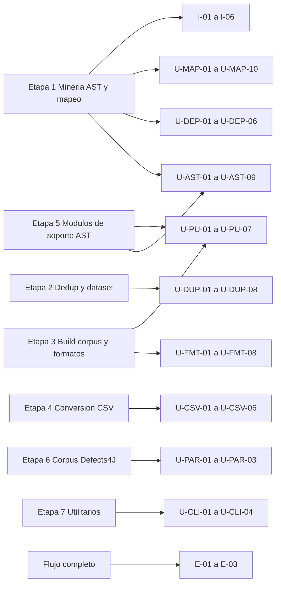

# DynaMTests — Plan de batería de pruebas con `pytest`

**Estado:** PLAN (no implementado). Este documento es el contrato para la futura implementación.
**Alcance:** diseñar la estructura, la matriz de pruebas, las fixtures, la estrategia de ejecución y el criterio de aceptación de una batería `pytest` que cubra las etapas 1–7 del pipeline documentado en [`PIPELINE_STEPS.md`](PIPELINE_STEPS.md:1).
**Prohibiciones respetadas al redactar este plan:** no se creó ningún archivo `.py`, no se modificó ningún fuente, no se ejecutó el pipeline, no se clonó ningún repositorio, no se accedió a `corpus/`, `dataset/`, `repos/`, `defects4j_corpus/`, `mining_results/`, ni a archivos `*.csv` / `*.json` distintos de [`repos_prueba.json`](tests/fixtures/repos_prueba.json:1).

Convención de etiquetas (heredada de la documentación): las etiquetas conceptuales `FM_FC_MS_FF` y `FM_FC_DCTX` **no existen como literales** en el código; corresponden a las variables `src_fm_fc_ms_ff`, `src_fm_fc_dctx` y la variante extra `src_fm_fc_dctx_priv`, emitidas por [`build_format_corpus()`](build_corpus.py:416).

---

## 0) Obstáculos de implementación que el plan resuelve

| # | Obstáculo | Evidencia (`file:line`) | Solución adoptada en el plan |
|---|---|---|---|
| O1 | Credenciales GitHub leídas por índice directo en tiempo de importación → `KeyError` antes de ejecutar cualquier test | [`GITHUB_USER`](find_map_tests_cases_from_repo.py:32), [`GITHUB_TOKEN`](find_map_tests_cases_from_repo.py:33) | `tests/conftest.py` ejecuta `os.environ.setdefault("GITHUB_USER", ...)` y `...("GITHUB_TOKEN", ...)` **en la cabecera del conftest** (antes de que cualquier test importe el módulo). Ningún `test_*.py` importa el módulo en el nivel superior: se obtiene con la fixture `fm_repo_module`, que hace `importlib.import_module` y, si hubo un import previo fallido, `importlib.reload`. |
| O2 | Módulos de raíz sin paquete y con nombres colisionables (`ClassParser`, `ParserUtils`, `git`, `command_runner`) | [`from ClassParser import ClassParser`](find_map_tests_cases_from_repo.py:18), [`from ParserUtils import ParserUtils`](build_corpus.py:8) | `conftest.py` inserta el *rootdir* al inicio de `sys.path` (`sys.path.insert(0, str(ROOT))`). Para módulos homónimos entre sí (`test_clean_duplicates` importa `clean_duplicates_and_build_dataset`) se usa `importlib.util.spec_from_file_location` en `tests/helpers/module_loader.py`, que registra el módulo bajo un alias único (`dynamtests_build_corpus`, `dynamtests_build_corpus_d4j`, ...) para evitar colisiones en `sys.modules`. |
| O3 | `match_test_cases()` resuelve por `list.index()` sobre nombres → insensible a sobrecargas | [`focal_methods_names_norm.index()`](find_map_tests_cases_from_repo.py:614) | Se **bloquea el comportamiento actual** (U-MAP-06: `runSomeVoid` sobrecargado mapea siempre a la primera declaración) y se añade el test deseado marcado `@pytest.mark.xfail_spoon(strict=True)` (U-MAP-07). |
| O4 | `--validate_against_d4j_dataset` con `type=bool` → `"False"` se convierte en `True` | [`type=bool`](build_corpus.py:744) | U-CLI-01 documenta el bug (`args == True`), U-CLI-02 es el `xfail` con el comportamiento deseado. |
| O5 | `grep` vía `subprocess.check_output(..., shell=True)` → dependencia de shell | [`grep -l -r @Test`](find_map_tests_cases_from_repo.py:220) | Ningún test depende de `grep`: I-01/I-03 monkeypatchean `subprocess.check_output` del módulo cargado y trabajan sobre un árbol temporal pre-construido (`tmp_path`). |
| O6 | `open()` fuera del `try` en `parse_file()` → `FileNotFoundError` propaga (no devuelve `[]`) | [`with open(file, 'r')`](ClassParser.py:41) | U-AST-09 fija el comportamiento real con `pytest.raises(FileNotFoundError)`. |
| O7 | `body is None` provoca `TypeError` **antes** del filtro previsto | [`method_src_code + test_src_code`](clean_duplicates_and_build_dataset.py:103) vs [filtro `None`](clean_duplicates_and_build_dataset.py:115) | U-DUP-03 fija el `TypeError`; U-DUP-04 es el `xfail` del comportamiento deseado (descartar sin abortar). |
| O8 | `build_format_corpus()` está duplicado literalmente en dos módulos | [`build_corpus.py:416`](build_corpus.py:416) y [`build_corpus_d4j.py:375`](build_corpus_d4j.py:375) | Bloque U-PAR de paridad (3 tests) para impedir deriva. |

---

## A) Estructura propuesta de `tests/`

```text
tests/
├── TEST_PLAN.md                  # este documento
├── README.md                     # cómo ejecutar, markers, deps, troubleshooting de import
├── conftest.py                   # env vars ANTES de importar + sys.path + fixtures globales
├── pytest.ini                    # (alternativa: sección [tool.pytest.ini_options] en pyproject.toml)
├── helpers/
│   ├── __init__.py
│   └── module_loader.py          # load_module_from_path(): spec_from_file_location + alias único
├── fixtures/
│   ├── __init__.py
│   ├── metadata_samples.py       # dicts hechos a mano (metadata_focal_context, metadata_empty_priv, ...)
│   ├── mining_samples.py         # builders de JSON sintéticos de minería (make_mtc_json)
│   └── java/
│       └── BrokenClass.java.txt  # fuente Java malformada (fixture de U-AST-06)
├── unit/
│   ├── test_class_parser.py          # U-AST-*
│   ├── test_parser_utils.py          # U-PU-*
│   ├── test_dependency_parser_utils.py # U-DEP-*
│   ├── test_match_test_cases.py      # U-MAP-*
│   ├── test_build_format_corpus.py   # U-FMT-*  + literales exactos
│   ├── test_clean_duplicates.py      # U-DUP-*
│   ├── test_convert_csv.py           # U-CSV-*
│   ├── test_build_corpus_parity.py   # U-PAR-*
│   └── test_cli_args.py              # U-CLI-*
├── integration/
│   ├── test_find_map_test_cases.py   # I-01..I-03
│   └── test_parse_and_match.py       # I-04..I-06
└── regression/
    ├── test_known_bugs.py            # bloqueos de comportamiento actual (U-AST-09, U-DUP-03, U-CLI-01, U-MAP-06)
    └── test_spoon_desired.py         # todos los xfail_spoon (U-MAP-07, U-DUP-04, U-CLI-02)
```

| Archivo | Responsabilidad | Por qué existe |
|---|---|---|
| `tests/conftest.py` | (1) `os.environ.setdefault` de `GITHUB_USER`/`GITHUB_TOKEN` en la primera línea ejecutable; (2) inserción del *rootdir* en `sys.path`; (3) fixtures globales (`java_tmp_tree`, `mining_tmp_tree`, `metadata_focal_context`, `no_network`, `env_github`, `repo_prueba_payload`, `fm_repo_module`, `parser_utils`). | Es el **único** punto que se ejecuta antes de cualquier `import` de los módulos del pipeline; resuelve O1 y O2 sin tocar producción. |
| `tests/helpers/module_loader.py` | Carga por ruta con `importlib.util.spec_from_file_location` y alias estable. | `build_corpus.py` y `build_corpus_d4j.py` comparten nombres de función/símbolos globales; cargarlos con alias distintos permite compararlos en el mismo proceso (U-PAR). |
| `tests/fixtures/*` | Datos de entrada deterministas y legibles (dicts y JSON sintéticos), sin dependencia de `corpus/` ni de `dataset/`. | Mantiene los tests herméticos y cumpliendo `.rooignore`. |
| `tests/unit/` | Una función pura por archivo, asserts exactos. | Fallos localizables; `pytest -m unit` es el ciclo rápido. |
| `tests/integration/` | Colaboración entre 2–3 funciones reales sobre árboles temporales. | Detecta roturas de contrato (p. ej. `parse_test_cases` ↔ `match_test_cases`). |
| `tests/regression/` | Separa “comportamiento actual feo pero real” de “comportamiento deseado post-Spoon”. | Evita que un `xfail` se confunda con un test roto y permite borrar el bloque entero tras la migración. |
| `tests/README.md` | Cómo correr (`pytest -m unit`, `pytest -m "not slow"`), deps, cómo exportar `GITHUB_USER`/`GITHUB_TOKEN` si se ejecuta fuera de `conftest`, y explicación de `xfail_spoon`. | Onboarding de terceros y trazabilidad de la decisión de fijar bugs. |
| `tests/pytest.ini` | `testpaths`, `markers`, `addopts`, `filterwarnings`. | Un único lugar para la política de ejecución (ver sección D). |

---

## B) Matriz de pruebas

Columnas: `ID` | `Nivel` | `Archivo objetivo` | `Función bajo prueba` | `Fixture` | `Entrada` | `Aserción exacta` | `Tipo`.

### B.1 AST / Tree-sitter — `ClassParser`

| ID | Nivel | Objetivo | Función (`file:line`) | Fixture | Entrada | Aserción exacta | Tipo |
|---|---|---|---|---|---|---|---|
| U-AST-01 | unit | `ClassParser.py` | [`parse_file()`](ClassParser.py:32) | `java_tmp_tree` | `.../focals/FocalContext.java` | `len(classes) == 3`; `[c['class_name'] for c in classes] == ['FocalContext', 'ExternalContext04', 'ExternalContext04Test']` | normal |
| U-AST-02 | unit | `ClassParser.py` | [`parse_file()`](ClassParser.py:32) + [`get_class_metadata()`](ClassParser.py:300) | `java_tmp_tree` | idem | `c['class_name'] == 'FocalContext'`; `c['package'] == 'package com.eljavatar.focals;'`; `len(c['imports']) == 9`; `c['has_constructor'] is True`; `c['superclass'] == 'extends Parent'`; `c['interfaces'] == 'implements IAction, Clonable'`; `c['class_signature'] == 'public class FocalContext extends Parent implements IAction, Clonable'` | normal |
| U-AST-03 | unit | `ClassParser.py` | [`get_class_fields()`](ClassParser.py:368) | `java_tmp_tree` | idem | `[(f['var_name'], f['type'], f['modifier']) for f in c['fields']] == [('ext01','ExternalContext01','private'), ('fromSamePackExt01','SamePackageExternal01','private')]` | normal |
| U-AST-04 | unit | `ClassParser.py` | [`parse_file()`](ClassParser.py:32) | `java_tmp_tree` | idem | `[(m['method_name'], len(m['parameters_list'])) for m in c['methods']] == [('FocalContext',0), ('FocalContext',1), ('doSomething',5), ('callSomeMethod',1), ('runSomeVoid',1), ('runSomeVoid',1), ('runSomeVoid',1), ('runSomeVoid',1)]` | normal |
| U-AST-05 | unit | `ClassParser.py` | [`get_function_metadata()`](ClassParser.py:443) | `java_tmp_tree` | idem | constructores: `[m['is_constructor'] for m in c['methods']].count(True) == 2`; y `[m['modifiers'] for m in c['methods'] if m['method_name']=='runSomeVoid']` contiene exactamente 2 entradas con `'private'`; `all(m['is_testcase'] is False for m in c['methods'])` | normal |
| U-AST-06 | unit | `ClassParser.py` | [`parse_file()`](ClassParser.py:32) | `tmp_path` + `java/BrokenClass.java.txt` | archivo con `public class Broken { void x( }` | `parse_file(...) == []` (política: solo código sintácticamente válido, [`has_error` → `[]`](ClassParser.py:62)) | borde |
| U-AST-07 | unit | `ClassParser.py` | [`parse_file()`](ClassParser.py:32) | `java_tmp_tree` | `MyClass.java` | `len(classes) == 1`; `c['class_name'] == 'MyClass'`; `c['class_signature'] == '@AllConstructors\npublic class MyClass<T> extends Parent implements IAction, Clonable'`; `len(c['imports']) == 6` (duplicado `import org.junit.Assert;` conservado: [`import_list`](ClassParser.py:70) no deduplica) | normal |
| U-AST-08 | unit | `ClassParser.py` | [`get_static_imports()`](ClassParser.py:1542) / [`get_class_imports()`](ClassParser.py:1561) | `java_tmp_tree` | `FocalContext.java` | `get_static_imports(imports) == {'getSomeStrFrom03':'ExternalContext03','getSomeStrFrom04':'ExternalContext04','STATIC_INT_VAL':'StaticExternal01','nonNull':'Objects'}`; `get_class_imports(imports) == ['ExternalContext01','ExternalContext02','StaticExternal01','List','Map']` | normal |
| U-AST-09 | unit | `ClassParser.py` | [`parse_file()`](ClassParser.py:32) | ninguna | ruta inexistente | `pytest.raises(FileNotFoundError)` — el `open()` está fuera del `try` ([`ClassParser.py:41`](ClassParser.py:41)); **NO** retorna `[]` | regresión |

### B.2 `ParserUtils` sobre cadenas Java mínimas

| ID | Nivel | Objetivo | Función (`file:line`) | Fixture | Entrada | Aserción exacta | Tipo |
|---|---|---|---|---|---|---|---|
| U-PU-01 | unit | `ParserUtils.py` | [`clean_comments()`](ParserUtils.py:101) | `parser_utils` | `"int a = 1; // c\nint b = 2;"` | `== "int a = 1;  \nint b = 2;"` (el comentario se sustituye por un espacio, [`ParserUtils.py:163`](ParserUtils.py:163); no se colapsan espacios ni se hace `strip`) | normal |
| U-PU-02 | unit | `ParserUtils.py` | [`clean_comments()`](ParserUtils.py:101) | `parser_utils` | `"int a = 1; /* x */ int b = 2;"` | `== "int a = 1;   int b = 2;"` (comentario de bloque → `" "`, [`ParserUtils.py:141`](ParserUtils.py:141)) | borde |
| U-PU-03 | unit | `ParserUtils.py` | [`clean_annotations()`](ParserUtils.py:173) | `parser_utils` | `'@Override public String toString() { return ""; }'` | `== 'public String toString() { return ""; }'` | normal |
| U-PU-04 | unit | `ParserUtils.py` | [`fix_type_parameters_inconsistences()`](ParserUtils.py:314) | `parser_utils` | `'public<T> <T> MyConstructor() { }'` | `== 'public <T> MyConstructor() { }'` (elimina el nodo `type_parameters` bajo el nodo de error, [`ParserUtils.py:342-345`](ParserUtils.py:342), y colapsa espacios). *Derivado analíticamente: si la versión de `tree-sitter` produce otro nodo de error, congelar el literal en la primera corrida y dejar además `result.count('<T>') == 1` como invariante.* | normal |
| U-PU-05 | unit | `ParserUtils.py` | [`method_body_is_empty()`](ParserUtils.py:66) | `parser_utils` | (a) `'public void a() { }'` (b) `'public void a() { return; }'` (c) `'public abstract void a();'` | (a) `is True`; (b) `is False`; (c) `is True` (sin nodo `body`, [`ParserUtils.py:81-83`](ParserUtils.py:81)) | normal + borde |
| U-PU-06 | unit | `ParserUtils.py` | [`validate_if_code_has_errors()`](ParserUtils.py:30) | `parser_utils` | (a) `('public class X { void a( }', True)` (b) `('public class X { }', True)` (c) `('public FocalContext { }', False)` (tolerante) (d) `('public class X { }', False)` | (a) `True` (b) `False` (c) `False` — todos los *missing* son `identifier`, [`ParserUtils.py:47-59`](ParserUtils.py:47) (d) `False` | normal + borde |
| U-PU-07 | unit | `ParserUtils.py` | [`fix_close_type_parameter_sig_class()`](ParserUtils.py:277) | `parser_utils` | `'public class SomeClass<T'` | `== 'public class SomeClass<T>'` y `'{' not in result and '}' not in result` ([`ParserUtils.py:307`](ParserUtils.py:307)) | borde |

### B.3 Dependencias externas — origen de `FM_FC_DCTX`

| ID | Nivel | Objetivo | Función (`file:line`) | Fixture | Entrada | Aserción exacta | Tipo |
|---|---|---|---|---|---|---|---|
| U-DEP-01 | unit | `dependency_parser_utils.py` | [`parse_potential_focal_and_external_dependencies()`](dependency_parser_utils.py:113) | `java_tmp_tree` | `parsed_classes` de `FocalContext.java` + `all_focal_java_files` = los 10 `.java` de `tests/fixtures/java/sample_java_repo/src/main` | `set(d['class_name'] for d in meth['external_dependencies']) == {'ExternalContext01','SamePackageExternal01','ExternalContext02','ExternalContext03','ExternalContext04','StaticExternal01'}` — justificación: `ExternalContext01` (campo + import + `ExternalContext01::methodReference`), `SamePackageExternal01` (campo `fromSamePackExt01`, resuelto por paquete [`dependency_parser_utils.py:243`](dependency_parser_utils.py:243)), `ExternalContext02/03` (import + paquete, fusionados por firma [`dependency_parser_utils.py:380-407`](dependency_parser_utils.py:380)), `ExternalContext04` (static import + clase en el mismo archivo [`dependency_parser_utils.py:257`](dependency_parser_utils.py:257)), `StaticExternal01` (import + static import de `STATIC_INT_VAL`) | normal |
| U-DEP-02 | unit | `dependency_parser_utils.py` | idem | `java_tmp_tree` | idem | `all('.' not in d['class_name'] for d in deps)` — `Map.Entry` se descarta por contener punto ([`dependency_parser_utils.py:222-223`](dependency_parser_utils.py:222)) | normal |
| U-DEP-03 | unit | `dependency_parser_utils.py` | idem | `java_tmp_tree` | idem | `{d['class_name']: d['has_constructor'] for d in deps} == {'ExternalContext01': True, 'SamePackageExternal01': False, 'ExternalContext02': False, 'ExternalContext03': False, 'ExternalContext04': False, 'StaticExternal01': True}` | normal |
| U-DEP-04 | unit | `dependency_parser_utils.py` | idem + [`extract_info_from_dependency()`](dependency_parser_utils.py:322) | `java_tmp_tree` | idem | dep `SamePackageExternal01`: `d['class_signature'] == 'public class SamePackageExternal01'`; `d['fields'] == []`; `[m['full_signature_parameters'] for m in d['methods']] == ['public String getSomeStrFromSamePackExt01()']` | normal |
| U-DEP-05 | unit | `dependency_parser_utils.py` | `extract_info_from_dependency()` | `java_tmp_tree` | idem | dep `ExternalContext01`: `'public String methodReference();' in sigs` y `'private String methodReference(Long val);' not in sigs` (privado excluido por [`get_used_fields_from_external_dependency`/`allow_private=False`](dependency_parser_utils.py:350) y [`get_methods_from_external_dependency`](dependency_parser_utils.py:560)) | normal |
| U-DEP-06 | unit | `dependency_parser_utils.py` | idem | `java_tmp_tree` + árbol sintético `pkg/Ext.java` + `pkg/Focal2.java` | focal invoca `ext.missingMethod()`; `Ext` no lo declara | `d['undefined_methods']` contiene una entrada que empieza por `'missingMethod'` (bucket creado en [`dependency_parser_utils.py:594-599`](dependency_parser_utils.py:594)) y las claves de cada dep son exactamente `{'class_name','external_dependency','superclass','interfaces','class_signature','has_constructor','fields','methods','undefined_methods'}` ([`dependency_parser_utils.py:414-424`](dependency_parser_utils.py:414)) | normal + borde |

### B.4 Las tres heurísticas de `match_test_cases()` + casos de fallo

Fixture requerida (ver sección C.3): [`tests/fixtures/java/sample_java_repo/src/test/com/eljavatar/focals/FocalContextTest.java`](tests/fixtures/java/sample_java_repo/src/test).

| ID | Nivel | Objetivo | Función (`file:line`) | Fixture | Entrada (método del test fixture) | Aserción exacta | Tipo |
|---|---|---|---|---|---|---|---|
| U-MAP-01 | unit | `find_map_tests_cases_from_repo.py` | [`match_test_cases()`](find_map_tests_cases_from_repo.py:581), estrategia 1 ([`612-615`](find_map_tests_cases_from_repo.py:612)) | `metadata_focal_context` + `match_inputs_real` | `testDoSomething()` → nombre normalizado `dosomething` | `len(mapped) == 1`; `mapped[0]['focal_method']['method_name'] == 'doSomething'`; `mapped[0]['focal_method']['parameters'] == 'int val'`; `'method_dependencies_by_class' not in mapped[0]['test_case']` | normal |
| U-MAP-02 | unit | idem | idem | idem | `DoSomethingTest()` → `dosomething` (sufijo `test` recortado, [`604-605`](find_map_tests_cases_from_repo.py:604)) | `mapped[0]['focal_method']['method_name'] == 'doSomething'` | normal |
| U-MAP-03 | unit | idem | estrategia 2, invocación única ([`632-666`](find_map_tests_cases_from_repo.py:632)) | idem | `verifyBehaviour() { new FocalContext().runSomeVoid("x"); }` | `len(mapped) == 1`; `mapped[0]['focal_method']['parameters'] == 'String val'`; log contiene `'> [Single-Invocation] Found Focal-Method:'` ([`666`](find_map_tests_cases_from_repo.py:666)) | normal |
| U-MAP-04 | unit | idem | ambigüedad ([`644-646`](find_map_tests_cases_from_repo.py:644)) | idem | `verifyAmbiguous()` con 2 invocaciones a la clase focal (`runSomeVoid("x")` y `callSomeMethod(1)`) | `mapped == []` | borde |
| U-MAP-05 | unit | idem | 0 invocaciones | idem | `verifyNoInvocation() { Assert.assertEquals(1, 1); }` | `mapped == []` (`extract_methods_from_focal_class` vacío, [`652`](find_map_tests_cases_from_repo.py:652)) | borde |
| U-MAP-06 | unit | idem | `list.index()` insensible a sobrecargas ([`614`](find_map_tests_cases_from_repo.py:614)) | idem | `runSomeVoidTest() { new FocalContext().runSomeVoid(1L); }` | **bloqueo del bug**: `mapped[0]['focal_method']['parameters'] == 'String val'` (primera `runSomeVoid` en orden de declaración, [`FocalContext.java:83`](tests/fixtures/java/sample_java_repo/src/main/com/eljavatar/focals/FocalContext.java:83)) aunque la invocación real recibe `Long`; `len(mapped) == 1` | regresión |
| U-MAP-07 | unit | idem | resolución por aridad/tipo (deseada) | idem | idem U-MAP-06 | `mapped[0]['focal_method']['parameters'] == 'Long val'` | xfail (`xfail_spoon`, `strict=True`) |
| U-MAP-08 | unit | idem | filtro por nombre de clase ([`634-642`](find_map_tests_cases_from_repo.py:634)) | idem | `verifyOtherClass() { new SamePackageExternal01().getSomeStrFromSamePackExt01(); }` | `mapped == []` (la dependencia no coincide con `focal_class_name`) | borde |
| U-MAP-09 | unit | idem | contrato de mutación del caso de prueba ([`617-618`](find_map_tests_cases_from_repo.py:617), [`655-656`](find_map_tests_cases_from_repo.py:655)) | idem | `testDoSomething()` | ambas claves de dependencias eliminadas del dict **in situ**; `mapped[0]['test_case']` es el mismo objeto que el de entrada (`is`) | normal |
| U-MAP-10 | unit | idem | métricas del log ([`671-675`](find_map_tests_cases_from_repo.py:671)) | idem | los 7 métodos del fixture | `log` contiene `'Test-Cases: 7'`, `'Mapped Test Cases: 4'` y `'+++++++++'` | normal |

**Resumen esperado sobre el fixture completo:** 7 métodos `@Test`, 4 mapeados (`testDoSomething`, `DoSomethingTest`, `verifyBehaviour`, `runSomeVoidTest`), 3 sin mapear (`verifyAmbiguous`, `verifyNoInvocation`, `verifyOtherClass`).

### B.5 Formatos exactos — `build_format_corpus()`

Fixture: `metadata_focal_context` (dict hecho a mano, sección C.2). Tags por defecto de [`build_corpus.py:760-795`](build_corpus.py:760).

Componentes que produce el dict:

- `class_signature` → `public class FocalContext extends Parent implements IAction, Clonable`
- `body_method` → `public String doSomething(int val) { return helper(val); }`
- `constructors_str` → `public FocalContext(); public FocalContext(int val);`
- `non_private_methods_str` → `public String doSomething(int val);`
- `non_private_fields_str` → `public int counter;`
- `used_non_private_signatures_of_class_str` → `public FocalContext(); public FocalContext(int val); public int counter;`
- `used_private_signatures_of_class_str` → `private int helper(int val); private int secret;`
- bloque externo → `public class SamePackageExternal01 { public String getSomeStrFromSamePackExt01(); }`

| ID | Nivel | Objetivo | Función (`file:line`) | Fixture | Entrada | Aserción exacta | Tipo |
|---|---|---|---|---|---|---|---|
| U-FMT-01 | unit | `build_corpus.py` | [`build_format_corpus()`](build_corpus.py:416), plantilla [`'{} {{ {} {} {} {} }}'`](build_corpus.py:469) | `metadata_focal_context`, `parser_utils` | dict de C.2 | igualdad literal completa con `src_fm_fc_ms_ff` (bloque L1) | normal |
| U-FMT-02 | unit | idem | plantilla [`'{}{} {{ {} {} {} }}{} {}'`](build_corpus.py:599) | idem | idem | igualdad literal completa con `src_fm_fc_dctx` (bloque L2) | normal |
| U-FMT-03 | unit | idem | plantilla dctx_priv ([`613-622`](build_corpus.py:613)) | idem | idem | igualdad literal completa con `src_fm_fc_dctx_priv` (bloque L3) | normal |
| U-FMT-04 | unit | idem | rama `<ECTX></ECTX>` ([`565-566`](build_corpus.py:565)) | `metadata_focal_context_no_ext` | `external_dependencies == []` | `src_fm_fc_dctx.endswith('</FCTX> <ECTX></ECTX>')` y `src_fm_fc_dctx.count('<ECTX>') == 1` | borde |
| U-FMT-05 | unit | idem | rama privada vacía ([`619`](build_corpus.py:619)) | `metadata_focal_context_no_priv` | sin deps privadas usadas ni constructores privados | `'<PRIVATE_FCTX></PRIVATE_FCTX>' in src_fm_fc_dctx_priv` y `'<PRIVATE_FCTX>' not in src_fm_fc_dctx` (la variante sin `_priv` no emitiría esa etiqueta) | borde |
| U-FMT-06 | unit | `build_corpus.py` | [`clean_tabs_and_new_lines()`](build_corpus.py:661) | ninguna | `'  a\n\tb   c  '` | `== 'a b c'`; e idempotencia `f(f(x)) == f(x)` para `x = ' a\n\tb  c '` | normal |
| U-FMT-07 | unit | `build_corpus.py` | [`build_format_corpus()`](build_corpus.py:416) manejo de fallo de validación ([`440-446`](build_corpus.py:440)) | `metadata_invalid_sig` + `monkeypatch` de `validate_if_code_has_errors` → `True` | dict con `class_signature` válido | `== (None, None, None)` y `len(build_corpus.list_errors_focal_class_sig) == 1` | borde |
| U-FMT-08 | unit | `build_corpus.py` | [`build_class_signature()`](build_corpus.py:631) | `metadata_myclass` (de `MyClass.java`) | `class_name='MyClass'`, `superclass='extends Parent'`, `interfaces='implements IAction, Clonable'`, `class_signature` con `@AllConstructors` y `<T>` | `== 'public class MyClass extends Parent implements IAction, Clonable'` — **bloquea la pérdida de `<T>`** ([`641-646`](build_corpus.py:641)) y la reincorporación de `extends`/`implements` desde los campos del nodo | regresión |

#### Literales esperados

**L1 — `src_fm_fc_ms_ff`**

```text
public class FocalContext extends Parent implements IAction, Clonable { public String doSomething(int val) { return helper(val); } public FocalContext(); public FocalContext(int val); public String doSomething(int val); public int counter; }
```

**L2 — `src_fm_fc_dctx`**

```text
<FCTX>public class FocalContext extends Parent implements IAction, Clonable { public String doSomething(int val) { return helper(val); } public FocalContext(); public FocalContext(int val); public int counter; private int helper(int val); private int secret; }</FCTX> <ECTX>public class SamePackageExternal01 { public String getSomeStrFromSamePackExt01(); }</ECTX>
```

**L3 — `src_fm_fc_dctx_priv`**

```text
<FCTX>public class FocalContext extends Parent implements IAction, Clonable { public String doSomething(int val) { return helper(val); } public FocalContext(); public FocalContext(int val); public int counter; <PRIVATE_FCTX>private int helper(int val); private int secret;</PRIVATE_FCTX> }</FCTX> <ECTX>public class SamePackageExternal01 { public String getSomeStrFromSamePackExt01(); }</ECTX>
```

Estos tres literales se derivan de las plantillas y del orden exacto de argumentos documentado en [`02_clean_and_corpus.md`](docs/_sections/02_clean_and_corpus.md:304) (ítems 2.7.18–2.7.22). Al implementar, el primer test que los ejecute debe congelarlos tal cual; cualquier diferencia indica un cambio de formato y **no** debe “arreglarse” el test sin actualizar la documentación.

### B.6 Deduplicación — `extract_uniques()`

| ID | Nivel | Objetivo | Función (`file:line`) | Fixture | Entrada | Aserción exacta | Tipo |
|---|---|---|---|---|---|---|---|
| U-DUP-01 | unit | `clean_duplicates_and_build_dataset.py` | [`extract_uniques()`](clean_duplicates_and_build_dataset.py:68) | `mining_tmp_tree` | 2 JSON con `(body_focal, body_test)` idénticos | `(accepted, ignored) == (1, 1)`; en `dataset/train/<repo_id>/` queda 1 archivo ([`129-132`](clean_duplicates_and_build_dataset.py:129)) | normal |
| U-DUP-02 | unit | idem | clave `method+test` sin normalizar ([`103`](clean_duplicates_and_build_dataset.py:103)) | `mining_tmp_tree` | mismos cuerpos salvo espacios/tabs | `(accepted, ignored) == (2, 0)` — **comportamiento actual: se conservan** | regresión |
| U-DUP-03 | unit | idem | orden de evaluación ([`103`](clean_duplicates_and_build_dataset.py:103) antes de [`115`](clean_duplicates_and_build_dataset.py:115)) | `mining_tmp_tree` | `test_case['body'] = None` | `pytest.raises(TypeError)` (`None + str`) — el filtro de `None` nunca se alcanza | regresión |
| U-DUP-04 | unit | idem | filtro `None` deseado | `mining_tmp_tree` | idem U-DUP-03 | `(accepted, ignored) == (0, 1)` sin excepción | xfail (`xfail_spoon`) |
| U-DUP-05 | unit | idem | exclusión Defects4J ([`99-101`](clean_duplicates_and_build_dataset.py:99)) | `mining_tmp_tree` | `repository.url == 'https://github.com/apache/commons-lang/'` (literal con barra final, [`clean_duplicates_and_build_dataset.py:29-47`](clean_duplicates_and_build_dataset.py:29)) | `(accepted, ignored) == (0, 1)`; y con `'https://github.com/apache/commons-lang'` (sin barra) `== (1, 0)` | borde |
| U-DUP-06 | unit | `clean_duplicates_and_build_dataset.py` | [`clean_duplicates()`](clean_duplicates_and_build_dataset.py:142) precedencia | `mining_tmp_tree` | mismo par en `train/output` y en `test/output` | `train` conserva el archivo; `test/output` produce `(0, 1)` ([`158-162`](clean_duplicates_and_build_dataset.py:158)) | normal |
| U-DUP-07 | unit | `extract_uniques()` | ruta inexistente ([`69-71`](clean_duplicates_and_build_dataset.py:69)) | `tmp_path` | `path_in` inexistente | `== (0, 0)` y no lanza | borde |
| U-DUP-08 | unit | `clean_duplicates()` | creación incondicional de salidas ([`151-153`](clean_duplicates_and_build_dataset.py:151)) | `tmp_path` sin entradas | raíz vacía | existen `dataset/train`, `dataset/validation`, `dataset/test` y están vacíos | borde |

### B.7 CSV — `convert()`

| ID | Nivel | Objetivo | Función (`file:line`) | Fixture | Entrada | Aserción exacta | Tipo |
|---|---|---|---|---|---|---|---|
| U-CSV-01 | unit | `convert_json_corpus_to_csv_input.py` | [`convert()`](convert_json_corpus_to_csv_input.py:25) | `json_corpus_2_repos` (tmp) | 2 registros de 6 claves | `pd.read_csv(out, nrows=0).columns.tolist() == ['target','src_fm_fc_ms_ff','src_fm_fc_dctx','src_fm_fc_dctx_priv','imports_focal_class','imports_test_class']` | normal |
| U-CSV-02 | unit | idem | idem | idem | idem | `len(pd.read_csv(out)) == 2` | normal |
| U-CSV-03 | unit | idem | idem | idem | `target` con `'\n'` y `','` embebidos | `df.loc[i,'target'] == original` exactamente (round-trip de quoting) | borde |
| U-CSV-04 | unit | idem | [`df.sample(random_state=SEED)`](convert_json_corpus_to_csv_input.py:110) | idem | dos ejecuciones a directorios distintos | archivos byte-idénticos (`read_bytes()` iguales); `SEED == 42` ([`8`](convert_json_corpus_to_csv_input.py:8)) | normal |
| U-CSV-05 | unit | idem | nombre de salida ([`27`](convert_json_corpus_to_csv_input.py:27)) | idem | `type_corpus='validation'` | existe `{out}/validation.csv` | normal |
| U-CSV-06 | unit | idem | corpus vacío | `tmp_path` con carpeta de repo vacía | sin JSON | el archivo se crea y `pd.read_csv` lanza `pandas.errors.EmptyDataError` | borde |

### B.8 Paridad `build_corpus.py` ↔ `build_corpus_d4j.py`

| ID | Nivel | Objetivo | Función (`file:line`) | Fixture | Entrada | Aserción exacta | Tipo |
|---|---|---|---|---|---|---|---|
| U-PAR-01 | unit | ambos módulos | [`build_format_corpus()`](build_corpus.py:416) vs [`build_format_corpus()`](build_corpus_d4j.py:375) | `metadata_focal_context` (parametrizado con `metadata_focal_context_no_ext` y `metadata_focal_context_no_priv`) + `module_loader` | mismo dict, misma instancia de `ParserUtils`, mismos tags | `t1 == t2` para los 3 elementos de la terna (comparación de tuplas completa) | normal |
| U-PAR-02 | unit | idem | [`build_class_signature()`](build_corpus.py:631) vs [`build_class_signature()`](build_corpus_d4j.py:577) | `metadata_myclass` | idem | `a == b == 'public class MyClass extends Parent implements IAction, Clonable'` | normal |
| U-PAR-03 | unit | idem | guarda de deriva de código | — | `inspect.getsource` de ambas funciones | `ast.dump(ast.parse(f1)) == ast.dump(ast.parse(f2))` tras `textwrap.dedent` (compara estructura, no comentarios) | regresión |

### B.9 CLI / `parse_args()`

| ID | Nivel | Objetivo | Función (`file:line`) | Fixture | Entrada | Aserción exacta | Tipo |
|---|---|---|---|---|---|---|---|
| U-CLI-01 | unit | `build_corpus.py` | [`parse_args()`](build_corpus.py:716) con [`type=bool`](build_corpus.py:744) | `monkeypatch` de `sys.argv` | `['prog','--validate_against_d4j_dataset','False']` | `args['validate_against_d4j_dataset'] is True` (**bug documentado**) | regresión |
| U-CLI-02 | unit | idem | comportamiento deseado | idem | idem | `args['validate_against_d4j_dataset'] is False` | xfail (`xfail_spoon`) |
| U-CLI-03 | unit | idem | defaults de tags ([`760-795`](build_corpus.py:760)) | idem | `['prog']` | `args['tag_focal_context_start']=='<FCTX>'`, `..._end=='</FCTX>'`, `tag_external_context_start=='<ECTX>'`, `tag_external_context_end=='</ECTX>'`, `tag_private_focal_context_start=='<PRIVATE_FCTX>'`, `tag_private_focal_context_end=='</PRIVATE_FCTX>'`, `args['input_encoding']=='utf-8'`, `args['type_dataset']=='train'` | normal |
| U-CLI-04 | unit | `find_map_tests_cases_from_repo.py` | [`parse_args()`](find_map_tests_cases_from_repo.py:798) | `fm_repo_module` + `monkeypatch` de `sys.argv` | `['prog']` | `args['repo_url']=='https://github.com/google/gson'`, `args['repo_id']=='32538871'`, `args['repos_file'] is None` | normal |

### B.10 Integración

| ID | Nivel | Objetivo | Función (`file:line`) | Fixture | Entrada | Aserción exacta | Tipo |
|---|---|---|---|---|---|---|---|
| I-01 | integration | `find_map_tests_cases_from_repo.py` | [`find_map_test_cases()`](find_map_tests_cases_from_repo.py:192) | `java_tmp_tree` + `monkeypatch` de `subprocess.check_output` devolviendo `b'src/test/.../FocalContextTest.java\n'` (evita `grep`, O5) | árbol con `src/main/...` y `src/test/...` | retorna 7-tupla; `tot_tclass == 1`; `tot_mtc == 4`; existe `log.txt` con `'REPOSITORY'` y `'Mapped Test Cases: 4'` | normal |
| I-02 | integration | idem | idem | `tmp_path` | `root` inexistente | `== (0, 0, 0, 0, False, True, True)` ([`209-216`](find_map_tests_cases_from_repo.py:209)) | borde |
| I-03 | integration | idem | idem | `java_tmp_tree` + `check_output` que lanza `CalledProcessError(1, 'grep')` | árbol sin `@Test` | `== (0, 0, 0, 0, True, False, False)` ([`223-237`](find_map_tests_cases_from_repo.py:223)) | borde |
| I-04 | integration | idem | [`parse_test_cases()`](find_map_tests_cases_from_repo.py:512) | `java_tmp_tree` + `ClassParser` | `FocalContextTest.java` | `len(cases) == 7`; `all(c['is_testcase'] for c in cases)`; `'class' in c` y `c['class']['class_name'] == 'FocalContextTest'`; para cada c, las 12 claves eliminadas en [`532-545`](find_map_tests_cases_from_repo.py:532) no están presentes y `method_dependencies_by_class` sí | normal |
| I-05 | integration | idem | `parse_test_cases()` + `parse_potential_focal_methods()` + [`match_test_cases()`](find_map_tests_cases_from_repo.py:581) | `java_tmp_tree`, `parser_utils` | clases reales (sin dicts a mano) | `len(mapped) == 4`; `{m['focal_method']['method_name'] for m in mapped} == {'doSomething','doSomething','runSomeVoid','runSomeVoid'}`; ningún `mapped` proviene de `verifyAmbiguous`/`verifyNoInvocation`/`verifyOtherClass` | normal |
| I-06 | integration | idem | [`export_mtc()`](find_map_tests_cases_from_repo.py:679) + [`export()`](find_map_tests_cases_from_repo.py:713) | `tmp_path` + salida de I-05 | `repo = {'repo_id': '123', 'url': 'https://example.invalid/x'}` | se escriben 4 archivos `123_{i}.json`; cada JSON tiene claves `test_class`,`test_case`,`focal_class`,`focal_method`,`repository`; `focal_method` **no** tiene `body`/`external_dependencies`/`class_private_deps_used` ([`693-701`](find_map_tests_cases_from_repo.py:693)); `focal_class` sí conserva `external_dependencies` a nivel de método | normal |

### B.11 End-to-end (mini-pipeline)

| ID | Nivel | Objetivo | Función (`file:line`) | Fixture | Entrada | Aserción exacta | Tipo |
|---|---|---|---|---|---|---|---|
| E-01 | e2e | 4 módulos | [`clean_duplicates()`](clean_duplicates_and_build_dataset.py:142) → [`build_corpus()`](build_corpus.py:80) → [`convert()`](convert_json_corpus_to_csv_input.py:25) | `mining_tmp_tree`, `parser_utils`, `no_network` | `mining/{train,validation,test}/output/<repo_id>/*.json` (2 JSON válidos por split: uno con dep externa, uno sin) | existen: `dataset/train/<repo>/<repo>_0.json`; `corpus/json/train/<repo>/<repo>_0_corpus.json` (6 claves); `corpus/raw/train/` con los 6 `.txt`; `corpus/csv/train.csv` con 2 filas y la cabecera de U-CSV-01 | normal |
| E-02 | e2e | aislamiento | [`clone_repo()`](find_map_tests_cases_from_repo.py:82) y `pandas` network | `no_network` (autouse) | — | `git.Repo.clone_from` parcheado para lanzar `AssertionError`; `socket.socket.connect` parcheado para lanzar; ningún test intenta red. Si se ejecuta sin `no_network`, el test falla explícitamente | normal |
| E-03 | e2e | invariantes del corpus | [`export_corpus_raw()`](build_corpus.py:275) | salida de E-01 | — | los 6 archivos `raw/train/*.txt` tienen exactamente el mismo número de líneas; `n_lineas == n_json_corpus == n_filas_csv`; para cada índice, `json_corpus` contiene exactamente los mismos valores que la línea correspondiente (no hay desalineación) | regresión |

**Totales:** 61 unitarios + 6 de integración + 3 e2e = **70 IDs** (de los cuales 3 son `xfail_spoon` estrictos —U-MAP-07, U-DUP-04, U-CLI-02— y 8 están marcados `regression` como bloqueo de comportamiento actual imperfecto).

---

## C) Fixtures y utilidades de test

### C.1 Fixtures de `tests/conftest.py`

| Fixture | Scope | Devuelve | Usada por |
|---|---|---|---|
| `env_github` (autouse) | `session` | `None`; ejecuta `os.environ.setdefault('GITHUB_USER','test-user')` y `os.environ.setdefault('GITHUB_TOKEN','test-token')` **a nivel de módulo del conftest** (no solo dentro de la fixture) para que ocurra antes de cualquier import. | Todos (resuelve O1) |
| `repo_root` | `session` | `pathlib.Path` del rootdir del proyecto | `module_loader`, `java_tmp_tree` |
| `fm_repo_module` | `module` | el módulo [`find_map_tests_cases_from_repo.py`](find_map_tests_cases_from_repo.py:1) cargado con alias `dynamtests_find_map`, haciendo `importlib.reload` si ya estaba en `sys.modules` con estado fallido | U-CLI-04, I-01..I-06, U-MAP-* |
| `parser_utils` | `session` | instancia `ParserUtils('utf-8')` | U-PU-*, U-FMT-*, U-PAR-*, E-01 |
| `java_tmp_tree` | `function` | `tmp_path` con la copia del layout `sample_java_repo/src/{main,test}` (copia con `shutil.copytree`, incluida la clase de test del GAP) y un `BrokenClass.java` malformado en `src/main/broken/` | U-AST-*, U-DEP-*, I-01, I-03..I-06 |
| `mining_tmp_tree` | `function` | `tmp_path` con `mining/{train,validation,test}/output/<repo_id>/` y JSON sintéticos (helper `make_mtc_json(body_focal, body_test, url)`) | U-DUP-*, E-01 |
| `json_corpus_2_repos` | `function` | `tmp_path` con `corpus/json/validation/repoA/`, `.../repoB/` y 2 JSON de 6 claves | U-CSV-* |
| `metadata_focal_context` | `function` | dict de C.2 | U-FMT-01..03, U-PAR-01 |
| `metadata_focal_context_no_ext` / `_no_priv` | `function` | variantes (sin dependencias externas / sin firmas privadas) | U-FMT-04, U-FMT-05, U-PAR-01 |
| `metadata_myclass` | `function` | dict con la firma de `MyClass.java` (con `@AllConstructors` y `<T>`) | U-FMT-08, U-PAR-02 |
| `match_inputs_real` | `function` | tupla `(test_class_dict, focal_class_dict, test_cases, focal_methods)` construida con `ClassParser` real sobre `java_tmp_tree` | U-MAP-01..10, I-05 |
| `no_network` (autouse) | `session` | `None`; parchea `git.Repo.clone_from`, `git.Repo.__init__`, `socket.socket.connect`, `urllib.request.urlopen`, `requests.*` si están importados | Todos (E-02 lo verifica) |
| `repo_prueba_payload` | `session` | `json.loads` del contenido de [`repos_prueba.json`](tests/fixtures/repos_prueba.json:1) (15 entradas, claves `repo_id` + `url`) | U-CLI-04, I-01 (construcción del `repo` dict) |
| `tmp_log` | `function` | `io.StringIO()` que simula el `log` de [`match_test_cases()`](find_map_tests_cases_from_repo.py:581) | U-MAP-10 |

### C.2 `metadata_focal_context` (dict canónico)

```python
{
  "focal_class": {
    "class_name": "FocalContext",
    "superclass": "extends Parent",
    "interfaces": "implements IAction, Clonable",
    "class_signature": "public class FocalContext extends Parent implements IAction, Clonable",
    "fields": [
      {"original_string": "private int secret;", "modifier": "private"},
      {"original_string": "public int counter;", "modifier": "public"},
    ],
    "methods": [
      {"full_signature": "public FocalContext()",        "modifiers": "public",  "is_constructor": True},
      {"full_signature": "public FocalContext(int val)", "modifiers": "public",  "is_constructor": True},
      {"full_signature": "public String doSomething(int val)", "modifiers": "public",  "is_constructor": False},
      {"full_signature": "private int helper(int val)",  "modifiers": "private", "is_constructor": False},
    ],
  },
  "focal_method": {
    "body": "public String doSomething(int val) { return helper(val); }",
    "class_private_deps_used":     {"methods": [<helper>],  "fields": [<secret>]},
    "class_non_private_deps_used": {"methods": [],          "fields": [<counter>]},
    "external_dependencies": [
      {"class_signature": "public class SamePackageExternal01",
       "fields": [],
       "methods": [{"full_signature": "public String getSomeStrFromSamePackExt01()"}]}
    ],
  },
}
```

### C.3 GAP de fixtures: `tests/fixtures/java/sample_java_repo/src/test/` está vacío

**Hallazgo:** la carpeta [`tests/fixtures/java/sample_java_repo/src/test/`](tests/fixtures/java/sample_java_repo/src/test) existe y está **vacía**. Sin ella no se puede ejercitar [`parse_test_cases()`](find_map_tests_cases_from_repo.py:512) ni las tres heurísticas de [`match_test_cases()`](find_map_tests_cases_from_repo.py:581) de extremo a extremo. Es una precondición bloqueante de los bloques U-MAP, I-04 y I-05.

**Archivo que debe crearse:** `tests/fixtures/java/sample_java_repo/src/test/com/eljavatar/focals/FocalContextTest.java`

Contenido mínimo requerido (7 métodos `@Test`, todos en la misma clase, mismo paquete que `FocalContext`, sin `@Ignore`):

| Método | Cuerpo requerido | Propósito |
|---|---|---|
| `testDoSomething()` | `assertEquals("value", new FocalContext().doSomething(null, null, null, null, null));` | heurística (a) coincidencia exacta de nombre |
| `DoSomethingTest()` | idem anterior | heurística (b) sufijo `Test` + diferencia de capitalización |
| `verifyBehaviour()` | `new FocalContext().runSomeVoid("x");` | heurística (c) invocación única |
| `runSomeVoidTest()` | `new FocalContext().runSomeVoid(1L);` | bloqueo de la insensibilidad a sobrecargas (U-MAP-06) y `xfail` deseado (U-MAP-07) |
| `verifyAmbiguous()` | `new FocalContext().runSomeVoid("x"); new FocalContext().callSomeMethod(1);` | 2 invocaciones → no mapeado |
| `verifyNoInvocation()` | `assertEquals(1, 1);` | 0 invocaciones → no mapeado |
| `verifyOtherClass()` | `new SamePackageExternal01().getSomeStrFromSamePackExt01();` | dependencia de otra clase → no mapeado |

Requisitos adicionales del archivo: `package com.eljavatar.focals;`, `import org.junit.Test;`, `import org.junit.Assert;` (o `assertEquals` estático), clase `public class FocalContextTest`, y **ningún** otro método con `@Test`. El nombre de clase debe ser exactamente `FocalContextTest` para que la normalización de ruta `src/test → src/main` de [`find_map_tests_cases_from_repo.py:289-300`](find_map_tests_cases_from_repo.py:289) empareje con `FocalContext.java`.

**Nota sobre `@Test` y comentarios:** el archivo no debe contener la cadena `@Test` fuera de anotaciones reales, porque la detección de archivos de test se hace por `grep` (O5).

---

## D) Estrategia de ejecución

### D.1 Markers

| Marker | Significado |
|---|---|
| `unit` | función pura / módulo aislado, sin I/O de disco salvo `tmp_path` |
| `integration` | ≥2 funciones del pipeline + árbol temporal real |
| `e2e` | mini-pipeline completo (dedup → corpus → CSV) |
| `slow` | > 1 s esperado (p. ej. parseo de los 10 fixtures Java); excluido por defecto |
| `xfail_spoon` | comportamiento **deseado** tras la migración a Spoon; hoy falla y debe seguir fallando (`strict=True`) |
| `regression` | fija un comportamiento actual deliberadamente imperfecto |

### D.2 `tests/pytest.ini`

```ini
[pytest]
testpaths = tests
addopts = -ra -m "not slow"
markers =
    unit: pruebas de unidad puras
    integration: integración entre etapas
    e2e: mini-pipeline completo
    slow: pruebas lentas
    xfail_spoon: comportamiento deseado tras migrar a Spoon
    regression: bloqueo de comportamiento actual
filterwarnings =
    error::DeprecationWarning:pandas.*
    ignore::DeprecationWarning:tqdm.*
```

Reglas de uso: cada módulo de `tests/unit/` declara `pytestmark = pytest.mark.unit`; `tests/integration/` → `pytest.mark.integration`; `tests/regression/test_spoon_desired.py` → `pytestmark = [pytest.mark.xfail_spoon, pytest.mark.xfail(strict=True)]`.

### D.3 Orden de ejecución y presupuesto

| Grupo | Comando | Orden | Presupuesto esperado |
|---|---|---|---|
| 1. Unidad AST | `pytest -m unit tests/unit/test_class_parser.py` | primero | < 2 s |
| 2. Unidad resto | `pytest -m unit` | después | < 5 s |
| 3. Integración | `pytest -m integration` | después de unidad | < 10 s |
| 4. e2e | `pytest -m e2e` | último | < 15 s |
| 5. Completa | `pytest` | CI | < 30 s |

Sin `slow` por defecto: si algún test de parseo supera 1 s de forma consistente, se marca `slow` y se ejecuta en un job aparte.

### D.4 Dependencias

`pytest`, `pytest-mock`, `tree-sitter==0.21.0`, `tree-sitter-java==0.21.0`, `pandas`, `GitPython`, `tqdm`, `command_runner`. Runtime adicional: `ast`, `inspect`, `importlib.util`, `pathlib`, `shutil`, `io`, `json` (stdlib).

Guardas recomendadas: `pytest.importorskip("tree_sitter")`, `pytest.importorskip("pandas")`, `pytest.importorskip("git")`, `pytest.importorskip("command_runner")` a nivel de módulo en los archivos que dependen de ellos, para que un entorno parcial produzca *skips* y no *errors* de colección.

---

## E) Cobertura objetivo y criterio de aceptación

### E.1 Mapa etapa del pipeline → IDs



| Etapa de `PIPELINE_STEPS.md` | IDs que la cubren |
|---|---|
| 1) `find_map_tests_cases_from_repo.py` | U-AST-01..09, U-DEP-01..06, U-MAP-01..10, U-CLI-04, I-01..06 |
| 2) `clean_duplicates_and_build_dataset.py` | U-DUP-01..08, E-01 |
| 3) `build_corpus.py` | U-PU-01..07, U-FMT-01..08, U-CLI-01..03, E-01 |
| 4) `convert_json_corpus_to_csv_input.py` | U-CSV-01..06, E-01 |
| 5) Módulos de soporte (`ClassParser`, `DependencyClassParser`, `dependency_parser_utils`, `ParserUtils`) | U-AST-*, U-DEP-*, U-PU-* |
| 6) Corpus Defects4J (`build_corpus_d4j.py`) | U-PAR-01..03 |
| 7) Utilitarios | U-CLI-*, (sin cobertura intencional: `compress_folder.py`, `get_repos_not_exists.py` — requieren `HOME` Linux o `tar`) |

### E.2 Cobertura objetivo por función pura (medida con `pytest --cov`, informativa)

| Módulo / función | Objetivo de líneas | Objetivo de ramas | Justificación |
|---|---|---|---|
| [`ClassParser.parse_file()`](ClassParser.py:32) + `get_class_metadata()` + `get_class_fields()` | ≥ 90 % | ≥ 85 % | Núcleo del dataset; el 10 % restante es resolución de `var_declars`/`method_reference` no ejercitada por los fixtures |
| [`ParserUtils`](ParserUtils.py:13) (`clean_comments`, `clean_annotations`, `fix_type_parameters_inconsistences`, `method_body_is_empty`, `validate_if_code_has_errors`, `fix_close_type_parameter_sig_class`) | 100 % de las 6 funciones | ≥ 90 % | Funciones cortas y puras |
| [`dependency_parser_utils.parse_potential_focal_and_external_dependencies()`](dependency_parser_utils.py:113) | ≥ 85 % | ≥ 75 % | Ramas de comodín/import inexistente difíciles de cubrir sin repos reales |
| [`build_format_corpus()`](build_corpus.py:416) (ambas copias) | 100 % | ≥ 90 % | Es el contrato del corpus |
| [`clean_duplicates_and_build_dataset.extract_uniques()`](clean_duplicates_and_build_dataset.py:68) | ≥ 95 % | 100 % | Lógica de filtros completa |
| [`convert_json_corpus_to_csv_input.convert()`](convert_json_corpus_to_csv_input.py:25) | ≥ 90 % | ≥ 80 % | Los `print` de diagnóstico no son medibles |

### E.3 Definition of Done

1. `pytest` (sin `slow`) devuelve **0 failed, 0 errors**, con exactamente 3 `xfailed` (U-MAP-07, U-DUP-04, U-CLI-02, los tres alojados en `tests/regression/test_spoon_desired.py`) y 0 `xpassed`.
2. Los 3 literales L1/L2/L3 pasan como igualdad estricta, sin normalizar en el test.
3. `tests/README.md`, `tests/TEST_PLAN.md`, `tests/conftest.py`, `tests/pytest.ini` y el fixture `FocalContextTest.java` existen; **no** se ha modificado ningún archivo del pipeline.
4. Los tests de bloqueo (O3, O4, O6, O7) fallan de forma explícita y comprensible si se “arregla” el código sin actualizar el plan y el test correspondiente.
5. `pytest -m "not slow" --collect-only -q` lista exactamente los 70 IDs planificados (nombres de test deben empezar por su ID, p. ej. `test_u_ast_02_focal_context_metadata`).
6. Ningún test depende de: `corpus/`, `dataset/`, `repos/`, `mining_results/`, `*.csv`, red, `grep`, ni de rutas absolutas de `E:/...` o `/root/...`.
7. Al ejecutarse en un entorno sin `tree_sitter`/`pandas`/`git`/`command_runner`, la batería se salta (`skipped`) y nunca rompe la colección.
